# HaqiCombatSim — 技术架构

## 架构图

> 2026-11-18 前端架构模块化续接：控制器 DOM 剥离、`app_bus` 事件总线启用、`commitSave` 统一存档提交、`scene_renderer` 按 pass 拆分、`adventure_app` 业务抽离、动作处理注册表化（由 `tests/architecture_boundaries.test.mjs` 守卫）。

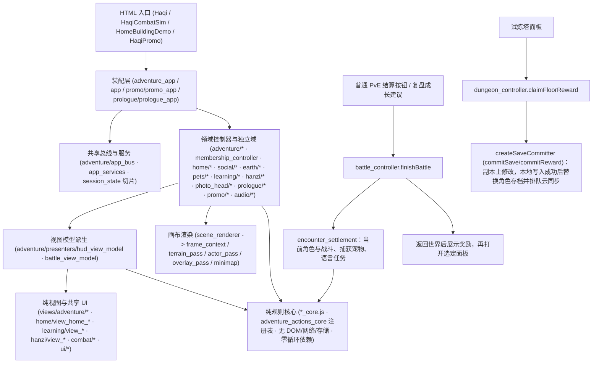

- **纯核心层（`*_core.js`）**：只允许导入其他 `*_core.js`，禁止引用 `document`/`fetch`/`localStorage`/`indexedDB`。`combat_unit_core.js` 拆出 `combat_unit_stats_core.js` 与 `combat_unit_deck_core.js`；`combat_cards_core.js` 拆出 `combat_damage_pipeline_core.js` 与 `combat_card_targeting_core.js`；`adventure_core.js` 拆出 `adventure_quests_core.js`、`adventure_save_core.js`、`adventure_deck_core.js` 与 `adventure_actions_core.js`（动作处理注册表），并保留兼容重导出与全仓零循环依赖。
- **应用装配与控制器（`js/adventure/`、`js/home/`、`js/social/`）**：`adventure_app.js` 订阅 `app_bus`（`hud:dirty`、`panel:dirty`、`dialogue:dirty`、`battle:dirty`、`cloud:queued`、`word-goals:refresh`、`audio:stop-word`、`audio:stop-battle-voice`、`rewards:show`）驱动跨控制器通知；存档提交统一经由 `adventure_reward_persistence.js` 的 `createSaveCommitter`（`commitSave`/`commitReward`）；宠物懒加载迁至 `pets/pet_loader.js`，会员/魔豆兑换迁至 `adventure/membership_controller.js`，自动保存资格判断归入 `role_cloud_controller.canAutoSave()`；控制器不再直接调用 `document.createElement`/`innerHTML`。
- **渲染分层（`js/adventure/renderer/`）**：`scene_renderer.js` 编排 `frame_context.js`（每帧相机与视口）、`terrain_pass.js`（地形/地面/路径/传送门）、`actor_pass.js`（角色/怪物/伙伴/社交角色与排序绘制）、`overlay_pass.js`（世界气泡/雾效/天气/暗角/地球地标）与 `minimap.js`。
- **独立功能域目录**：序章（`prologue/`）、宣传片（`promo/`）、音频语音（`audio/`）、战斗模拟工具（`combat/`）、家园（`home/`）、本地双人与社交（`social/`）、地球世界（`earth/`）、宠物系统（`pets/`）、语言学习/词库/对话（`learning/`）、汉字学习与动画（`hanzi/`）、大头贴（`photo_head/`）均已迁出 `js/` 根目录并完成入口、测试、脚本与 Vite/扫描配置同步；`js/` 根目录仍保留若干共享基础适配器（资源/云同步/游戏服/全局渲染辅助等非 `view_*.js` 模块）。
- **Presenter 与纯视图（`js/adventure/presenters/`、`js/views/adventure/`、`js/ui/`）**：全部 `view_*.js` 已从 `js/` 根目录迁至对应领域目录（`js/` 根目录无任何 `view_*.js` 残留），由 `tests/architecture_boundaries.test.mjs` 守卫。

### Family Pad 启动（2026-10-20）

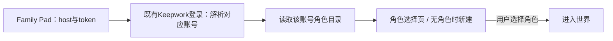

Family Pad 不再触发自动恢复最近角色，即使旧入口带有 `signin=direct`。其他入口的显式直入参数保持原行为。

### 战斗设计尺寸（2026-10-18）

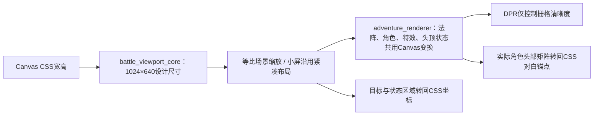

大屏倍率取宽/1024与高/640的较小值，取消场景倍率不超过1的限制；小屏保留原倍率（高度不足270时缩小）。普通冒险与序章复用同一渲染入口，手牌和HUD保持原DOM布局。

### 角色读取失败与恢复（2026-10-12）

云端目录与资源预加载共用 `MAX_ROLES=20`；角色创建仍区分免费与会员名额。标题页在已登录时展示读取错误、隔离角色和暂停同步状态。

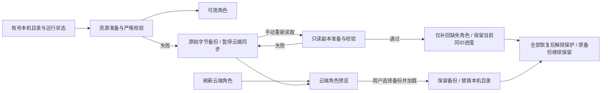

以下按当前源码（2026-10-01）展示主要模块与数据流，省略独立预览工具及部分玩法子模块。图中箭头表示启动、调用或数据传递，不是完整的 import 依赖图；GitHub 可直接渲染 Mermaid 图。

### 1. 游戏与实验室的分层

哈奇岛屿的静态渲染（2026-10-05）：视野物件集合跨帧复用，静态Y顺序与动态角色合并。树木仅将连续且不遮挡玩家的片段合成有界缓存，固定深度区间分组并保护当前视野批次，避免内存满后反复重绘；NPC、怪物、建筑与淡化树冠仍按原深度顺序绘制。地表在独立原生模块Worker中使用同一地形画笔，传回ImageBitmap；不可用或失败时恢复原分帧准备。

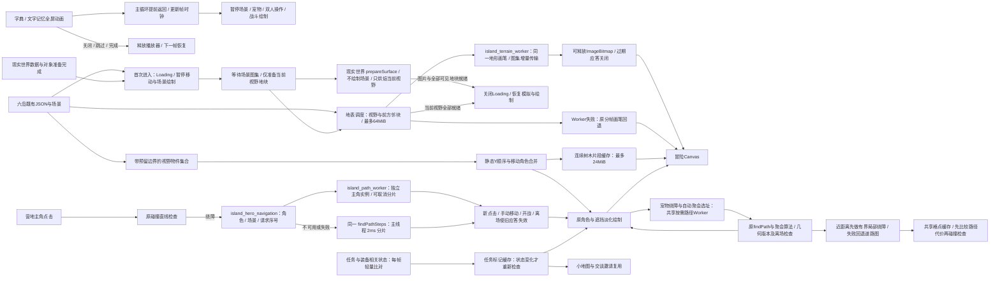

2026-10-20 寻路优化：岛屿距离不超过480的非直达目标先在起终点外扩96的区域搜索，最多512节点；仅接受到达原目标且长度不超过直线1.2倍加48的路线，否则沿用道路与全局格网回退。道路队列复用稳定最小堆；岛屿／地球格网缓存单次搜索的节点通行结果，城市和家园同样先排除无法改善代价的邻居。海岸和河段先用扩展包围盒排除远处边，再按原公式精算，采样间距和桥梁规则不变。主角、宠物、社交居民及宣传路线均通过原共享入口受益，未新增线程、存档或第三方依赖。

2026-10-17：粗指针触屏设备从首帧将场景画布 DPR 上限设为 1.25、地形纹理 DPR 上限设为 1；DOM 文字与交互坐标保持原样。桌面地形支持四分之一档密度，不将 1.25/1.5 一律提升为 2。地形密度独立于自动降画质，准备与绘制共用策略，避免缓存重建。后台地形仅复制新增或替换的图集；切岛复用已有图集，移除或替换时关闭旧位图。资源到达仅使实际使用该图集的地块失效，在途结果返回后核对依赖，无关图集不会取消任务。

任务标记缓存由renderer实例持有，`adventure_quest_marker_cache_core.js`每帧比较任务/库存/装备等相关字段的序列化快照，以覆盖原地修改；坐标、血量、计时和通用revision不参与。状态不变时每个NPC（含无标记）只求值一次，全部NPC共享一次按需属性快照；换角色、场景或内容配置引用时失效。缓存仅用于显示，实际接取/交付仍即时校验原规则。

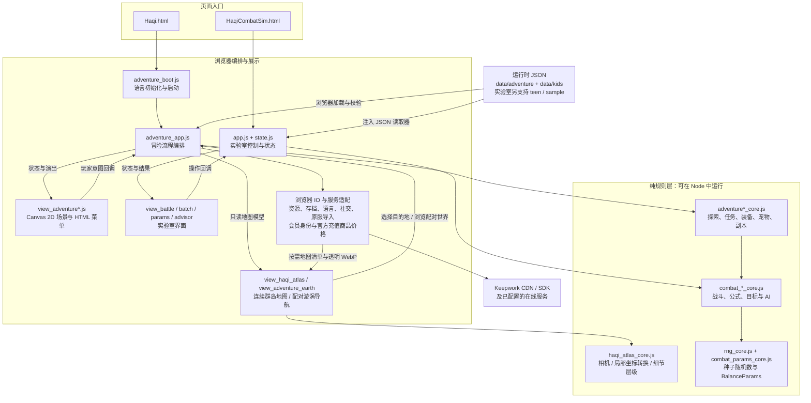

**分层边界：** 视图负责绘制和事件绑定，控制器协调玩法与 IO；核心规则不访问 DOM、网络或浏览器存储。冒险与实验室复用战斗规则，新增玩家内容以 kids 为范围。冒险细节见 [冒险系统](adventure.md)。

会员充值仅在打开充值页时，由 `adventure_membership.js` 调用 `adventure_recharge_pricing.js` 读取官方公开商品目录（只查询价格，不创建订单），合并并缓存查询；手动刷新可重查。金额、天数、续费日期与魔豆预估由纯 `adventure_recharge_core.js` 计算，再交给视图显示；价格失败时不使用猜测单价，账号身份与付款结果仍以现有 SDK 链路确认。

### 地球世界的按需数据流（2026-10-02）

### 城市节点副本（2026-10-03）

街景 1.0 在既有节点契约上增加可选 `streetscape`；详情见 [城市街景](city-streets.md)。所有原始地理资料保留在制作侧，不进入玩家存档。

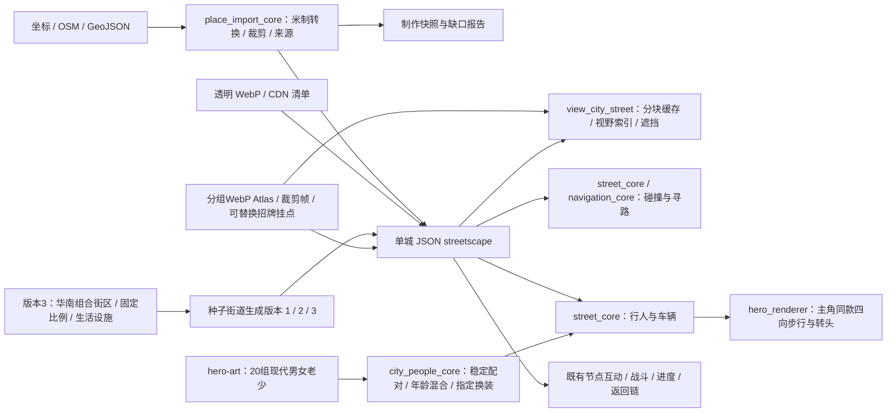

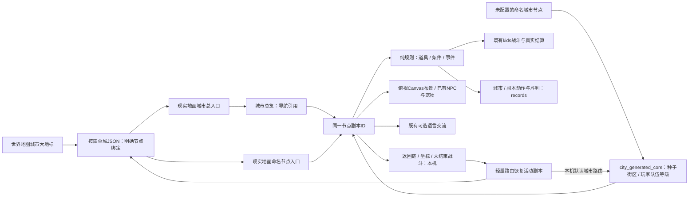

`adventure_city_dungeons_core.js` 管理节点契约、明确归属、道具和故事进度；城市加载器负责按需读取与过期请求检查。未配置城市使用 `adventure_city_generated_core.js` 的确定性街区，沿用试炼生命、儿童版技能与奖励，根据当前玩家及准备队伍的最高等级安排挑战。默认城市的来源、布局种子、挑战等级与队伍人数仅存本机以恢复活动场景。副本保留原有战斗结算接口，城市地图构造独立于线性清怪地图。生成技能只在开发期更新单城作者源与轻量路由，不调用运行时内容生成服务。

### 连续地球场景

2026-10-03：地球玩家导航允许已加载水域，`adventure_earth_boat_core.js` 根据地形和桥面推导临时船状态，`view_earth_boat.js` 叠放四向WebP与人物；不写入坐骑装备或云存档。道路采样在宽水域的已知岸端提供码头元数据，地球服务随局部场景更新并按需登记/释放船图集。普通地图抵达保持陆地校验，本机恢复可保留水上坐标。

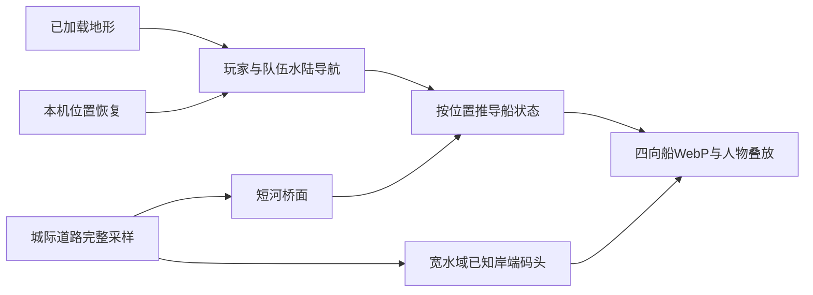

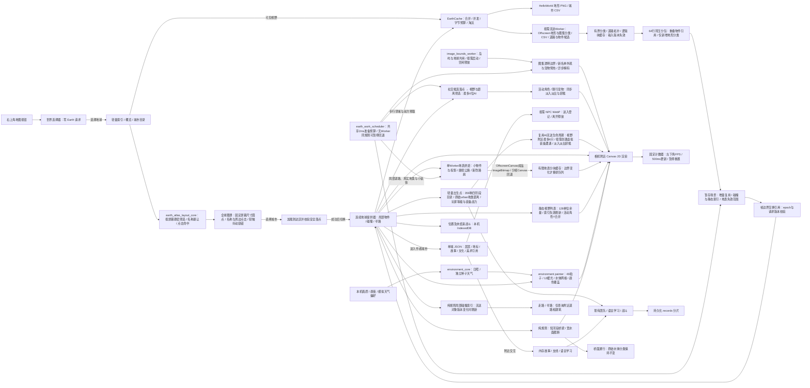

`adventure_earth_core.js` 保持纯规则；浏览器加载由动态导入的 `adventure_earth.js` 负责。打包器明确排除启动包中的 Earth 内容，逐个保留原相对 JSON 路径。图层共享经纬度变换，不建立全球对象列表或位图；完整单城 JSON 与地理数据独立缓存。详见 [地球世界](earth-world.md)。

### 2. 批量模拟与可复现验证

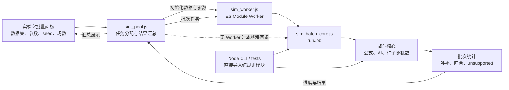

相同 seed、数据和参数用于重现模拟结果；BalanceParams 统一提供数值覆盖。Worker 将批量运算移出主线程，未支持卡牌效果必须进入统计，不静默忽略。公式来源见 [Lua 对照表](lua-mapping.md)。

### 3. 本地存档与可选云同步

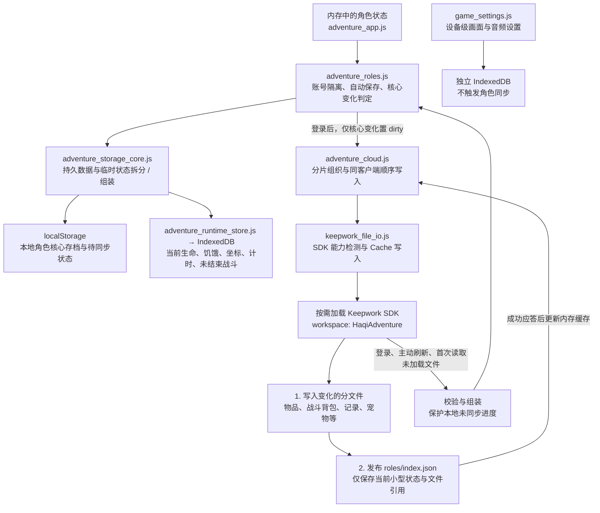

**存储边界：** 未变化分片复用已有引用；临时状态及设备设置不上传。云同步采用单客户端写入假设，不是多人实时状态服务器。SDK 支持时直接等待 Cache PUT 成功，否则兼容原 Cache 同步链路；失败、超时或身份变化不清除待同步状态。访客与网络失败时仍保留本地体验，详见 [用户存储](user-storage.md)。

## 2026-09-25 用户存储分层

当前云端入口为v2小型状态/引用清单；完整物品收藏、战斗背包、历史记录按角色分别保存，只更新变化的分文件。血量、饥饿、坐标、在线时长和未结束战斗仅存本机IndexedDB。`adventure_storage_core.js`负责纯数据拆装，`adventure_runtime_store.js`负责本地IO，`adventure_roles.js`按核心变化判断dirty。详见[用户存储结构](user-storage.md)；下文早期全量存档说明以该文为准。

## 原服导入分层（2026-09-21）

`haqi_original.js` 负责认证及选择性只读背包IO（默认全量以兼容独立测试页）；`haqi_import_core.js` 纯转换并校验新存档；`haqi_import.js` 暂存、身份核验与预览流程；`view_haqi_import.js` 渲染确认入口。预览复用现有背包/卡包面板，传入克隆存档且禁用持久化回调。最终确认才由 `adventure_app.js` 调用角色存储创建新角色，沿用账号隔离/并发写入检查，不直接写原服或云端。

## 1. 加载与运行模型

- 纯 ES Module + Vanilla JS，自带 `css/style.css`（不依赖 CDN，离线可用）；用任意静态 http 服务打开 `HaqiCombatSim.html` 即运行，无构建。
- `HaqiCombatSim.html` 只含顶栏 / `#main` / 底栏骨架，`<script type="module" src="js/app.js">`。
- 数据通过 `fetch('./data/{version}/*.json')` 加载，失败回退 `./data/sample/`。因此需要 http(s) 或 Live Preview 环境，`file://` 下 Worker 与 fetch 可能受限。
- 批量模拟运行在 `new Worker('./js/sim_worker.js', { type: 'module' })`，Worker 内只 import `*_core.js`。

## 2. 目录结构

见 [README.md](../README.md) "目录结构"。分层约定：

```
view_*.js  (DOM 事件) → app.js 回调 → state.js mutate → render(currentView)
                                    ↘ sim_pool.js → sim_worker.js → *_core.js
```

- `*_core.js`：纯逻辑，无 DOM / fetch / 全局副作用，Node 可直接测试。
- `view_*.js`：只渲染与绑事件，通过 `callbacks` 把意图交回 `app.js`。
- `state.js`：单一状态源，`subscribe/notify`。
- `data_core.js`（`readJson` 注入，浏览器用 fetch、Node 用 fs）、`llm_advisor.js`、`sim_pool.js`：唯一允许做 IO 的非视图模块。

## 3. 数据模型

### 3.1 数据集（只读，来自导出器）

```js
dataset = {
  version: 'kids' | 'teen',
  manifest: { cardCount, typeHistogram, supportedTypes, unsupportedTypes, unmapped, exportedAt },
  cards: { [key]: { key, spellName, type, target, pipcost, accuracy, hitchance, spellSchool,
                    requireLevel, canLearn, params: { damageMin, damageMax, damageSchool, dots, ... } } },
  charms: { charm: {[id]: {...}}, ward: {...}, miniaura: {...}, globalaura: {...} },
  statsByGear: { [school]: [ { from, to, hp, damageAllAbsolute, resistAllAbsolute, powerPipPercent,
                               outputHealPercent, criticalstrikeAllPercent, ... } ] },
  aiDecks: { [style]: { school, cards: [ { key, target: 'hostile'|'self', baseWeight, conditions: {colName: weight} } ] } },
  aiDecksByGear: { [school]: [ { from, to, style, cards: [ { gsid, key|null, count } ] } ] },
  hpTable: { [level]: hp },
}
```

### 3.2 BalanceParams（可写覆盖层，`combat_params_core.js`）

```js
params = {
  version: 'kids' | 'teen',
  global: { maxPips, maxRounds, handSize, deckCapacity, deckEachCapacity, deckPresetCopies,
            critDamageRatio, dodgeDamageRatio, maxSpellPenetration, areaSiblingRatio, healPenalty },
  //   deckCapacity / deckEachCapacity：卡包总容量 / 单卡上限（Lua 卡包道具 stats[167] / [170]），默认 40 / 6，0 = 不限
  //   deckPresetCopies：未自定义配卡时官方卡组每卡份数（默认 3；模拟器项）
  perSchool: { fire: { hp: 1, damage: 1, heal: 1, accuracy: 0, powerPip: 0, resist: 0, crit: 0 }, ice: {...}, ... },
  //   hp/damage/heal 为乘子；accuracy/powerPip/resist/crit 为加法百分点
  cardOverrides: { [cardKey]: { pipcost?, accuracy?, params?: { damageMin?, damageMax?, ... } } },
  fairPlay: null | { maxHp: {fire: n, ...}, forceDamageBoost, forceResist, forceAccuracyBoost, forcePowerPipChance },
}
```

`resolveParams(dataset, params)` 返回引擎实际读取的 `resolved`（卡牌模板已合并 override，perSchool 已归一）。`diffParams(a, b)` 用于面板高亮与调参器输出。

### 3.3 单位（`combat_unit_core.js`）

```js
unit = {
  id, name, side: 0|1, school, level, isBot,
  maxHp, hp, pipsNormal, pipsPower,
  stats: { damagePct: {school: n}, damageAbs: {school: n}, resistPct: {...}, resistAbs: {...},
           accuracyPct: {...}, crit: {...}, resilience: {...}, hitRating, dodgeRating,
           hitPct, dodgePct, penetration: {...}, penetrationReceive, powerPipPct,
           outputHealPct, inputHealPct },
  charms: [ { id, boostDamage, boostAccuracy, school, positive, dispelSchool, ... } ],
  wards:  [ { id, ... } ],
  absorbs: [ { remaining, school } ],
  dots: [ { school, perRound, rounds, casterId } ], hots: [...],
  miniaura: null | { id, rounds }, stun: 0, stances: [...],
  deckSpec: [ {key, count} ],            // setDeck → clampDeck 按 deckCapacity / deckEachCapacity 裁剪，deckTrimmed 记录裁掉张数
  deckSeq: [ cardKey... ], deckMap: [ 0|1|-1|-2|-3 ],  // 洗牌后的序列与状态：未抽 / 手牌 / 待弃 / 已用 / 失误补入
  cooldowns: { [spellName]: rounds },
  totals: { damageDealt, healDone, damageTaken, casts, fizzles, passes, noCardPasses },
}
```

卡包相关纯函数：`clampDeck(deck, {capacity, eachCapacity, cards, version})`、`deckCounts(unit)`（手牌 / 待弃 / 未抽 / 已用 / 失误 / 剩余 / 总数）、`isDeckExhausted(unit)`、`restoreDiscardedCard`。`playTurn` 对 `pick.discardSeqs` 的处理与是否出牌无关（Lua 允许弃牌 + 跳过）；无手牌时 `pass.reason` 为 `no_cards` / `deck_empty`。`checkFinish` 在双方存活单位全部打空且无 DOT 时提前判 `timeout` 平局（`decksExhausted=true`，纯加速，不改变结果）。

### 3.4 竞技场与事件（`combat_arena_core.js`）

```js
arena = {
  params: resolved, rng, round: 0, state: 'active' | 'finished',
  sides: [ [unit...], [unit...] ], globalAura: null | {...}, healPenalty: 0,
  events: CombatEvent[], stats: { perUnit: {...}, perCard: {...}, unsupported: {...} },
  winner: null | 0 | 1 | 'draw',
}
CombatEvent = { round, type: 'pip'|'pick'|'cast'|'fizzle'|'damage'|'heal'|'charm'|'ward'|'dot'|'hot'|'stun'|'death'|'end',
                casterId?, targetId?, cardKey?, amount?, crit?, dodged?, school?, detail? }
```

`advanceTurn(arena, picks)`：
1. 每个存活单位 `generatePip`；抽牌补到 `handSize`；cooldown / stun 递减。
2. `picks` 为 `{unitId: {cardKey, targetId} | null}`（由 Policy 给出；Human 由 UI 提供）。
3. 按顺序（先 side 0 再 side 1，或按 arena 顺序规则）逐个 `useCard`：合法性 → 扣 pips → accuracy → 分派 type 处理器 → 事件。
4. DOT / HOT 结算与递减，aura / miniaura / charm 时长递减。
5. 死亡判定；`round++`；`isFinished` 判胜负或超 `maxRounds` 判平。

### 3.5 策略（`combat_policy_core.js`）

```js
Policy = { pick(arena, unit, rng) => { cardKey, targetId } | null | Promise<...> }
```

- `DeckAttackerBot(aiDeckStyle)`：对手牌中每张卡查 `aiDecks[style].cards[key]`；权重 = `baseWeight + Σ(命中的条件列权重)`；条件列语义见 [data-export.md](data-export.md)；负权重剔除；加权随机选卡；目标按 `target` 字段（hostile → 敌方按低 HP 加权，self/friendly → 自己或最需要的队友）。
- `SimpleBot`：无 CSV 时的后备：队友 HP < 40% 且有治疗 → 治疗；有 blade 且可出大招 → 大招；否则最高期望伤害卡打最低 HP 敌人；出不起则 Pass。
- `HumanPolicy`：返回 Promise，`view_battle.js` 在玩家点选后 resolve。

## 4. 批量模拟

- `sim_batch_core.js`
  - `buildMatrix({ schools, modes, levels, gearBand, composition })` → `matchup[]`，`composition` ∈ `'mirror-school'`（同系队）| `'mixed'`（随机混编）。
  - `runOne(matchup, resolved, seed)` → `{ winner, rounds, perSide: {damage, heal, fizzles}, cards: {...}, unsupported: {...} }`。
  - `aggregate(results[])` → 胜率、Wilson 95% 区间、平均回合、场均伤害 / 治疗、fizzle 率、卡牌使用频次与贡献伤害、未支持卡出现次数。
- `sim_worker.js`：`onmessage({ dataset, params, matchups, gamesPer, seed })`；每 50 场 `postMessage({type:'progress', done, total})`；结束 `postMessage({type:'done', results})`。
- `sim_pool.js`：按 `hardwareConcurrency` 建 Worker；按 matchup 分片；合并结果；支持取消。

## 5. 调参器（`sim_tuner_core.js`）

- 输入：矩阵配置、当前 params、可调维度（默认 `perSchool.*.{hp, damage}`）、步长、迭代上限、每次评估场次、seed。
- 目标：`loss = Σ_matchups (winrate − 0.5)²`（可加权：1v1 权重高）。
- 算法：坐标下降；每个维度尝试 ±step，取 loss 最小；无改善则 step 减半；到达迭代上限或 step < 最小步长停止。
- 输出：`{ params, history: [{iter, loss, change}], before: matrix, after: matrix }`。
- 运行在 Worker 池上（每次评估是一次批量任务），UI 显示进度并可中止。

## 6. LLM 建议（`llm_advisor.js`）

- `buildPrompt({ aggregate, params, manifest, version })`：中文系统提示（角色：数值策划），附矩阵、平均回合、每系前 5 张高频卡及数值、当前 perSchool 系数、未支持卡占比；要求输出：诊断、建议、可选 ```json 参数块（BalanceParams 子集）。
- `requestAdvice({ endpoint, apiKey, model, prompt })`：`POST {endpoint}/chat/completions`，OpenAI 兼容；凭据仅存 `localStorage`。
- `extractParamsBlock(markdown)`：解析 ```json 块 → 可应用的 params 片段。

## 7. 页面路由（`app.js`）

| 路由 | 视图 | 说明 |
|------|------|------|
| `battle` | `view_battle.js` | 配置阵容 → 对战 → 结束面板 |
| `batch` | `view_batch.js` | 矩阵配置 → 运行 → 热力图 / 表格 / 导出 |
| `params` | `view_params.js` | 参数编辑 / diff / 导入导出 |
| `advisor` | `view_advisor.js` | 调参器 + LLM |

顶栏：数据集下拉（`discoverDatasets` 找到的 kids / teen / sample；切换时 `loadDataset` 并把 params 重置为该 version 默认值，若 localStorage 有同 version 的参数则恢复），数据集状态标签。

## 8. 测试

`npm test` = `node --test tests/*.test.mjs`，零依赖，30 例：

- `tests/formulas.test.mjs`：rng 确定性；`aboveMinBoost` / `damageExpression`（kids 逐项 ceil、teen 正负 buff 分治、穿透上限）/ `healExpression` / 治疗惩罚；crit / dodge / fizzle 阈值与大样本频率；五系 HP 曲线端点与装备 HP%；power pip 概率；`generatePip` 双版本；`canAffordCard` / `costPips` 本系 / 他系；竞技场伤害递增与 absorb。
- `tests/engine.test.mjs`：sample 数据集加载与预设卡组；1v1 跑通；同 seed 结果全等；2v2 / 3v3 / 4v4 完成；Random / Simple 策略；状态机（手牌 / 可出牌 / snapshot）；`perSchool.hp` 生效与 diff；X 费 DOT 与溅射 DOT；`buildJobs` 25 组 + 聚合自洽（A→B + B→A + 平局 = 1、CI 包含点估计）；`matchupMatrix`；`wilson`；调参器在假模型上收敛；LLM 提示词 / 参数块解析 / 启发式补丁。
- `tests/xml_lite.test.mjs`：声明 / 注释 / CDATA / 自闭合 / 实体 / 嵌套 / CRLF。

## 9. 意图 vs 现实

实施完成（2026-09-16）后的对照：

| 计划 | 实际 | 原因 |
|------|------|------|
| Tailwind CDN | 自写 `css/style.css`（约 180 行） | 离线 / 内网可用，避免外链 |
| `fast-xml-parser` devDependency | `scripts/lib/xml_lite.mjs` 零依赖解析器 | 配置 XML 结构简单；`npm install` 都不需要 |
| `config.js`、`i18n.js`、`data_loader.js` | 并入 `state.js` / `combat_presets_core.js` / `data_core.js` | 模块数量已多，避免碎片化 |
| `view_*.js` 通过 `callbacks` 回 `app.js` | `view_*.js` 直接 import `state.js` 的 mutator（`updateParams`、`setSetting`…） | 单页应用无需二级间接层；`view` 仍不含引擎逻辑 |
| `threat.json` | 未导出 | PvP 不使用威胁值 |
| 5 个测试文件 | 3 个测试文件 30 例 | 合并同类用例 |
| `HumanPolicy` 返回 Promise | `HumanPolicy.pick` 返回 `null`，由 `view_battle` 收集人类选择后调用 `playTurn(arena, picks)` | 半回合制下所有行动方同时出牌，同步接口更简单 |
| 单体 charm / ward 目标由 type 决定 | 由模板 `positive` 推断（`inferTargetKind`） | Lua 由客户端选目标、服务器不校验；陷阱 / 虚弱必须贴敌方 |

未支持 type（kids 37 张 5.3%，teen 53 张 4.2%）：`Dead`、`PickPet`、`CatchPet`、`Fizzle`、`SingleFreeze`、`ConversePositiveWard`、`SingleStealth`、`SingleGuardianWithImmolate`、`Enrage`、`SingleTaunt`、`AreaTaunt`、`AreaControl`。均不出现在官方 Aggressive 卡组，预设卡组过滤后批量报告的「未支持」为 0。

性能实测（Node 24 单线程）：teen 1v1 ≈ 5800 场/s，kids 1v1 ≈ 8200 场/s，teen 4v4 ≈ 1250 场/s；浏览器 8 worker teen 1v1 ≈ 14000 场/s。

分层未被打破：`js/*_core.js` 无 DOM / fetch（`node --input-type=module -e "import('./js/x.js')"` 可逐个加载，只有 `app.js`、`sim_worker.js` 依赖 `document` / `self`）。

## 10. 与仓库其他部分的关系

- 只读引用 `script/apps/Aries/Combat/ServerObject/*.lua` 作为规范来源，不修改。
- 只读读取 `config/Aries/`（gitignored）生成数据。
- 已在 `docs/aries/haqi-combat-sim.md`、`docs/CODEMAP.md`、`docs/TOPIC-INDEX.md` 登记。
- 计划中的「线上角色导入」「异步 PVP」「帕鲁式宠物/VIP 口粮」「卡牌多语言」不改变本节模块边界：玩家 IO 与 locale 表只能放在浏览器适配层或数据 JSON，`*_core.js` 仍禁止 `fetch`。对照 [player-import.md](player-import.md)、[async-pvp.md](async-pvp.md)、[pets-vip-innovation.md](pets-vip-innovation.md)、[card-i18n.md](card-i18n.md)。

## 11. Haqi.html 单人冒险（2026-09-17）

新增入口及 `adventure_app.js` 控制器。`view_adventure.js` 只构建DOM并传回事件；`adventure_renderer.js` 绘制Canvas世界/战斗；`adventure_assets.js` 负责HTTP资源与localStorage。规则拆为 `adventure_core.js`（任务/道具/成长/存档结构）、`adventure_world_core.js`（地图/移动/交互）、`adventure_content_core.js`（内容验证）。

`combat_pve_core.js` 复用 `combat_cards_core.js`、`combat_formulas_core.js`、单位和参数解析，不调用PvP半回合推进。PvE完整回合是所有单位生成魔力 → 怪物前置动作 → 玩家 → 怪物普通动作 → 怪物后置动作。怪物使用源脚本/HP基因/可重复技能池；玩家用有限卡包及装备附加牌。仅在公共伤害模块加入 `arena.mode === 'pve'` 分支，PvP行为由原34测试回归覆盖。

存档使用独立键和决定重演；世界装饰随机数与战斗随机数不共享。数据与资源准备为开发命令，所有运行时文件位于本目录，无父目录/兄弟模拟器导入。完整契约见 [adventure.md](adventure.md)。

## 12. WebP / CDN 与可选云存档（2026-09-17）

`adventure_media_core.js` 是纯资源策略：loopback默认local，线上默认CDN，显式查询参数可切换。`adventure_assets.js` 根据 `media.json` 读取WebP并设置CORS；`assets.json`仍为原版来源清单。Pillow开发脚本负责完整解码及无损转换，发布脚本生成内容哈希命名的上传计划、在远端验证后记录URL，不包含上传凭据。运行时不执行资源准备。

`adventure_cloud_core.js` 只处理版本化封装和原存档/战斗重演校验；时钟/UUID从IO层传入。`adventure_cloud.js` 按需加载Keepwork SDK core，使用独立PersonalPageStore workspace写入唯一检查点；验证远端原始JSON，避免SDK缓存/本地回退导致假成功。`view_adventure_cloud.js`只渲染连接、保存、列表、进度比较和确认，控制器负责替换本地进度。

云端恢复前检查账号未变化、本地原文与预览时一致、备份写入成功。任一失败均不覆盖主存档。SDK读写超时不等于请求已取消，失败提示要求刷新检查；不会自动重试覆盖同一文件。2026-09-25 起改为 savePageData(path,content,text,false,true) 暂存，再 syncToGit(path,true)，并通过服务器缓存 API 核验内容。角色目录读取也开启 useCache/useServerCache；保留自动云同步和角色冲突检查。钓鱼镜像仅在纪录变化时写入，完整玩法配置首次进入钓鱼才加载。

## 13. 技能演出

`spell-effects.json`集中定义45张冒险牌的演出类型、五系颜色、时间轴、粒子和召唤角色裁剪；`spell_effects_core.js`验证配置并独立播种视觉数据，`spell_effects.js`绘制Canvas演出。战斗控制器只改变cast事件展示时长，渲染器传入实际caster/target坐标。`HaqiEffects.html`提供无存档副作用的独立预览。详见[技能特效](spell-effects.md)。

## 14. 全卡库特效与共享变体

特效配置升级版本2：701个card引用225个base，变体共用品质光环。`prepare_spell_effects.mjs`显式映射所有导出type，`export_spell_names.py`通过Lua数据解析器导出中文名，`audit_spell_effects.mjs`同时校验全卡库和章节覆盖。工坊额外读取本地kids快照，游戏仍只读取原章节战斗数据；因此不会将未支持的战斗机制自动解锁。群体演出接收目标坐标数组，未修改战斗公式/规则。

## Shared engine subset: AI Work Company

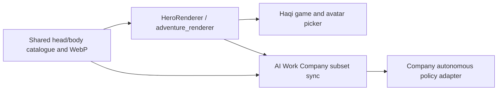

Haqi owns the shared renderer, independent textures and neck/sole anchors.
`bodyVariants.geometry` supplies per-variant frames; classic recolors still
inherit base geometry. Optional `footY` grounds unmounted/default poses.
`save.observer` omits the player object; social `sceneLabel` overrides bottom
text. Existing defaults remain unchanged. The company copies exact source and
art bytes, keeping task/account/permission policy in its own adapters.
`data/ai-personas.json` identifies the four unofficial AI personas.

### Shared city scenery and CSP-safe map icons (2026-10-22)

`data/adventure/neural-city-art.json` provides six independent WebP scenery
textures plus `homeItems` consumable by the existing home renderer, building cache
and collision catalogue. The map illustration is separate from navigable terrain.
`applyUiIcon` in `adventure_ui_art.js` applies the existing atlas cell directly to
an element for strict-CSP consumers, without injecting a stylesheet. It does not
change `loadUiArt` or the existing Haqi GUI.

## 历史变更归档

按日期追加的功能演进与早期增量设计记录已迁出至 [历史架构变更记录归档](devlog/devlog_2026-11-19-architecture-history.md)；日常新增开发记录继续写入 docs/devlog/devlog_YYYY-MM-DD.md。
