## 2026-10-26：语言故事场景驱动

任务目录是只读目标投影；不再挂载练习控制器。`languageSceneTarget` 从当前真实世界的NPC／地标／遭遇列表解析配置，`track` 调用已有寻路，`interact` 核对正确对象及既有语言交互距离（默认85）才创建 `island_language_course`。普通任务追踪的 `questDialogue` 保持原对话优先。对话复用 `createLearningChatView`，关闭后继续下一处，保持场景异步身份保护。

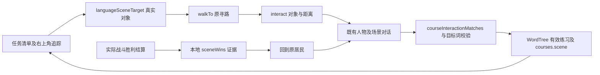

战斗开始将语言／课程／当前步骤／遭遇身份冻结在可选 `pendingEncounter.languageTask`；结算前等待本地胜利证据保存，失败可重试结算。旧检查点无元数据时不推进语言场景。新场景进度保存在 `courses[id].scene`，原 `next` 保留为旧练习历史；新旧不混用，不追加奖励账本。正式故事源仍为 `island-language-courses.json`。

以下任务详情内练习架构为历史，已由场景驱动替代。

## 2026-10-26：语言任务接入原任务清单与 HUD

`language_quest_core` 将既有课程进度投影为语言任务，选择当前岛屿优先的未完成项；HUD 在三格中为该项保留一格。`language_quest` 按账号／角色／语言／捕获 epoch 加载并订阅 WordTree，仅课程进度变化才通知刷新。异步返回须仍属于当前角色和语言。

`view_adventure_quests` 在原任务详情中嵌入练习；`island_language_course` 负责本地接取、回答与语音生命周期。普通数字任务ID与 `course:` 展示ID共用目录筛选／定位，后者不写入原任务奖励账本。旧中文字源岛仍用原任务控制器。关闭任务详情、切换任务或身份即释放练习视图与语音。

## 2026-10-26：多语言课程与家园练习数据流

目标语言独立于界面语言及母语。新课程按需加载目标语词库和共享中文键，课程推进与有效练习写入角色隔离的本地 WordTree 事务；不扩展云存档。旧任务由 `learning_quest_core` 在接取、追踪、信号和交付处统一过滤。纯核心负责校验，浏览器适配器负责 AI、语音和 IndexedDB。

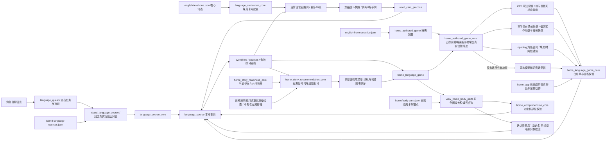

英语家园先从作者故事选择已练目标与匹配设施；明确标记 introduces 的作者故事可在会话新词预算内介绍新词，选择和开场不写学习证据，完成后仍走同一 WordTree 事务；本次会话优先未玩故事，然后依据最久未练词轮换。作者故事不请求生成模型，语音仍使用既有适配器。其他语言及无适用故事时保留原 AI 路径。家园对话与物理动作分别验证；重复保存沿用同一回执。角色、语言及会话变化使迟到模型和语音结果失效。英语 L1 的 180 个规范词条通过 language_course 的卡片加载入口接入；只有 WordTree 有有效练习记录或原卡片账本有合格候选时间才可进入新战斗。原卡片定义优先保留，缺失的核心词补用现有基础卡效果；旧检查点仍按快照恢复。完整实施边界见 [多语言岛屿](language-island-plan.md)。

## 2026-10-24：地图服务器选择

哈奇及现实世界地图右上角复用 `view_map_servers.js`，通过控制器回调读取会话、查询分页和选择实例，关闭地图时取消列表请求并退订。编号仅取鉴权分配且经 `welcome.instanceId` 核对的连接，`migrate` 更新编号，断开清空。每页20项、支持跳页和刷新；绿色流畅、橙色拥挤、红色已满、灰色维护，附人数/容量。战斗中禁止手动切服。列表人数来自网关最近心跳，最终容量由世界服入场检查决定。

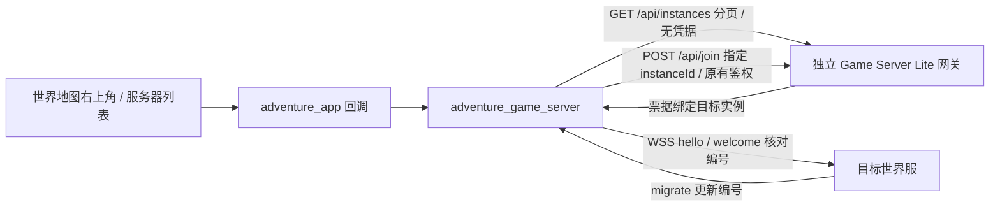

新增服务端接口尚未部署；上线须同时更新独立服务器，并在反向代理允许公开 GET/OPTIONS `/api/instances`，保留管理路由隔离。未完成公网真实账号切服与正式页面视觉验收。

## 2026-10-23：共享在场服务器已迁出

源码、服务器测试和 VS Code 启动任务已迁至独立仓库 [HaqiGameServerLite](https://github.com/LiXizhi/HaqiGameServerLite)，供 HaqiCombatSim、AI-work-company 和 AIChat 共用。默认内部网关端口8797、世界服端口8798。2026-10-23 Haqi 源码正式入口已接入 `adventure_game_server.js`，公网为 `https://us1.gameserver.keepwork.com`；其他两个项目待接入，本轮Haqi网页未发布。接入约定见新仓库 docs/integration.md。

`adventure_cloud.gameServerCredentials()` 只在有效的现有SDK会话中提供内存凭据。适配器每秒采样账号/角色/区域与坐标；服务端验证token及username，签发60秒一次性票据，世界服核验后返回welcome才显示已连接。入场CORS允许任意页面来源；共享鉴权对象按账号维护最多10条同时连接，每次join使用独立playerId，同角色多开不互踢，断线/失败释放名额。退出/账号变化/pagehide立即关闭，角色变化重新入场、区域变化enterRoom、断线有限退避重试，旧异步回包不得恢复前一个身份。旅途设置提供服务器状态、手动重连、切换及恢复默认；网关地址仅作本机偏好保存。切换先取消旧请求和连接，重新向目标网关鉴权取票；只接受 Keepwork 游戏服 HTTPS 域名（本地开发另支持 localhost）。恢复网络/回到前台立即检查连接，20秒无服务端消息判为失联；兼容旧服replaced消息时暂停自动重连；新服同账号最多10条独立连接，同角色由最新成功入场连接接管，旧连接收到 replaced 后返回登录页。访客不请求游戏服，网络失败保留本地玩法。2026-10-24 已接入远端玩家名单、入离房、外观与移动消息；adventure_presence_core 保存仅内存的同房间玩家并做1秒位置插值，场景渲染器以独立 remote-player 对象绘制姓名、下一行主语言和原版头像/身体（真人略偏冷色）；主语言来自角色 languageLearning.native，通过现有 appearance 消息传递。移动插值期间朝向目标，停止后才采用网络最终朝向。同房间可定位的其他真人达到8名时，社交控制器隐藏生成路人及其交互入口，保留已接受的队伍伙伴，人数下降或断线后恢复。场景渲染器，不接入本地模拟伙伴AI、不写玩家存档。换房、迁移、断线、换账号清除旧名单；服务器roster包含现有玩家坐标与外观，晚入场也可立即看到静止玩家。尚未同步远端宠物、坐骑、自定义照片头像或战斗。

网关负责任务分配、实例增减和中文管理页；游戏服只保存当前连接的房间、外观和坐标。房间名由客户端自定，第二个人进入才建立房间对象。每个实例最多500人，一台游戏服最多8000人。移动按距离分档转发，慢连接丢移动帧；同机实例冷却10分钟后可合并或按区域拆分，并提前8秒通知。

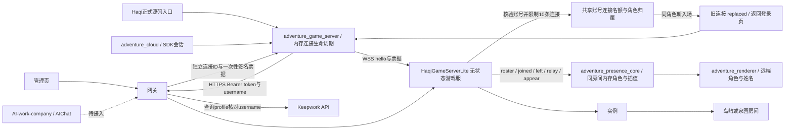

## 2026-10-18：世界树唯一 JS 类库

公开入口 `js/word_tree.js` 的 `WordTree` 类；字典通过 `word_tree_dictionary.js` 直接挂载；独立预览页面与构建入口已删除，测试夹具仅在 tests/fixtures。使用 Shadow DOM 隔离当前组件 CSS，不用 iframe，也不加载页面壳。纯布局与学习核心保持独立可测试。旧侧栏、六叉导航、模拟遗忘曲线与专用压力页面已删除。API 与模块表见 [世界树](word-tree.md)。

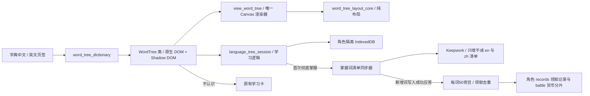

## 2026-10-18：摄影机投影与统一受击反馈修正

摄影机从标准正交机位到特写机位时，先插值焦点、yaw、pitch、zoom和透视强度，再对全部地面点使用同一个齐次分母；不再混合两个机位投影后的屏幕坐标。地面方位保持一致，实际yaw限于约±45°，俯视角最低约18°；近裁剪面外不逐顶点钳制深度，避免圆盘折叠。人物仍为按深度缩放的直立精灵。

播放时钟统一使用1900ms名称前段，技能后段时长×1.65且基础演出至少1500ms；跳过/Miss为2100ms，受击650ms、致命受击900ms、治疗1000ms。音效、命中预测、序章及双人宣传片复用同一进度与时长函数。减少动态效果模式保留可读文案而不新增震动。

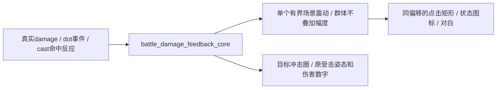

震动由真实伤害驱动，覆盖0费攻击、反伤和持续伤害；失误、治疗与零伤害不伪造扣血冲击。镜头不再按技能类型提前制造一次假命中。已在技能命中时完成后仰的事件，结算阶段只补较轻震动与伤害反馈；致命伤害先冲击再倒下。

## 2026-10-18：大招摄影机

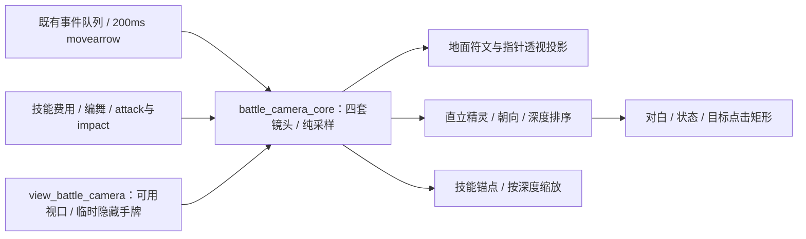

数值型 `pipcost >= 1` 的施法，以及跳过/失误事件使用镜头；反射补播、持续伤害和减少动态效果模式保持标准镜头。模板为追击、群体、召唤、辅助；依据儿童版原版 `CombatCameraView.lua` 与 `Cameras.xml` 的 caster/target/ground 镜头结构，采用 Canvas 2D 透视地面与直立精灵，不加载三维库。单视角怪物维持原素材。

共用冒险渲染入口覆盖普通冒险、竞技场、序章。序章播放适配器补齐同样的200ms指针事件；新增可读前段：施法名称在人物头顶大字展示，前12%进度用1400ms播放，后续特效保持原速度；跳过/失误展示1600ms，文字为“跳过”/“miss”。共享播放时钟统一重映射渲染、音效和命中反馈，战斗事件不变。摄影机不会写存档或消耗引擎随机数。演出中的手牌、阵容信息和宠物建议暂隐，撤退按钮保留；按顶端操作区测量安全取景区域，结束恢复。没有新增用户设置，复用系统减少动态效果偏好。

验收入口：`tests/fixtures/battle-camera.html`，仅内存数据；`scripts/check_battle_camera.mjs` 接收 `--playwright`、`--executable`、`--url`、`--out`，截图与性能结果写入临时目录。原实验室SVG战场不变。

## 2026-10-18：互动序章《失落的光》（`Haqi.html?prologue`）

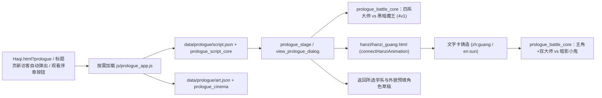

复用 `Haqi.html` 已加载资源、战斗渲染器、语音朗读与 `hanzi_guang.html` 书写协议，不依赖登录、不写存档；详见 [互动序章](prologue.md) 与 [序章剧本](story/prologue-lost-light.md)。

## 2026-10-18：30字独立动画

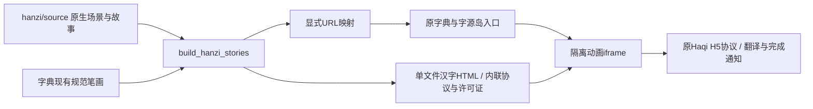

补齐23个故事，修正舞/武引用；动画不直接读写存档，完成通知继续走现有宿主校验。作者源、生成及验证见[汉字独立动画](hanzi-stories.md)。

## 2026-10-18：本地学习成就摘要

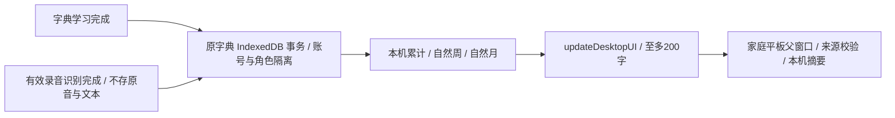

详见 [学习周报、月报](learning-report.md)。统计不新增 workspace 查询或云端同步。

## 2026-10-17：字典与文字战斗卡

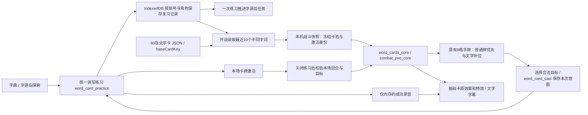

引擎只读取冻结的文字卡元数据与动作；IndexedDB、麦克风和音频仅位于浏览器层。`wordCards` 在 `BalanceParams` 定义配额，普通牌随机流保持原样。旧字卡模块仅用于历史存档／战斗兼容，新入口不安装旧魔法外观、不生成旧增益或收藏。


## 2026-09-30：单客户端内存读取与 Cache 直接写入

按用户确认的单客户端写入模式，登录读取服务器最新目录；后续角色入口、已加载分片和宠物文件以内存为准，未加载文件首次使用才读。保存不再查询远端版本或读取历史判断远端分支。主动刷新角色目录和重新登录会重新读取；账号/token 变化使旧请求失效。本地未同步进度与登录快照不同仍保留备份选择，避免直接丢弃本地数据。

所有游戏文件写入集中于 `keepwork_file_io.js`，继续使用 `personalPageStore.withWorkspace('HaqiAdventure')` 的 Cache 接口：`savePageData(path,'content',text,true,true,{directWrite:true})`。新增 SDK option 默认关闭，仅游戏调用启用；跳过 SDK 文件预读和合并，不安排后台同步，等待 pageCache PUT 明确成功，不再写后 GET。支持 `.json` 与 `.md` 完整内容，不改变原文件格式或其他 SDK 用户的默认行为。SDK 能力标志未就绪时沿用旧 Cache 暂存/同步接口，不绕开 SDK；旧 CDN 包仍可能有 SDK 内部预读，新选项上线后才消除这部分请求。

成功后更新内存入口和文件缓存；失败、超时或身份变化不标记角色已同步。写入顺序是分文件、当前入口；2026-10-05 已移除角色目录历史快照和父版本链。同客户端角色保存和 SDK 同路径直接写入串行。不可变分片成功后可复用，重试不重复上传已经确认的文件。关系正文、历史及每日额度首次读取后复用内存；SDK 没有新增远端 CAS。

社交关闭后台轮询，岛屿入口读取名单，邮件在打开时读取，公开名片复用内存并在主动刷新时失效；内容未变化不重复发布。会员普通查询合并请求并复用账号内存，手动刷新、充值和账号事件更新状态。角色目录按角色进一步拆分加载尚未在本轮实现；当前登录仍加载既有角色必要分片。


# HaqiCombatSim — 技术架构

## 架构图

### Family Pad 启动（2026-10-20）

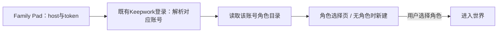

Family Pad 不再触发自动恢复最近角色，即使旧入口带有 `signin=direct`。其他入口的显式直入参数保持原行为。

### 战斗设计尺寸（2026-10-18）

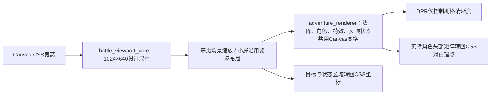

大屏倍率取宽/1024与高/640的较小值，取消场景倍率不超过1的限制；小屏保留原倍率（高度不足270时缩小）。普通冒险与序章复用同一渲染入口，手牌和HUD保持原DOM布局。

### 角色读取失败与恢复（2026-10-12）

云端目录与资源预加载共用 `MAX_ROLES=20`；角色创建仍区分免费与会员名额。标题页在已登录时展示读取错误、隔离角色和暂停同步状态。

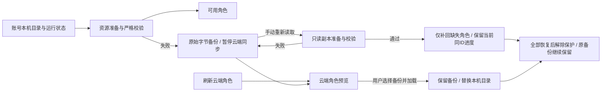

以下按当前源码（2026-10-01）展示主要模块与数据流，省略独立预览工具及部分玩法子模块。图中箭头表示启动、调用或数据传递，不是完整的 import 依赖图；GitHub 可直接渲染 Mermaid 图。

### 1. 游戏与实验室的分层

哈奇岛屿的静态渲染（2026-10-05）：视野物件集合跨帧复用，静态Y顺序与动态角色合并。树木仅将连续且不遮挡玩家的片段合成有界缓存，固定深度区间分组并保护当前视野批次，避免内存满后反复重绘；NPC、怪物、建筑与淡化树冠仍按原深度顺序绘制。地表在独立原生模块Worker中使用同一地形画笔，传回ImageBitmap；不可用或失败时恢复原分帧准备。

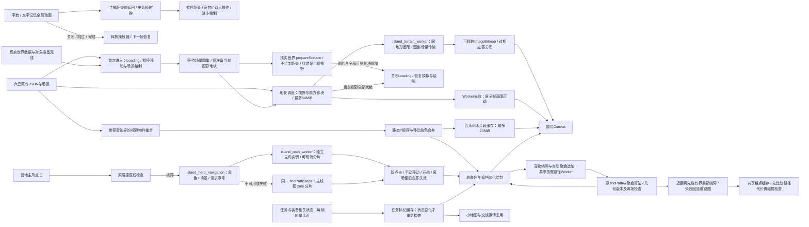

2026-10-20 寻路优化：岛屿距离不超过480的非直达目标先在起终点外扩96的区域搜索，最多512节点；仅接受到达原目标且长度不超过直线1.2倍加48的路线，否则沿用道路与全局格网回退。道路队列复用稳定最小堆；岛屿／地球格网缓存单次搜索的节点通行结果，城市和家园同样先排除无法改善代价的邻居。海岸和河段先用扩展包围盒排除远处边，再按原公式精算，采样间距和桥梁规则不变。主角、宠物、社交居民及宣传路线均通过原共享入口受益，未新增线程、存档或第三方依赖。

2026-10-17：粗指针触屏设备从首帧将场景画布 DPR 上限设为 1.25、地形纹理 DPR 上限设为 1；DOM 文字与交互坐标保持原样。桌面地形支持四分之一档密度，不将 1.25/1.5 一律提升为 2。地形密度独立于自动降画质，准备与绘制共用策略，避免缓存重建。后台地形仅复制新增或替换的图集；切岛复用已有图集，移除或替换时关闭旧位图。资源到达仅使实际使用该图集的地块失效，在途结果返回后核对依赖，无关图集不会取消任务。

任务标记缓存由renderer实例持有，`adventure_quest_marker_cache_core.js`每帧比较任务/库存/装备等相关字段的序列化快照，以覆盖原地修改；坐标、血量、计时和通用revision不参与。状态不变时每个NPC（含无标记）只求值一次，全部NPC共享一次按需属性快照；换角色、场景或内容配置引用时失效。缓存仅用于显示，实际接取/交付仍即时校验原规则。

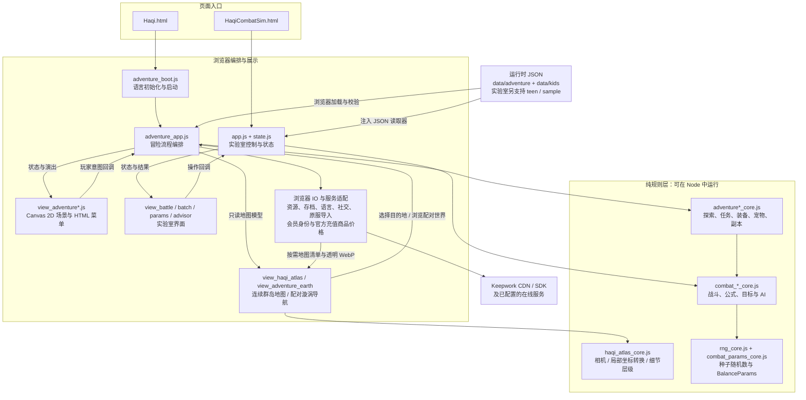

**分层边界：** 视图负责绘制和事件绑定，控制器协调玩法与 IO；核心规则不访问 DOM、网络或浏览器存储。冒险与实验室复用战斗规则，新增玩家内容以 kids 为范围。冒险细节见 [冒险系统](adventure.md)。

会员充值仅在打开充值页时，由 `adventure_membership.js` 调用 `adventure_recharge_pricing.js` 读取官方公开商品目录（只查询价格，不创建订单），合并并缓存查询；手动刷新可重查。金额、天数、续费日期与魔豆预估由纯 `adventure_recharge_core.js` 计算，再交给视图显示；价格失败时不使用猜测单价，账号身份与付款结果仍以现有 SDK 链路确认。

### 地球世界的按需数据流（2026-10-02）

### 城市节点副本（2026-10-03）

街景 1.0 在既有节点契约上增加可选 `streetscape`；详情见 [城市街景](city-streets.md)。所有原始地理资料保留在制作侧，不进入玩家存档。

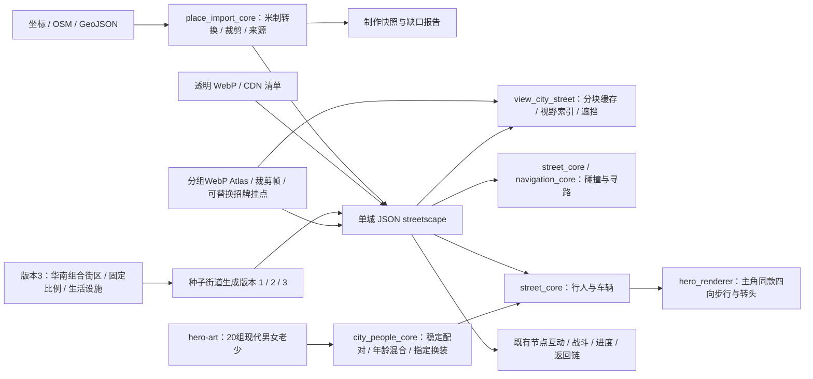

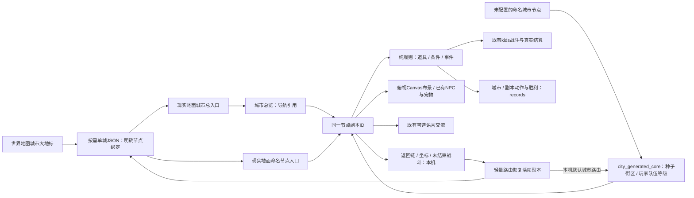

`adventure_city_dungeons_core.js` 管理节点契约、明确归属、道具和故事进度；城市加载器负责按需读取与过期请求检查。未配置城市使用 `adventure_city_generated_core.js` 的确定性街区，沿用试炼生命、儿童版技能与奖励，根据当前玩家及准备队伍的最高等级安排挑战。默认城市的来源、布局种子、挑战等级与队伍人数仅存本机以恢复活动场景。副本保留原有战斗结算接口，城市地图构造独立于线性清怪地图。生成技能只在开发期更新单城作者源与轻量路由，不调用运行时内容生成服务。

### 连续地球场景

2026-10-03：地球玩家导航允许已加载水域，`adventure_earth_boat_core.js` 根据地形和桥面推导临时船状态，`view_earth_boat.js` 叠放四向WebP与人物；不写入坐骑装备或云存档。道路采样在宽水域的已知岸端提供码头元数据，地球服务随局部场景更新并按需登记/释放船图集。普通地图抵达保持陆地校验，本机恢复可保留水上坐标。

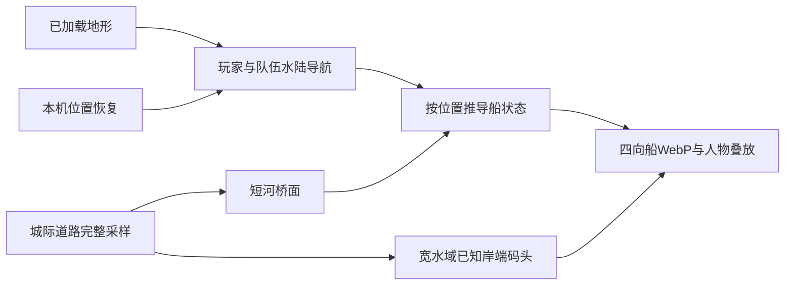

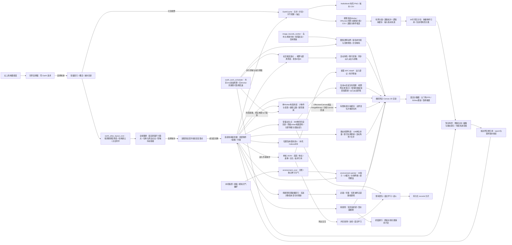

`adventure_earth_core.js` 保持纯规则；浏览器加载由动态导入的 `adventure_earth.js` 负责。打包器明确排除启动包中的 Earth 内容，逐个保留原相对 JSON 路径。图层共享经纬度变换，不建立全球对象列表或位图；完整单城 JSON 与地理数据独立缓存。详见 [地球世界](earth-world.md)。

### 2. 批量模拟与可复现验证

```mermaid
flowchart LR
    UI["实验室批量面板<br/>数据集、参数、seed、场数"] --> Pool["sim_pool.js<br/>任务分配与结果汇总"]
    Pool -->|初始化数据与参数| Worker["sim_worker.js<br/>ES Module Worker"]
    Pool -->|批次任务| Worker
    Worker --> Batch["sim_batch_core.js<br/>runJob"]
    Pool -.->|无 Worker 时本线程回退| Batch
    Batch --> Engine["战斗核心<br/>公式、AI、种子随机数"]
    Engine --> Stats["批次统计<br/>胜率、回合、unsupported"]
    Stats -->|进度与结果| Pool
    Pool -->|汇总展示| UI
    CLI["Node CLI / tests<br/>直接导入纯规则模块"] --> Batch
    CLI --> Engine
```

相同 seed、数据和参数用于重现模拟结果；BalanceParams 统一提供数值覆盖。Worker 将批量运算移出主线程，未支持卡牌效果必须进入统计，不静默忽略。公式来源见 [Lua 对照表](lua-mapping.md)。

### 3. 本地存档与可选云同步

```mermaid
flowchart TB
    State["内存中的角色状态<br/>adventure_app.js"] --> Roles["adventure_roles.js<br/>账号隔离、自动保存、核心变化判定"]
    Roles --> Split["adventure_storage_core.js<br/>持久数据与临时状态拆分 / 组装"]
    Split --> Local["localStorage<br/>本地角色核心存档与待同步状态"]
    Split --> Runtime["adventure_runtime_store.js → IndexedDB<br/>当前生命、饥饿、坐标、计时、未结束战斗"]
    Settings["game_settings.js<br/>设备级画面与音频设置"] --> SettingsDB["独立 IndexedDB<br/>不触发角色同步"]
    Roles -->|登录后，仅核心变化置 dirty| Cloud["adventure_cloud.js<br/>分片组织与同客户端顺序写入"]
    Cloud --> FileIO["keepwork_file_io.js<br/>SDK 能力检测与 Cache 写入"]
    FileIO --> SDK["按需加载 Keepwork SDK<br/>workspace: HaqiAdventure"]
    SDK --> Parts["1. 写入变化的分文件<br/>物品、战斗背包、记录、宠物等"]
    Parts --> Index["2. 发布 roles/index.json<br/>仅保存当前小型状态与文件引用"]
    Index -->|成功应答后更新内存缓存| Cloud
    SDK -->|登录、主动刷新、首次读取未加载文件| Read["校验与组装<br/>保护本地未同步进度"]
    Read --> Roles
```

**存储边界：** 未变化分片复用已有引用；临时状态及设备设置不上传。云同步采用单客户端写入假设，不是多人实时状态服务器。SDK 支持时直接等待 Cache PUT 成功，否则兼容原 Cache 同步链路；失败、超时或身份变化不清除待同步状态。访客与网络失败时仍保留本地体验，详见 [用户存储](user-storage.md)。

## 2026-09-25 用户存储分层

当前云端入口为v2小型状态/引用清单；完整物品收藏、战斗背包、历史记录按角色分别保存，只更新变化的分文件。血量、饥饿、坐标、在线时长和未结束战斗仅存本机IndexedDB。`adventure_storage_core.js`负责纯数据拆装，`adventure_runtime_store.js`负责本地IO，`adventure_roles.js`按核心变化判断dirty。详见[用户存储结构](user-storage.md)；下文早期全量存档说明以该文为准。

## 原服导入分层（2026-09-21）

`haqi_original.js` 负责认证及选择性只读背包IO（默认全量以兼容独立测试页）；`haqi_import_core.js` 纯转换并校验新存档；`haqi_import.js` 暂存、身份核验与预览流程；`view_haqi_import.js` 渲染确认入口。预览复用现有背包/卡包面板，传入克隆存档且禁用持久化回调。最终确认才由 `adventure_app.js` 调用角色存储创建新角色，沿用账号隔离/并发写入检查，不直接写原服或云端。

## 1. 加载与运行模型

- 纯 ES Module + Vanilla JS，自带 `css/style.css`（不依赖 CDN，离线可用）；用任意静态 http 服务打开 `HaqiCombatSim.html` 即运行，无构建。
- `HaqiCombatSim.html` 只含顶栏 / `#main` / 底栏骨架，`<script type="module" src="js/app.js">`。
- 数据通过 `fetch('./data/{version}/*.json')` 加载，失败回退 `./data/sample/`。因此需要 http(s) 或 Live Preview 环境，`file://` 下 Worker 与 fetch 可能受限。
- 批量模拟运行在 `new Worker('./js/sim_worker.js', { type: 'module' })`，Worker 内只 import `*_core.js`。

## 2. 目录结构

见 [README.md](../README.md) "目录结构"。分层约定：

```
view_*.js  (DOM 事件) → app.js 回调 → state.js mutate → render(currentView)
                                    ↘ sim_pool.js → sim_worker.js → *_core.js
```

- `*_core.js`：纯逻辑，无 DOM / fetch / 全局副作用，Node 可直接测试。
- `view_*.js`：只渲染与绑事件，通过 `callbacks` 把意图交回 `app.js`。
- `state.js`：单一状态源，`subscribe/notify`。
- `data_core.js`（`readJson` 注入，浏览器用 fetch、Node 用 fs）、`llm_advisor.js`、`sim_pool.js`：唯一允许做 IO 的非视图模块。

## 3. 数据模型

### 3.1 数据集（只读，来自导出器）

```js
dataset = {
  version: 'kids' | 'teen',
  manifest: { cardCount, typeHistogram, supportedTypes, unsupportedTypes, unmapped, exportedAt },
  cards: { [key]: { key, spellName, type, target, pipcost, accuracy, hitchance, spellSchool,
                    requireLevel, canLearn, params: { damageMin, damageMax, damageSchool, dots, ... } } },
  charms: { charm: {[id]: {...}}, ward: {...}, miniaura: {...}, globalaura: {...} },
  statsByGear: { [school]: [ { from, to, hp, damageAllAbsolute, resistAllAbsolute, powerPipPercent,
                               outputHealPercent, criticalstrikeAllPercent, ... } ] },
  aiDecks: { [style]: { school, cards: [ { key, target: 'hostile'|'self', baseWeight, conditions: {colName: weight} } ] } },
  aiDecksByGear: { [school]: [ { from, to, style, cards: [ { gsid, key|null, count } ] } ] },
  hpTable: { [level]: hp },
}
```

### 3.2 BalanceParams（可写覆盖层，`combat_params_core.js`）

```js
params = {
  version: 'kids' | 'teen',
  global: { maxPips, maxRounds, handSize, deckCapacity, deckEachCapacity, deckPresetCopies,
            critDamageRatio, dodgeDamageRatio, maxSpellPenetration, areaSiblingRatio, healPenalty },
  //   deckCapacity / deckEachCapacity：卡包总容量 / 单卡上限（Lua 卡包道具 stats[167] / [170]），默认 40 / 6，0 = 不限
  //   deckPresetCopies：未自定义配卡时官方卡组每卡份数（默认 3；模拟器项）
  perSchool: { fire: { hp: 1, damage: 1, heal: 1, accuracy: 0, powerPip: 0, resist: 0, crit: 0 }, ice: {...}, ... },
  //   hp/damage/heal 为乘子；accuracy/powerPip/resist/crit 为加法百分点
  cardOverrides: { [cardKey]: { pipcost?, accuracy?, params?: { damageMin?, damageMax?, ... } } },
  fairPlay: null | { maxHp: {fire: n, ...}, forceDamageBoost, forceResist, forceAccuracyBoost, forcePowerPipChance },
}
```

`resolveParams(dataset, params)` 返回引擎实际读取的 `resolved`（卡牌模板已合并 override，perSchool 已归一）。`diffParams(a, b)` 用于面板高亮与调参器输出。

### 3.3 单位（`combat_unit_core.js`）

```js
unit = {
  id, name, side: 0|1, school, level, isBot,
  maxHp, hp, pipsNormal, pipsPower,
  stats: { damagePct: {school: n}, damageAbs: {school: n}, resistPct: {...}, resistAbs: {...},
           accuracyPct: {...}, crit: {...}, resilience: {...}, hitRating, dodgeRating,
           hitPct, dodgePct, penetration: {...}, penetrationReceive, powerPipPct,
           outputHealPct, inputHealPct },
  charms: [ { id, boostDamage, boostAccuracy, school, positive, dispelSchool, ... } ],
  wards:  [ { id, ... } ],
  absorbs: [ { remaining, school } ],
  dots: [ { school, perRound, rounds, casterId } ], hots: [...],
  miniaura: null | { id, rounds }, stun: 0, stances: [...],
  deckSpec: [ {key, count} ],            // setDeck → clampDeck 按 deckCapacity / deckEachCapacity 裁剪，deckTrimmed 记录裁掉张数
  deckSeq: [ cardKey... ], deckMap: [ 0|1|-1|-2|-3 ],  // 洗牌后的序列与状态：未抽 / 手牌 / 待弃 / 已用 / 失误补入
  cooldowns: { [spellName]: rounds },
  totals: { damageDealt, healDone, damageTaken, casts, fizzles, passes, noCardPasses },
}
```

卡包相关纯函数：`clampDeck(deck, {capacity, eachCapacity, cards, version})`、`deckCounts(unit)`（手牌 / 待弃 / 未抽 / 已用 / 失误 / 剩余 / 总数）、`isDeckExhausted(unit)`、`restoreDiscardedCard`。`playTurn` 对 `pick.discardSeqs` 的处理与是否出牌无关（Lua 允许弃牌 + 跳过）；无手牌时 `pass.reason` 为 `no_cards` / `deck_empty`。`checkFinish` 在双方存活单位全部打空且无 DOT 时提前判 `timeout` 平局（`decksExhausted=true`，纯加速，不改变结果）。

### 3.4 竞技场与事件（`combat_arena_core.js`）

```js
arena = {
  params: resolved, rng, round: 0, state: 'active' | 'finished',
  sides: [ [unit...], [unit...] ], globalAura: null | {...}, healPenalty: 0,
  events: CombatEvent[], stats: { perUnit: {...}, perCard: {...}, unsupported: {...} },
  winner: null | 0 | 1 | 'draw',
}
CombatEvent = { round, type: 'pip'|'pick'|'cast'|'fizzle'|'damage'|'heal'|'charm'|'ward'|'dot'|'hot'|'stun'|'death'|'end',
                casterId?, targetId?, cardKey?, amount?, crit?, dodged?, school?, detail? }
```

`advanceTurn(arena, picks)`：
1. 每个存活单位 `generatePip`；抽牌补到 `handSize`；cooldown / stun 递减。
2. `picks` 为 `{unitId: {cardKey, targetId} | null}`（由 Policy 给出；Human 由 UI 提供）。
3. 按顺序（先 side 0 再 side 1，或按 arena 顺序规则）逐个 `useCard`：合法性 → 扣 pips → accuracy → 分派 type 处理器 → 事件。
4. DOT / HOT 结算与递减，aura / miniaura / charm 时长递减。
5. 死亡判定；`round++`；`isFinished` 判胜负或超 `maxRounds` 判平。

### 3.5 策略（`combat_policy_core.js`）

```js
Policy = { pick(arena, unit, rng) => { cardKey, targetId } | null | Promise<...> }
```

- `DeckAttackerBot(aiDeckStyle)`：对手牌中每张卡查 `aiDecks[style].cards[key]`；权重 = `baseWeight + Σ(命中的条件列权重)`；条件列语义见 [data-export.md](data-export.md)；负权重剔除；加权随机选卡；目标按 `target` 字段（hostile → 敌方按低 HP 加权，self/friendly → 自己或最需要的队友）。
- `SimpleBot`：无 CSV 时的后备：队友 HP < 40% 且有治疗 → 治疗；有 blade 且可出大招 → 大招；否则最高期望伤害卡打最低 HP 敌人；出不起则 Pass。
- `HumanPolicy`：返回 Promise，`view_battle.js` 在玩家点选后 resolve。

## 4. 批量模拟

- `sim_batch_core.js`
  - `buildMatrix({ schools, modes, levels, gearBand, composition })` → `matchup[]`，`composition` ∈ `'mirror-school'`（同系队）| `'mixed'`（随机混编）。
  - `runOne(matchup, resolved, seed)` → `{ winner, rounds, perSide: {damage, heal, fizzles}, cards: {...}, unsupported: {...} }`。
  - `aggregate(results[])` → 胜率、Wilson 95% 区间、平均回合、场均伤害 / 治疗、fizzle 率、卡牌使用频次与贡献伤害、未支持卡出现次数。
- `sim_worker.js`：`onmessage({ dataset, params, matchups, gamesPer, seed })`；每 50 场 `postMessage({type:'progress', done, total})`；结束 `postMessage({type:'done', results})`。
- `sim_pool.js`：按 `hardwareConcurrency` 建 Worker；按 matchup 分片；合并结果；支持取消。

## 5. 调参器（`sim_tuner_core.js`）

- 输入：矩阵配置、当前 params、可调维度（默认 `perSchool.*.{hp, damage}`）、步长、迭代上限、每次评估场次、seed。
- 目标：`loss = Σ_matchups (winrate − 0.5)²`（可加权：1v1 权重高）。
- 算法：坐标下降；每个维度尝试 ±step，取 loss 最小；无改善则 step 减半；到达迭代上限或 step < 最小步长停止。
- 输出：`{ params, history: [{iter, loss, change}], before: matrix, after: matrix }`。
- 运行在 Worker 池上（每次评估是一次批量任务），UI 显示进度并可中止。

## 6. LLM 建议（`llm_advisor.js`）

- `buildPrompt({ aggregate, params, manifest, version })`：中文系统提示（角色：数值策划），附矩阵、平均回合、每系前 5 张高频卡及数值、当前 perSchool 系数、未支持卡占比；要求输出：诊断、建议、可选 ```json 参数块（BalanceParams 子集）。
- `requestAdvice({ endpoint, apiKey, model, prompt })`：`POST {endpoint}/chat/completions`，OpenAI 兼容；凭据仅存 `localStorage`。
- `extractParamsBlock(markdown)`：解析 ```json 块 → 可应用的 params 片段。

## 7. 页面路由（`app.js`）

| 路由 | 视图 | 说明 |
|------|------|------|
| `battle` | `view_battle.js` | 配置阵容 → 对战 → 结束面板 |
| `batch` | `view_batch.js` | 矩阵配置 → 运行 → 热力图 / 表格 / 导出 |
| `params` | `view_params.js` | 参数编辑 / diff / 导入导出 |
| `advisor` | `view_advisor.js` | 调参器 + LLM |

顶栏：数据集下拉（`discoverDatasets` 找到的 kids / teen / sample；切换时 `loadDataset` 并把 params 重置为该 version 默认值，若 localStorage 有同 version 的参数则恢复），数据集状态标签。

## 8. 测试

`npm test` = `node --test tests/*.test.mjs`，零依赖，30 例：

- `tests/formulas.test.mjs`：rng 确定性；`aboveMinBoost` / `damageExpression`（kids 逐项 ceil、teen 正负 buff 分治、穿透上限）/ `healExpression` / 治疗惩罚；crit / dodge / fizzle 阈值与大样本频率；五系 HP 曲线端点与装备 HP%；power pip 概率；`generatePip` 双版本；`canAffordCard` / `costPips` 本系 / 他系；竞技场伤害递增与 absorb。
- `tests/engine.test.mjs`：sample 数据集加载与预设卡组；1v1 跑通；同 seed 结果全等；2v2 / 3v3 / 4v4 完成；Random / Simple 策略；状态机（手牌 / 可出牌 / snapshot）；`perSchool.hp` 生效与 diff；X 费 DOT 与溅射 DOT；`buildJobs` 25 组 + 聚合自洽（A→B + B→A + 平局 = 1、CI 包含点估计）；`matchupMatrix`；`wilson`；调参器在假模型上收敛；LLM 提示词 / 参数块解析 / 启发式补丁。
- `tests/xml_lite.test.mjs`：声明 / 注释 / CDATA / 自闭合 / 实体 / 嵌套 / CRLF。

## 9. 意图 vs 现实

实施完成（2026-09-16）后的对照：

| 计划 | 实际 | 原因 |
|------|------|------|
| Tailwind CDN | 自写 `css/style.css`（约 180 行） | 离线 / 内网可用，避免外链 |
| `fast-xml-parser` devDependency | `scripts/lib/xml_lite.mjs` 零依赖解析器 | 配置 XML 结构简单；`npm install` 都不需要 |
| `config.js`、`i18n.js`、`data_loader.js` | 并入 `state.js` / `combat_presets_core.js` / `data_core.js` | 模块数量已多，避免碎片化 |
| `view_*.js` 通过 `callbacks` 回 `app.js` | `view_*.js` 直接 import `state.js` 的 mutator（`updateParams`、`setSetting`…） | 单页应用无需二级间接层；`view` 仍不含引擎逻辑 |
| `threat.json` | 未导出 | PvP 不使用威胁值 |
| 5 个测试文件 | 3 个测试文件 30 例 | 合并同类用例 |
| `HumanPolicy` 返回 Promise | `HumanPolicy.pick` 返回 `null`，由 `view_battle` 收集人类选择后调用 `playTurn(arena, picks)` | 半回合制下所有行动方同时出牌，同步接口更简单 |
| 单体 charm / ward 目标由 type 决定 | 由模板 `positive` 推断（`inferTargetKind`） | Lua 由客户端选目标、服务器不校验；陷阱 / 虚弱必须贴敌方 |

未支持 type（kids 37 张 5.3%，teen 53 张 4.2%）：`Dead`、`PickPet`、`CatchPet`、`Fizzle`、`SingleFreeze`、`ConversePositiveWard`、`SingleStealth`、`SingleGuardianWithImmolate`、`Enrage`、`SingleTaunt`、`AreaTaunt`、`AreaControl`。均不出现在官方 Aggressive 卡组，预设卡组过滤后批量报告的「未支持」为 0。

性能实测（Node 24 单线程）：teen 1v1 ≈ 5800 场/s，kids 1v1 ≈ 8200 场/s，teen 4v4 ≈ 1250 场/s；浏览器 8 worker teen 1v1 ≈ 14000 场/s。

分层未被打破：`js/*_core.js` 无 DOM / fetch（`node --input-type=module -e "import('./js/x.js')"` 可逐个加载，只有 `app.js`、`sim_worker.js` 依赖 `document` / `self`）。

## 10. 与仓库其他部分的关系

- 只读引用 `script/apps/Aries/Combat/ServerObject/*.lua` 作为规范来源，不修改。
- 只读读取 `config/Aries/`（gitignored）生成数据。
- 已在 `docs/aries/haqi-combat-sim.md`、`docs/CODEMAP.md`、`docs/TOPIC-INDEX.md` 登记。
- 计划中的「线上角色导入」「异步 PVP」「帕鲁式宠物/VIP 口粮」「卡牌多语言」不改变本节模块边界：玩家 IO 与 locale 表只能放在浏览器适配层或数据 JSON，`*_core.js` 仍禁止 `fetch`。对照 [player-import.md](player-import.md)、[async-pvp.md](async-pvp.md)、[pets-vip-innovation.md](pets-vip-innovation.md)、[card-i18n.md](card-i18n.md)。

## 11. Haqi.html 单人冒险（2026-09-17）

新增入口及 `adventure_app.js` 控制器。`view_adventure.js` 只构建DOM并传回事件；`adventure_renderer.js` 绘制Canvas世界/战斗；`adventure_assets.js` 负责HTTP资源与localStorage。规则拆为 `adventure_core.js`（任务/道具/成长/存档结构）、`adventure_world_core.js`（地图/移动/交互）、`adventure_content_core.js`（内容验证）。

`combat_pve_core.js` 复用 `combat_cards_core.js`、`combat_formulas_core.js`、单位和参数解析，不调用PvP半回合推进。PvE完整回合是所有单位生成魔力 → 怪物前置动作 → 玩家 → 怪物普通动作 → 怪物后置动作。怪物使用源脚本/HP基因/可重复技能池；玩家用有限卡包及装备附加牌。仅在公共伤害模块加入 `arena.mode === 'pve'` 分支，PvP行为由原34测试回归覆盖。

存档使用独立键和决定重演；世界装饰随机数与战斗随机数不共享。数据与资源准备为开发命令，所有运行时文件位于本目录，无父目录/兄弟模拟器导入。完整契约见 [adventure.md](adventure.md)。

## 12. WebP / CDN 与可选云存档（2026-09-17）

`adventure_media_core.js` 是纯资源策略：loopback默认local，线上默认CDN，显式查询参数可切换。`adventure_assets.js` 根据 `media.json` 读取WebP并设置CORS；`assets.json`仍为原版来源清单。Pillow开发脚本负责完整解码及无损转换，发布脚本生成内容哈希命名的上传计划、在远端验证后记录URL，不包含上传凭据。运行时不执行资源准备。

`adventure_cloud_core.js` 只处理版本化封装和原存档/战斗重演校验；时钟/UUID从IO层传入。`adventure_cloud.js` 按需加载Keepwork SDK core，使用独立PersonalPageStore workspace写入唯一检查点；验证远端原始JSON，避免SDK缓存/本地回退导致假成功。`view_adventure_cloud.js`只渲染连接、保存、列表、进度比较和确认，控制器负责替换本地进度。

云端恢复前检查账号未变化、本地原文与预览时一致、备份写入成功。任一失败均不覆盖主存档。SDK读写超时不等于请求已取消，失败提示要求刷新检查；不会自动重试覆盖同一文件。2026-09-25 起改为 savePageData(path,content,text,false,true) 暂存，再 syncToGit(path,true)，并通过服务器缓存 API 核验内容。角色目录读取也开启 useCache/useServerCache；保留自动云同步和角色冲突检查。钓鱼镜像仅在纪录变化时写入，完整玩法配置首次进入钓鱼才加载。

## 13. 技能演出

`spell-effects.json`集中定义45张冒险牌的演出类型、五系颜色、时间轴、粒子和召唤角色裁剪；`spell_effects_core.js`验证配置并独立播种视觉数据，`spell_effects.js`绘制Canvas演出。战斗控制器只改变cast事件展示时长，渲染器传入实际caster/target坐标。`HaqiEffects.html`提供无存档副作用的独立预览。详见[技能特效](spell-effects.md)。

## 14. 全卡库特效与共享变体

特效配置升级版本2：701个card引用225个base，变体共用品质光环。`prepare_spell_effects.mjs`显式映射所有导出type，`export_spell_names.py`通过Lua数据解析器导出中文名，`audit_spell_effects.mjs`同时校验全卡库和章节覆盖。工坊额外读取本地kids快照，游戏仍只读取原章节战斗数据；因此不会将未支持的战斗机制自动解锁。群体演出接收目标坐标数组，未修改战斗公式/规则。

## 2026-09-18：装备面板补全

新增 adventure_equipment_core.js 的纯属性展示与无副作用换装预览；装备穿戴仍由 adventure_core.js::applyAction 校验并执行，新增 unequip 动作。view_adventure_equipment.js 负责角色、槽位、背包筛选、详情和操作回调；adventure_app.js 保留面板筛选状态并处理存档与换装后的滚动/焦点。沿用原装备 stats、法杖强化表与固定卡，不修改战斗公式。


## 2026-09-18：共享技能美术

`skill_art_core.js` 校验图集和计算裁剪帧，无浏览器IO；`skill_art.js` 负责去重加载、动态卡面和主体绘制。`CardRenderer` 程序绘制标题与 `cardDescription`（中文套话 + 伤害/治疗数字）。`adventure_assets.js` 预加载章节需要的图集；`spell_art.js` 为工坊提供按需适配；`spell_effects.js` 复用同一主体并播放专属九帧。HaqiCards按学系/搜索分页展示全库；`skill_card_preview.js` 为儿童版模拟器手牌异步补图。美术不消耗战斗RNG，不改变数值规则。清单含本地/CDN、来源和独立哈希，新增WebP严格≤100KB。冒险界面语言见 [locale.md](locale.md)。卡名与带数字的卡面说明仍见 [card-i18n.md](card-i18n.md)。

## 2026-09-18：技能音效与粒子分层

图集主体不终止spell_effects.js的语义粒子分支，复用原kind/attack/secondary与时间轴。spell_sound_core.js只产生确定性的音效配方和跨帧触发节点；spell_sound.js负责Web Audio生命周期与本机开关，控制器按进度驱动，Canvas draw不直接发声。群体技能一套声音，粒子可多目标；两者都不消耗战斗RNG。


## 2026-09-18：调试属性编辑

adventure_debug_core.js 从内容构造数值字段目录，在副本上应用白名单修改、修正装备与配卡并走 parseSave 完整验证。adventure_debug.js 负责独立调试备份和本地写入；view_adventure_debug.js 仅管理表单草稿/预览与回调，adventure_app.js 校验成功且持久化完成后替换当前状态。未修改战斗公式、BalanceParams或存档版本。

## 宠物与商店扩展（2026-09-18）

`adventure_expansion_core`在原章节验证后合并静态宠物目录、原版装备候选与kids卡牌库；`adventure_pets_core`负责收藏、四卡位编队、商店、喂食和联动协议。浏览器IO注入恢复时间并按需加载宠物图集。`view_adventure_pets`只绑定意图回调；controller统一修改进度。

PvE可选接收`party`，主角保留第一项、显式slot控制站位及行动顺序；辅助宠物附卡不新增战斗单位。检查点包含完整入场规格和捕获库存，重演只使用种子与决定。版本2存档通过原本地、JSON和云端路径保存，版本1迁移不覆盖任务成果。参见[pets-and-shop.md](pets-and-shop.md)。帕鲁式深化与 VIP 口粮见[pets-vip-innovation.md](pets-vip-innovation.md)（未实现）。

## 2026-09-18：Vite与CDN发布

用户明确要求参考Maisi/MagicHaqi接入Vite。新增四入口构建、相对资源路径、静态JSON/WebP/Ogg复制、内联批量Worker与内容哈希CDN发布；此项取代早期“禁止打包器”的开发约定，原生ES modules源码仍可直接通过HTTP服务运行。详细命令与发布核验见[部署说明](deployment.md)。

最终构建与发布都排除美术/音频；所有域名默认CDN，源码显式离线模式保留。已核验52文件正式CDN版本与跨域发布页的7500场Worker模拟，详见qa-report。

## 2026-09-18：发布数据包与浏览器IO

runtime_data.js统一浏览器JSON读取；Vite生产构建将源码data的32个运行时JSON投影压缩到5包，manifest索引独立，以免数据集发现触发全版本下载。读取结果复制后交给原加载逻辑，避免共享缓存受规范化和冒险扩展修改。data_core移除fetch包装，保持Node注入式数据加载。详见deployment.md。


## 2026-09-19：世界地图

adventure_world_map_core集中六岛身份、出生点与BalanceParams.worldTravel等级检查；view_adventure_world_map仅展示选中岛屿和传送状态，控制器通过既有travel动作切换场景并保存。adventure_world_core复用可复现地形与碰撞，adventure_terrain区分远方岛屿地表；原版岛屿专属内容仍未导入。存档校验、调试降级和云端位置展示共用岛屿定义。

## 2026-09-20：大型岛屿地图

config/maps 提供六岛源文件与统一地域规则；adventure_map_generator_core 在离线生成阶段写入 data/adventure/maps，adventure_island_layout_core 提供纯几何与元数据查询；adventure_world_core 装配运行时对象并缓存空间桶/道路图；adventure_large_terrain 负责固定内存预算的分块地面和低分辨率导览。view_adventure_local_map 仅绑定目的地意图，adventure_app 负责步行与交互。worldLayoutVersion=2 标识六岛新地图坐标，parseSave 区分旧版尺寸校验和位置迁移；旧任务、战斗与来源数据不修改。详见 island-exploration.md。

## 2026-09-26：岛屿伙伴与快照组队

2026-10-10 双人追加组队：两位本地主角加最多两位快照伙伴，共享四个阵位；伙伴优先占空位，再替换出战宠物，保留主角站位与两份手牌。场景先更新本地移动，再由社交控制器将第二位主角和伙伴交给同一条轨迹；地球居民数组流送不重置队伍轨迹，乘船间距与横向错位由 `BalanceParams.islandSocial` 配置。离队后恢复本地自由控制。普通双人显式跟随与AI跟随也通过 `adventure_local_follow_core` 复用队长轨迹；进入场景与地图传送先同步两人位置，不再以距离取消跟随。

```mermaid
flowchart LR
    Local[adventure_local_play：本地移动] --> Social[adventure_social_controller：稳定队伍标识]
    Local --> LocalFollow[adventure_local_follow_core：换图同步 / 显式跟随]
    LocalFollow --> Trail
    Guests[最多两位快照伙伴] --> Social
    Social --> Trail[adventure_social_motion_core：第二主角与伙伴共用轨迹]
    Trail --> Render[adventure_renderer：步行与乘船]
    Guests --> Party[adventure_local_coop_core：四阵位合并]
    Local --> Party
    Party --> Battle[PvE / 红蘑菇：两人手动，其余AI]
```

`adventure_social_core` 处理名单、通信摘要和快照校验，`adventure_social_motion_core` 只做种子行为；`adventure_coop_core` 隔离副本进度、冻结阵容并保留血量；`adventure_social_pvp_core` 复用 free_pvp 及决定重演。`adventure_social` 是 SDK IO 边界，`adventure_social_controller` 连接场景和 UI，view 层只提交意图。组队房间对齐原版四人席：先选副本，空席开放后延迟补 AI。组队继续使用现有 PvE 与地图，不另写战斗公式。服务门禁与模块契约见 [岛屿社交](island-social.md)。

## 独立战斗AI（2026-09-27）

`js/battle_ai/index_core.js` 为纯服务入口；推理、配包、复盘与关卡统计不依赖页面。`haqi_adapter_core`复用真实结算器，`adventure_adapter_core`提供角色资格及入口路由。浏览器client/worker是IO边界。战斗RNG、AI抽样及复盘文案种子彼此隔离。接口和限制见 [battle-ai.md](battle-ai.md)。

## 2026-09-27 角色对话与关系IO

`character_relationship_core.js`负责纯规则、提示词、额度和赠礼；`character_workspace.js`负责账号/角色分文件、缓存API与版本检查；`character_conversation.js`控制LLM、语音和共享聊天视图，`view_character_details.js`负责关系/礼物详情。副本事件在settleEncounter结算内登记，可选第四参数`{now}`由调用方提供；未提供按0处理，不从核心读取系统时钟。参见[关系存储与限制](character-conversations.md)。

## H5 宣传片（2026-09-28）

`HaqiPromo.html` + `promo_app.js` 管理独立 JSON 剧本和时间轴，通过同源 iframe 调用 `promo_stage.js`。舞台复用正式游戏视图和 core 模块，只维护内存角色，不导入主应用或账号/存储客户端。`promo_timeline_core.js` 为纯时间轴与字幕模块。剧本单独打包为 `data/promo/film.json`，不进入游戏启动包；详见 [promo.md](promo.md)。

```mermaid
flowchart LR
    Film[film.json：镜头与操作解说] --> Player[promo_app：播放 / 暂停 / 跳转 / SRT]
    Player --> Stage[promo_stage：同源隔离舞台]
    Stage --> Features[promo_features：地图 / 城市 / 养成 / 生活控制器]
    Stage --> Replay[PvE及红蘑菇真实事件重演]
    Stage --> Duo[promo_duo：正式选角 / 双角色HUD / 共享战场与双手牌]
    Duo --> Views
    Duo --> DuoCore[promo_duo_core：正式双人阵容 / 准备门闩 / 联合PvE]
    DuoCore --> Rules
    Features --> Views[正式游戏界面]
    Features --> Rules[正式core规则]
    Features --> ReadOnly[CDN与静态地图数据只读加载]
    Rules --> Memory[每镜头独立内存角色]
    Replay --> Memory
```


## 全局语言学习规则入口

产品规则统一维护于 [语言学习设计](language-learning.md)。各口语控制器通过 `onSpeech`（副本为 `award`）提交有效事件，`adventure_app.js` 的 `awardLanguageSpeech` 调用纯核 `language_daily_buff_core.js` 分配当日奖励；视图不自行增加属性。角色 runtime 保存每日状态，durable/cloud 投影剔除；战斗入口冻结加成供重演。剧情、课程与自由对话判定仍由各自控制器负责。新增学习场景复用该公共奖励路径，数值、日期、存储、UI 和快照变更按该设计中的维护表联动检查。

语音交互复用：`dialogue_voice_session.js` 为自由角色聊天与副本剧情提供无 DOM 的 ASR/TTS 生命周期，`view_dialogue_microphone.js` 提供共享录音按钮和手势。业务判定、额度、buff 与推进留在调用方，详情见语言学习设计的共用组件边界。

地球高清表现层（2026-10-02）：`adventure_earth_surface_core.js` 负责纯地类混合与确定性采样；`adventure_earth_surface.js` 将真实分类和预制 WebP 合成为可见 Canvas 小块，使用单任务分帧队列、64 块 LRU 上限和统一像素边缘。`adventure_earth.js` 仅在实际绘制地球场景后读取 `surface-art.json` 与图集，图册阶段不加载。视觉层不改变地理碰撞、怪物随机流或持久数据。详见 [地球地表与装饰](earth-world.md#高清地表与地理装饰2026-10-02)。
# 城市地貌生成补充（2026-10-02）

`adventure_earth_transport_core.js` 复用已加载城市坐标，为通用城市生成有限聚落布局覆盖、铁路与站前设施；不依赖 authored region。铁路走廊先预留，再放置普通街区建筑。`city-art.json` 的交通图集按实际出现的物件类型加载，地理碰撞仍使用原始地类；列车只作为环境物件。

地表像素生成现在经单个原生 module Worker 执行，主线程只收集块内地类、接收转移的像素缓冲并提交 Canvas；失败使用分帧回退。`adventure_earth_city_layout_core.js` 为地表和物件共享街区分区。场景流送分批构建临时数据，校验 epoch 后一次替换，不在异步处理中暴露半完成数组。

高清地表队列按可见块优先，再预热周边一圈，合计受 64 块缓存预算限制；城市铺装在地表像素生成阶段烘焙，街灯等竖立物件保留 Y 排序。地标等比缩放和避让完整道路集合由纯核心函数负责，不依赖当前视口。

Earth 的 `adventure_earth_city_core.js` 只处理人口等级、稳定地理格点和物件候选；`adventure_earth.js` 提供已加载地表查询与安全空间过滤，并仅在场景有城市物件时读取 `city-art.json` 与两张 WebP。城市装饰与地标共用相机相对绘制和 Y 排序，不进入地图浏览或启动依赖。捕鱼通过 `isOcean` 的 Earth 分支读取真实地表分类，海岛规则保持独立。

城市底图补充（2026-10-02）：`surface-art.json.cityGround` 引用独立AI绘制连续街区的四张WebP，HelloWorld city02.png只保留为来源参考；仅实际地球场景加载，整幅像素传入单个 Worker 与主线程回退，城市地类按地理坐标混合采样。场景流送提交单元包含对象数组和 `drawEarthBuilding`，避免图片异步加载时数组与绘制器版本错配；Earth 不使用海岛精灵作为建筑缺图回退。城市底图保留细街巷纹理；场景道路统一为城市之间的连接，旧深圳作者道路不再加载，安全导航保留。


2026-10-02 地球渲染更新：城市道路连接由adventure_earth_transport_core.js按经纬度生成并裁剪，仍为纯核心层；浏览器IO层按需加载四张独立城市WebP，合成一张连续纹理后交给原生Worker。高清资源不进入网站发布包，永久CDN与明确离线模式继续使用同一清单。

2026-10-02 公路视觉调整：城际路面默认52单位，浅灰米色、浅路肩及渐淡外缘，弯道连续描边；地标避让使用当前城际道路。旧深圳道路 JSON 与离线生成脚本已删除，城市组件清单只引用当前使用的数据；程序城市支路不再放入world.paths。

城际连接在纯核心层精简可经更近城市到达的冗余三角长边；adventure_renderer在场景绘制完成后以屏幕坐标显示mapCities和landmarks名称，保持字号稳定并避让人物与其他地名。

### 当前城市地图视野

view_adventure_earth_local_map 将拖动视野通过 adventure_app 回调交给 adventure_earth.localViewport，按需请求既有地形切片与城市 CSV，并返回独立的地形采样、城市坐标与道路。此路径不执行 prepare/update，不改变游戏世界、玩家位置或存档。adventure_renderer.minimap 使用返回数据绘制；earth_map_labels_core 只计算屏幕空间名称避让，视图绘制连接真实坐标的连线。定位按钮只重置视野；窗口 dispose 与视野版本丢弃过期结果。

```mermaid
flowchart LR
    CityView[当前城市地图视图] -->|拖动视野| Controller[adventure_app]
    Controller --> MapIO[adventure_earth.localViewport]
    MapIO --> Data[地形切片与城市 CSV]
    MapIO -->|独立视野数据| CityView
    CityView --> Renderer[adventure_renderer.minimap]
    CityView --> Labels[earth_map_labels_core]
```

2026-10-02 地球流送稳定性：进入场景记录已经生成的逻辑块，避免下一帧重复构建。IO层生成下一邻域后，reuseEarthObjects按稳定编号/坐标复用重叠区域未变物件，并在物件变化时才通知空间索引与社交层。地表缓存以固定地理块为键，新源瓦片只标记采样范围相交的块（包括日期线回绕）；旧画布在替代块完成前继续绘制，过期Worker结果拒绝提交，内存块数仍受原预算限制。


2026-10-02 单城居民与任务：世界索引只保存城市范围与 cities/<id>.json；进入覆盖区加载完整单城配置，交谈复用内存。adventure_earth_city_config_core.js 负责纯配置与进度规则；earthCityProgress 按城市/章节/支线隔离并进入 records 分片，旧深圳进度兼容。NPC图片通过 adventure_assets 的动态登记与释放复用既有角色绘制，离开城市释放，共享图集不进入启动包或dist。交谈复用岛屿样式与共享关闭按钮，意图回调交给 app，战斗事件仍在真实结算推进。


2026-10-03 地球小物件烘焙补充：`adventure_earth_surface_objects.js` 为主线程与 Worker 共享小装饰绘制和投影。草丛、岩石、花草、麦穗、雪堆等按实际精灵及投影范围索引到相交分块，流送时只更新变化的块；高树继续 Y 排序及遮挡淡化。支持 OffscreenCanvas 时 Worker 合成地表、道路与装饰后转移 ImageBitmap，主线程直接纳入有界缓存；不支持合成时仍转移像素并在主线程分帧回退。缓存记录绘制身份，兼容空间索引浅复制，部分缓存期间逐块裁剪临时装饰，避免跨块重复绘制。过期、淘汰和退出的 ImageBitmap 显式 close；完整覆盖后跳过底层源地形与临时道路重画。

固定NPC外观通过 `adventure_city_people_core.js` 的 `npcCharacter` 解析，由 `hero_renderer.js` 统一绘制场景、剧情对话及自由聊天；`adventure_actor_assets.js` 按同一结果预加载头部/服装。旧人物portrait仅保留来源与配置兼容，不参与人物显示。

华南版本3 `frontageRevision:2` 街景通过纯布局核心生成门前路径、楼间连通巷和院墙。物件imageOffsetY只调整楼体图像与门脸接合，不改变脚底、排序和碰撞坐标；视野包围盒与地表烘焙轮廓须包含该偏移。图集中的view及主题camera用于制作/QA契约，运行时不旋转或拉伸纠正不合格透视。

静态生活细节沿用同一Atlas/组件协议；壁挂风扇、信箱与水管属于建筑组件，独立家具按真实底座碰撞。布局核心用独立ground-wear种子生成局部使用痕迹，街景核心校验wear多边形与markings折线，view_city_street按tile裁剪并进入24MiB地表缓存；不增加运行时网络或战斗随机调用。华南主题镜头由纯adventure_camera_core的clampCameraToWorld收边，渲染与screenToWorld复用最终原点，其他主题保持原逻辑。

版本3的圆形脚底、步长与边界留白从BalanceParams进入streetscape元数据；纯adventure_city_street_core提供点位及连续线段碰撞，adventure_world_core移动与adventure_city_navigation_core捷径共用。旧场景没有字段时保持旧算法。设施occludes只影响view_city_street整组透明度，不参与碰撞或存档进度。


2026-10-04街区步行落脚点补充：v3纯布局登记门前/设施/长椅目的地，几何校验限制地图内坐标，生成测试验证实际寻路。过街齐平入口与提示铺装进入现有地表缓存；候车挂牌仍使用同一建筑附属组件与文字缓存。没有新增IO层、玩法状态或战斗随机流。


街区静态渲染优化仍在view_city_street：场景选择建立地面精灵/投影阴影索引和静态资源ID表，tile烘焙按范围跳过无关几何并复用CanvasPattern。迟到Atlas使纹理/pattern/tile一起失效，离场统一释放；不改变核心碰撞、随机数或存档结构。招牌的测量排版与最近使用缓存也在渲染层。

### 宠物标签数据流（2026-10-05）

```mermaid
flowchart LR
    Summary[逐宠物文件摘要：标签与次数] --> Begin[首次进入战斗：比较同种宠物]
    Params[BalanceParams.petTraits] --> Begin
    Begin --> Snapshot[检查点：版本 / 参数 / 怪物标签]
    Begin --> Local[本机遭遇缓存：撤退保持 / 刷新清除]
    Snapshot --> Battle[纯战斗引擎：实际属性与捕获]
    Snapshot --> View[登场标签 / 传奇光圈 / 目标提示]
    Battle --> Merge[捕获结算：加载同种正文 / 最高等级合并 / 次数累计]
    Merge --> Files[逐宠物核心文件与摘要]
    Files --> Summary
```

世界加载不生成野怪标签。新检查点锁定参数与标签用于重演，旧检查点保持旧规则。已收服宠物死亡不重抽。旧同种重复实例在正文就绪且无未结束战斗时归并，来源归档与移除引用分开保存。详情见[宠物标签](pet-traits.md)。

## 2026-10-05 连续哈奇地图

`renderMaps`将群岛与六岛局部入口交给统一视图，保留副本局部地图。`haqi_atlas_core.js`提供纯几何与取景计算，`haqi_atlas_data.js`在打开地图后才读取并缓存version2清单。视图维护单个相机与最多6张静态局部预览，`drawIsland`回调由控制器创建只读场景并调用renderer.minimap的`atlasPreview/showPlayer`选项；预览不接受可写存档。当前人物/伙伴单独绘制，浏览不推进游戏状态。漩涡回调只改变panel与焦点，实际角色传送仍通过travel/travelEarth/teleportToPosition；关闭统一释放地图observer、绘制任务和过期加载应答。


### 2026-10-06 可配置岛屿续篇

潮汐、浮岸、风帆扩展沿用上图的游戏/实验室与IO/规则边界；[配置说明](island-expansion.md)记录作者源、生成流程与存档编号约定。

```mermaid
flowchart LR
    Packs[island-packs/index与每岛JSON] --> Registry[prepare_island_packs：纯登记表与伙伴配置]
    Registry --> MapBuild[generate_island_maps]
    Maps[config/maps/islands：海岸与布局] --> MapBuild
    MapBuild --> RuntimeMaps[运行时地图与出生点索引]
    Packs --> StoryExport[export_story：稳定S/L编号和作者源]
    StoryExport --> Chapters[60/70/80章节与独立副本剧本]
    Packs --> IO[adventure_assets：JSON读取与按需美术]
    RuntimeMaps --> IO
    IO --> Install[adventure_island_packs_core：校验与安装]
    Install --> Existing[现有NPC/目录任务/野外战斗/副本规则]
    Existing --> Save[现有本地与云端存档]
    Art[建筑与群岛清单：本地归档及永久CDN] --> IO
```

包内主线按本岛等级并行解锁。核心安装器无DOM/网络，目录任务与副本仍使用既有动作和保存结构；发布读取器增加island-packs目录，配置进入现有adventure数据包，美术不进入dist。局部地图预览槽数量随已登记岛屿变化，避免九岛互相淘汰。


宣传片补充（2026-10-06）：`promo_stage.js → promo_learning.js → createLearningVoice / createDialogueMapper → Keepwork AI`，仅固定演示句出站，结果缓存在舞台内存。词义映射复用正式解析与双语组件；证据通过后 `awardDailySpeech → arenaSeats → startRedMushroom`，语言加成进入正式赛场快照。宠物展示通过 `createPetScene` 运行内存角色互动；不接角色持久化与真人通信。

宣传片教学与进城适配：`promo_stage.js → promo_tactics_core.js → combat_arena_core.js` 使用正式卡牌预置教学出牌；`promo_features.js → promo_city_route_core.js → adventure_world_core.js` 规划并采样道路路线，城市资源仍由既有 Earth service 与 City dungeon 控制器加载。两条链路均只操作隔离演示角色。

```mermaid
flowchart LR
  PromoStage[promo_stage.js] --> Tactics[promo_tactics_core.js]
  Tactics --> Arena[combat_arena_core.js]
  PromoFeatures[promo_features.js] --> Route[promo_city_route_core.js]
  Route --> World[adventure_world_core.js]
  PromoFeatures --> Earth[adventure_earth.js]
  PromoFeatures --> City[adventure_city_dungeons_core.js]
```

宣传片口岸路线复用 `adventure_city_generated_core.generatedCityRoute` 与 `assets.dungeons.load` 的正式城市加载链路，使用地图CSV的原始入口身份；街景资源通过 `streetArtResources` 注册并等待 `ensureImage`，NPC/行人仍使用生产外观选择。道路图采样只作用于宣传片，不修改世界寻路规则。

## 2026-10-06：本机双人同屏

```mermaid
flowchart LR
  Entry[角色入口：单人 / 双人] --> Local[adventure_local_play：两路输入与两份个人界面]
  Local --> Rules[adventure_local_coop_core：四席阵容 / 同屏相机 / 双方准备 / 结算]
  Rules --> Battle[combat_pve_core / adventure_red_mushroom_core：联合回合]
  Local --> Record[adventure_local_store：按账号隔离的 IndexedDB]
  Record --> Checkpoint[共享阵容 / 联合战斗检查点 / 采集袋 / 冶炼事务]
  Local --> Roles[adventure_roles.commitRoles：一次写入两个角色]
  Roles --> Existing[既有本地分片与 Keepwork 云同步]
```

主界面继续显示玩家1，两名玩家共用一个场景与四个战斗法阵。两份法阵窗口都是同一阵容的编辑器；两份背包、卡包、任务与对话使用各自角色。核心规则保持纯 ES Module；键位独立存于既有游戏设置。联合作战先校验两份选择，在重演副本上执行，IndexedDB 保存成功后才发布新回合。结算先原子更新角色目录，再清除联合检查点，以双方领取标记防止重试重复奖励。

字幕朗读：`promo_app.js → promo_narration.js → loadKeepwork/loadAIChat → speech.getSupportedVoices + speechRTC.createSession/synthesize → Audio`。Keepwork IO与时间轴分离，代次校验隔离迟到请求，暂停与换句interrupt会话并释放音频URL，不回退浏览器系统TTS。

### 双角色标题与设备输入（2026-10-06）

```mermaid
flowchart LR
  Devices[浏览器Gamepad快照] --> IO[player_input.js：轮询已连接设备]
  Settings[本机game_settings：playerInputs / 左右按键组] --> IO
  IO --> Core[player_input_core：分配互斥 / 标准映射 / 死区 / 边沿与连选]
  Core --> Local[adventure_local_play：带玩家归属的control意图]
  Local --> Scene[移动 / 各自菜单 / 联合战斗选择]
  Local --> Solo[adventure_app：单人意图与全局设置导航]
  Roles[两个角色状态] --> Title[复用renderHeroTitle：两张标题与独立生命]
```

硬件API只在浏览器层访问；映射及按键状态迁移可在Node验证。设备偏好在本机全局设置中，不进入角色或云端存档。原“主界面继续显示玩家1”现更新为双人模式显示两个角色标题，任务追踪仍归玩家1。

## 地面装饰自动采集（2026-10-06）

```mermaid
flowchart LR
    Map[岛屿地图与固定装饰种子] --> Deco[groundDecorationSteps：共享坐标与稳定网格ID]
    Deco --> Bake[地表Worker与背景烘焙]
    Deco --> Gather[adventure_gathering_core：图格映射与剩余数量]
    Gather --> Dwell[localPlay：静止1秒与逐单位计时]
    Dwell --> Overlay[圆形进度与短暂碎片叠加]
    Dwell --> Local[本机IndexedDB：共享采集进度与个人采集袋]
```

背景图不因采集失效或重绘。部分已采数量替代单次布尔耗尽值，兼容旧true标记；双方共用一个点的数量，次日刷新沿用原规则。移动、暂停、弹窗和场景切换重置计时，长帧不补发奖励。


### 场景冶炼与领取（2026-10-06）

```mermaid
flowchart LR
    Gather[玩家/携带宠物逐单位采集] --> Credit[本机采集价值与余量]
    Credit --> Still[累计60且静止2秒：场景冶炼]
    Still --> Drop[本机地面掉落：可达坐标/货币/金额/唯一凭证]
    Drop --> Claim[玩家走近：持久化领取事务]
    Claim --> Roles[角色库存与去重凭证一起保存]
    Roles --> Clear[移除本机掉落与事务]
    PetTrait[采集小能手标签] --> Gather
```

金币先落地再领取，场景不提供归自己/平分的选择。账号本机命名空间隔离掉落ID，重载后按领取凭证恢复，宠物移动由localPlay提供临时位置给渲染器，同一个宠物不重复绘制。


### 同屏 AI 陪伴（2026-10-06）

```mermaid
flowchart LR
    Duo[双人入口 / 场外托管] --> Local[adventure_local_play]
    Local --> Planner[companion_ai_core：目标优先级 / 持续采集 / 指令 / 校验]
    Planner --> Movement[原寻路 / 碰撞 / 采集]
    Local --> BattleAI[原BattleAIClient：公开观察]
    BattleAI --> Picks[双人humanDecisions / 检查点 / 独立结算]
    Local --> Companion[companion_ai：浏览器会话与取消]
    Skill[companion-ai.json：长篇skill与基础台词] --> Companion
    Companion --> Voice[既有Keepwork模型 / ASR / TTS]
    Companion --> UI[轻量聊天 / 公共角色气泡 / 麦克风]
    Companion --> LocalDB[独立IndexedDB：角色组合记忆 / 账号额度]
```

行为和出牌不依赖模型响应；本地指令优先处理跟随/等待/采集，目标优先级与路径冷却控制行动，无事停留。模型接收真实资源与活动快照，主动交流不改目标，仅直接请求可建议本地提供的候选，不能执行游戏工具。记忆和额度不进入云端角色核心状态。未来CLI/MCP适配在浏览器服务层替换模型调用，当前未接入。细节见[AI陪伴](companion-ai.md)。

## 2026-10-07：双人共用战斗展示

```mermaid
flowchart LR
    Local[adventure_local_play 两份选牌状态] --> Shared[单人同款共用战场 / 顶部敌方 / 底部友方 / 日志与结算]
    Local --> Hands[左右两份原尺寸重叠手牌与选牌按钮]
    Hands --> Owner[当前选牌玩家]
    Owner --> Shared
    Shared --> Target[目标选择回调交给当前玩家]
    Target --> Ready[两人准备门闩与原战斗引擎]
```

`view_adventure.renderBattle` 的双人选牌视图只挂载手牌与操作，共用视图复用单人顶部、底部、Canvas 和状态提示。键盘选目标时切换当前玩家；卡牌尺寸沿用单人对应窗口档位，半屏空间不足通过网格列重叠。

双人提交行动后，该玩家视图只保留身份和取消按钮；另一份手牌通过布局扩展到全宽。取消准备仍沿用准备门闩，不清除原选中卡。

## 2026-10-07：双人互动与NPC气泡归属

```mermaid
flowchart LR
    Positions[两名玩家位置 / 社交NPC] --> Bubbles[localSocialBubbles：各自附近候选 / 同NPC取较近玩家]
    Bubbles --> Canvas[adventure_renderer 绘制NPC头顶气泡]
    Bubbles --> Local[adventure_local_play 点击归属 / 左右窗口]
    Local --> Menu[view_social_actions 共用互动列表 / 队友邀请替换为跟随]
    Menu --> Gesture[本地双角色表情 / 跳跃 / 冷却]
    Menu --> Chats[character_conversation 按角色独立实例]
    Chats --> Roles[对应角色存档 / 关系会话 / 语音学习奖励]
```

同屏队友的圆形互动入口属于玩家2工具栏；没有装备坐骑时，两名玩家也保留坐骑选择入口。NPC沿用原社交对话距离，单人气泡规则保持原入口，双人渲染与点击共同调用纯核心归属算法。第二角色对话实例按需创建，使用自身角色ID、存档与语言设置，避免写入玩家1的关系或奖励。

## 2026-10-07：照片头部生成

已接入，照片弹窗按“选照片 / 变身 / 校准”推进，最终 WebP 通过 SDK 自动上传永久 CDN，再核验保存；已开放本地源码入口，线上真人质量验证边界见[照片形象](photo-head.md)。

```mermaid
flowchart LR
    Picker[创建角色 / 修改形象] --> PhotoView[共用照片窗口：拍摄 / 裁剪]
    PhotoView --> Service[photo_head_service：身份 / 任务编排]
    Templates[预制男女2×2 WebP / 永久CDN / photo-head配置] -->|哈希与尺寸核验| Service
    Service --> SDK[Keepwork SDK：Image Pro四方向双参考图生成 / CDN上传]
    Service --> Worker[photo_head_worker：逐格去白底，不居中]
    Worker --> WebP[WebP预算 / 逐帧连接点同步缩放]
    WebP --> Service
    Service --> PPS[HaqiAdventure：10条正面小图index / 额度]
    PPS -->|点选才读取| HeadFile[一个形象一个当前JSON / 4或16方向图集]
    PhotoView -->|仅DIY读取| PPS
    Service --> Local[账号隔离IndexedDB：仅AI输出与任务]
    HeadFile --> Ref[角色与公开名片：headId + customHead]
    Ref --> Renderer[HeroRenderer自定义目录 / 版本隔离 / 预设回退]
    NPC[未来NPC四方向资源条目] --> Renderer
    Renderer --> Poses[四方向随身体 / 十六方向保留独立转头]
```

真人输入只留内存直接提交生成服务，不进入CDN或存档。纯规则和像素模块不依赖DOM/SDK；Worker与存储在浏览器IO层。正式资源目录与自定义目录隔离，NPC随机选择不读取用户形象。

照片DIY补充：`view_photo_head`仅在窗口打开后通过`service.preview`补齐历史缩略图，不触发选择或写入。应用回调传`head + {appearance,bodyId}`给`view_hero_picker`，再走既有角色创建/换装提交；窗口内服装选择不直接改玩家存档。世界启动仍仅创建惰性photoHeads入口，使用角色携带的当前customHead描述，不枚举账号形象库。

### 2026-10-10 自然装饰选择的数据流

```mermaid
flowchart LR
    Clock[现实日期：EarthService边界] --> Snapshot[同一时间快照与月份缓存键]
    Terrain[地形与经纬度] --> Nature[earth_nature_core：当地季节／气候美术规则／尺寸]
    Snapshot --> Nature
    Nature --> Scene[earth_scene_core：固定种子落点]
    Scene --> Worker[流式Worker与主线程回退]
    Worker --> Surface[小物地表烘焙与树木深度绘制]
```

日期只在浏览器边界读取；季节计算、自然图片选择与尺寸均为纯函数。月份变化更新静止场景，成长属性变化仍独立判断。来源为已有自然WebP图集，未新增运行时生成或网络天气依赖。

### 真实世界地图本机收藏（2026-10-10）

```mermaid
flowchart LR
    Atlas[真实世界地图：星标 / 收藏落点 / 删除] -->|意图回调| App[adventure_app]
    App --> Places[adventure_earth_places]
    Places --> Local[adventure_local_store：IndexedDB haqi-earth-places-v1]
    Local -->|最近1城及收藏点| Atlas
    App -->|目的地进入成功后记录城市| Places
    Atlas -->|一键传送| Travel[既有 travelEarth：战斗与副本限制 / 地形检查]
```

收藏为设备级偏好，不进入角色核心存档或云端。最近访问城市仅保留最后一次成功进入的具名城市；取消或失败的目的地不会覆盖记录，收藏点传送不替换最近城市。收藏事务成功后才更新图标；视图销毁后忽略异步绘制。地图底部列表支持键盘直达及取消收藏，不在哈奇世界图或当前城市图显示。

### 2026-10-12：地球首屏加载与显示进度

```mermaid
flowchart LR
    Travel[传送或恢复地球存档] --> Config[索引 / 地理与生成配置并行]
    Travel --> WarmWorkers[预启动场景与地表Worker]
    WarmWorkers --> Scene
    WarmWorkers --> Surface
    Travel --> Art[提前预热地表美术 / 拼图有界并发]
    Config --> Sources[并行读取地形、城市CSV、作者城市]
    Sources --> Scene[Worker生成道路与场景]
    Scene --> Assets[并行准备人物与建筑图集]
    Assets --> Commit[索引准备后切换场景]
    Art --> AtlasWorker[场景Worker准备无缝图集 / 失败兼容回退]
    AtlasWorker --> Surface[图片就绪后烘焙地表]
    Commit --> Surface
    Sources --> Progress[传送阶段进度]
    Scene --> Progress
    Assets --> Progress
    Surface --> Visible[当前视野完成分块数 / Canvas进度条]
```

`prepare` 的 `onProgress` 回调只报告当前有效请求的六个准备阶段，不代表下载字节百分比；进入场景后由 `surfaceStats.visibleReady/visibleTotal` 显示真实分块进度。网络失败保留原有重试和取消行为。`?profile=1` 的本机诊断区分网络读取、场景生成、人物/建筑美术准备与Worker地表烘焙，不写入存档或上传。

2026-10-12第二轮Profile：EarthCache加载器可在下载完成后释放并发槽位，解析继续保留在pending中以合并重复请求；释放幂等，取消/缓存预算仍在最终入库前验证。仅地形和CSV使用提前释放，其他加载器维持完成时释放；不会因等待Worker冷启动而阻塞后续地图下载。

## 2026-10-12：汉字魔法岛

新增懒加载入口、纯规则、程序动画/手写视图及展示层外观；详细模块图、数据边界见 [字有魔法](hanzi-magic.md#模块与数据)。`records.hanzi` 与每日本机 runtime 分开；普通启动不包含汉字资源。

### 2026-10-12：城市时光长卷

```mermaid
flowchart LR
    City[现实城市或城市内部副本] --> App[adventure_app：城市身份与进出代次]
    App --> IO[adventure_time_scroll：按需内容与会话编排]
    JSON[单城可选引用 / 通用时光JSON] --> IO
    IO --> Core[adventure_time_scroll_core：时间坐标 / 发现 / 完成校验]
    IO --> View[view_adventure_time_scroll：Canvas / 原HeroRenderer / DOM刻度]
    View --> Scenery[view_time_scenery：相邻站点图集加载与前后层绘制]
    Scenery --> Layout[adventure_time_scenery_core：确定性小物件布局]
    Scenery --> Art[earth/street-art.json：已有WebP图集 / CDN / 透明裁剪]
    IO --> Chat[现有StoryChat：practiceOnly无货币练习]
    Chat --> Award[awardLanguageSpeech：共享每日加成]
    Core --> Records[records：各城发现]
    Core --> Stories[已有languageAdventure：跨城故事完成]
    IO --> Runtime[本机runtime：时光位置 / 返回点]
    App --> Pause[共享pauseBackgroundScene：暂停现代场景]
```

不引用LifeStory运行时，借鉴其分段坐标、角色行走与相邻段渲染。角色/账号/场景代次隔离旧请求，离场取消语音及动画。位置不改变核心同步标记；云端缺少本机位置时沿用现有安全恢复。

## 字源岛与汉字战斗卡（2026-10-12）

字源岛通过现有 island-packs、地图生成器与普通任务目录接入。新角色仍在魔法营地出生；字源岛通过世界地图额外探索，进入时推荐岛内独立任务，旧档不迁移位置。普通任务交付写入 records 中的字卡收藏；可选练习和卡册按需打开。完整数据流见[汉字魔法](hanzi-magic.md)。

```mermaid
flowchart LR
    Pack[hanzi 岛屿包 / 普通任务] --> Save[save.hanzi 收藏与携带]
    Book[按需卡册 / 可选练习] --> Save
    Save --> Spec[playerSpec 字卡与参数快照]
    Spec --> Unit[combat_unit_core]
    Cast[combat_cards_core 成功施法] --> Buff[hanzi_battle_core 网页增益]
    Unit --> Buff
    Buff --> UI[战斗状态 / 日志]
```

字卡参数集中在 BalanceParams.hanzi；规则版本1随 playerSpec 进入本机未结束战斗。重演复用快照参数，旧快照不追加效果，核心不依赖浏览器或网络。


## 魔法营地坐标扩容（2026-10-14）

仅营地作者配置扩至 3600×3200；地图和索引使用独立 `coordinateVersion:2`，全局 `layoutVersion` 不变。角色、建筑、树木、默认镜头和步行速度保持原值；主路82、支路46、广场270×165，树木上限180、间隔80、交互留白125。社交角色和宠物容量沿用原值。

`adventure_coordinates_core` 统一迁移当前位置、返回快照与宠物出生点；纯核心负责版本和可通行投影，浏览器IO层在宠物正文按需加载后执行迁移。当前位置版本仍只进账号/角色隔离的本机运行态。存储约定见 [用户存储](user-storage.md#魔法营地坐标版本2026-10-14)。

`adventure_camp_scenery_core` 只生成静态花草印花，不接入采集节点、碰撞或交互；`adventure_camp_terrain` 把树下植物与广场石缝交给既有地表分块。Worker快照包含地标和码头，确保与主线程相同的装饰留白。地表64MiB、树木24MiB预算不变，诊断返回地表模式与占用；无整岛高清画布、逐帧粒子或动态光照。

### 语言字典与每日学习（2026-10-16）

```mermaid
flowchart LR
    HUD[字典按钮 / 任务字卡] --> Controller[adventure_dictionary 浏览器控制器]
    Files[中文zh.json / 英文en.json 按需加载] --> Controller
    Controller --> Core[dictionary_core 选题 / 复习间隔 / 判题 / 奖励资格]
    Controller --> View[view_dictionary 首页 / 字页 / 词页]
    View --> Frames[主动打开独立HTML动画]
    Controller --> AI[既有Keepwork模型和语音适配器]
    AI --> Check[目标ID和回答证据校验 / 本地题回退]
    Check --> Core
    Controller -->|捕获发起时的语言与词典| DB[dictionary_store 独立本机IndexedDB事务]
    DB -->|按操作序号接收状态| Controller
    DB --> Buff[既有dailyLanguageBuff及战斗快照]
    Quest[既有任务奖励与收藏] --> HUD
```

词条与个人复习索引分离，字典访问不触发云端核心存档变化；当日答题与口语共享既有加成上限和阶段奖励。旧汉字战斗卡及重演继续兼容，原卡册仍可从字典进入。

字典讲解由 `dictionary_tutor_core.js` 组织提示与校验结构，`adventure_dictionary.js` 复用模型 IO 并管理取消，`view_dictionary_tutor.js` 渲染当前词条的短对话。讲解不调用奖励核心，对话不写入存档或复习索引。

`dictionary_search_core.js` 负责纯本地检索与相关性排序，视图负责筛选和结果数量反馈；检索归一化不进入拼写判题或奖励链路。

字典控制器每次本地更新捕获发起时的 `{data, language}`，数据库 reducer 不再读取随后改变的活动语言；回传状态按操作序号接收，旧结果不替换较新界面状态。页面切换使用 generation 检查阻止旧任务继续导航；完成操作仅释放所属 session 的提交锁。词典内容加载完成后再一起切换 data/language。

### 字典教学例句语言（2026-10-16）

教师回复经dictionary_tutor_core校验；中文页仅在当前提问明确涉及英文时允许英文例句及中文译文，并由校验器派生exampleLanguage。tutorReplyExamples把语言随例句交给视图和控制器；控制器从已展示的对话例句选择语音locale，返回时复用会话内记录。词条正文发音、学习索引、云存档和奖励数据流不变。


## 2026-10-17：岛屿文字记忆

```mermaid
flowchart LR
    Pack[岛屿memory配置与生活任务] --> Core[hanzi_memory_core：选字、碎片、去重]
    Review[字典本机复习记录] --> Core
    World[道路候选点／怪物领地／战后回调] --> Controller[adventure_hanzi_memory]
    Core --> Controller
    Controller --> View[字卡／动画／字典笔顺组件]
    View --> Controller
    Controller --> Records[save.hanzi.memories：原角色records分片]
    Controller --> Local[hanziMemoryRuntime：仅本机]
    Records --> Goals[任务目标／场景文字标识／战斗卡所有权]
    H5[汉字H5] --> Bridge[校验来源与会话的消息桥]
    Bridge --> View
    Locale[现有语言字典] --> Bridge
```

动画观看与正确书写分开记录；字幕消息不计分。配置可供其他岛屿扩展，本轮只安装字源岛。

文字记忆美术加载与领取反馈（2026-10-17）：

```mermaid
flowchart LR
  Manifest[hanzi-memory-art.json / 六格 WebP] --> Loader[hanzi_memory_art.js / CDN 或显式本地模式]
  Loader --> Scene[world.memoryArt]
  Scene --> Draw[drawMemoryNode / 固定地面图集裁剪]
  Chant[文字记忆吟唱] --> GatherUI[view_gathering_progress / 屏幕采集提示]
  Plants[花草采集] --> GatherUI
  Core[hanzi_memory_core / 最少碎片任务字] --> Practice[居中字卡与练习]
  Practice --> Saved[保存成功]
  Saved --> Flight[view_hanzi_memory / 关闭后飞入字典]
```

字源岛守护怪物由现有 `stepMonsterWander → takeAutoInteraction → interact` 链路开战；文字记忆控制器只维护较长的采集计时与守护期间的结算阻止，不再拥有独立开战回调。

文字记忆任务由 `memoryBatch` 计算当前两字批次，`chooseMemoryWord` 与 `catalogVisibleGoalRows` 复用此结果；`catalogGoalRows` 仍返回全部目标供任务完成与奖励判定使用。

## 2026-10-18：回合记录失败时恢复选牌

普通冒险的 `playRound` 通过 `battle_round_transaction.js` 将战斗结算、演出快照和决定记录衔接起来。结算或记录抛错时，恢复出牌前的遭遇检查点及 revision，用既有重演重建 battle（包括随机数状态），重新绘制并提示重试；避免已扣血/已结束的引擎状态滞留在旧选牌界面。成功后先建立动画状态并绘制，再持久化及停止战斗对白。

```mermaid
flowchart LR
    Pick[选牌与目标] --> Snapshot[保存出牌前检查点]
    Snapshot --> Resolve[结算并捕获演出]
    Resolve --> Record[记录决定]
    Record --> Playback[建立动画并重绘]
    Playback --> Save[本地持久化]
    Resolve -->|异常| Restore[恢复检查点并重演]
    Record -->|异常| Restore
    Restore --> Retry[重新绘制选牌并提示重试]
```

## 2026-10-18：独立家园世界

底部家园按钮和宠物菜单按需进入独立家园窗口，沿用当前角色身份；不写冒险成长或坐标。详见[家园](home.md)。

```mermaid
flowchart LR
    Entry[底部家园按钮 / 宠物菜单] --> App[home_app 会话控制]
    App --> Rules[home_core / home_actions_core]
    App --> View[view_home / view_home_art]
    App --> Local[home_store IndexedDB 事务]
    Local --> Parts[目录 / 库存 / 居民 / 32×32分块 / 回执]
    App --> Voice[现有 Keepwork 语音 / 本地文字匹配]
    App --> Manual[用户主动同步]
    Manual --> Cloud[home_cloud 版本分文件]
    Cloud --> Cache[adventure_cloud homeRead/homeWrite / Cache]
```

只有视口及周边分块驻留，近处宠物限量模拟，地表按seed确定性生成。云端只同步变化分文件、最后更新目录；失败保留dirty，冲突保存副本。

### 家园场景切换

```mermaid
flowchart LR
  Map[独立家园目录] --> Home[home_app 独立家园会话]
  Home --> Walk[home_walk_core 家园移动与碰撞]
  Home --> View[view_home 全屏 Canvas 与专用底栏]
  View --> Art[冒险角色绘制与营地树木图集]
  Home --> Scene[onScene 隐藏原世界与 HUD]
  Scene --> Return[退出恢复原冒险坐标]
```

目录仍是地图弹窗；进入家园后独占游戏画面。原世界不在背后继续渲染或模拟附近宠物。家园使用独立角色坐标和按需分块，既有本地/云端分文件协议保持不变。

## 2026-10-19：家园自动寻路

```mermaid
flowchart LR
  Input[view_home 点击地面 / 查找宠物] --> App[home_app 路线队列]
  App --> Path[home_walk_core / 有界 A*]
  Path --> Collision[home_core 家具占地 / 河流与桥]
  App --> Step[stepHomeWalk 逐段移动]
  Manual[按住鼠标 / 方向键] --> Step
```

路线只计算已加载区块，复用 path_queue_core 优先队列与家园既有碰撞；新增目标替换路线，直接控制取消路线，家具和区块变化重新规划。家园坐标不写入冒险存档。


## 2026-10-19：家园复用岛屿后台地块缓存

```mermaid
flowchart LR
  View[view_home 每次浏览器刷新] --> Cache[home_terrain_cache]
  Cache --> Scheduler[共享 terrain_tile_scheduler / 无边界负坐标 / 64MiB]
  Scheduler --> Client[共享 island_terrain_rasterizer]
  Client --> Worker[home_terrain_worker / OffscreenCanvas]
  Worker --> Painter[原家园地表画笔]
  Worker --> Bitmap[ImageBitmap / 过期关闭]
  Bitmap --> View
  Scheduler --> Fallback[Worker失败 / 2ms协作调度 / 原画笔逐段yield]
```

图片到达按图集失效，当前视野优先、相邻块预取，缩放与DPR参与栅格密度；家园退出释放缓存和Worker。具体表现和验证限制见[家园系统](home.md)。


家园固定树影追加路径（2026-10-19）：`家具坐标快照 → home_terrain_cache 局部地块失效 → home_terrain_worker / 协作回退 → paintHomeTreeShadows → 共享 paintStaticShadows → terrain tile`。天然树木的树身继续独立纵深排序；位置变化取消受影响的在途旧结果，不重建其他地块。

家园局部重绘显示链路（2026-10-19）：

```mermaid
flowchart LR
  Move[家具位置变化] --> Dirty[局部地块标记待更新]
  Dirty --> Old[保留上一张完整地块供场景绘制]
  Dirty --> Render[Worker / 协作画笔重绘]
  Render --> Valid[丢弃过期结果]
  Valid --> Swap[新地块完成后替换并释放旧图]
```

该保留策略只由家园的局部坐标失效显式开启；准备进度仍只统计最新地块，普通岛屿失效行为不变。


## 2026-10-20：家园进入准备与外景释放

```mermaid
flowchart LR
    Home[选择家园] --> Gate[复用跑步伙伴加载窗口]
    Gate --> Data[读取居民、库存与可见地块]
    Data --> Release[释放外景地形、树木、街景缓存与地形 Worker]
    Data --> Art[等待环境图集、主角、家具与宠物图片]
    Art --> Terrain[等待首屏地形完成绘制]
    Terrain --> Ready[关闭加载窗口并允许家园移动]
    Gate --> Retry[失败重试或返回列表]
    Ready --> Exit[离开家园重新准备原场景]
```

`home_app.js` 管理进入代次及取消，`view_home.js.prepare` 检查图片解码和可见地形完成；加载中不推进移动与宠物活动。`adventure_renderer.releaseScene` 清理地形位图、后台 Worker、树木批次、街景、底图与缩略图画布；现实世界通过 `releaseSurface` 释放地面缓存及 Worker。保留角色进度、世界逻辑及共享角色资源；退出时使原场景加载门重新生效，不改变存档。

## 2026-10-20：家园宠物放出与收回

```mermaid
flowchart LR
  Owned[角色已拥有宠物] --> Init[首次初始化前6个 / 保留旧安置]
  Init --> Residents[residents名单与坐标 / 初始化标记]
  Residents --> Scene[场景宠物]
  Owned --> Bag[未在名单内的家园宠物背包]
  Bag -->|拖入| Save[串行保存 residents]
  Scene -->|拖回背包或底部按钮| Save
  Save --> Residents
  Residents --> Cloud[既有家园分文件手动云同步]
```

空名单保留初始化标记，不按当前收藏重建默认宠物。视图通过 drop / recallPet 回调交给 home_app 保存，成功后更新场景及背包，失败保留状态与重试。纯名单初始化和筛选位于 home_core。

### 家园双人输入与镜头（2026-10-20）

```mermaid
flowchart LR
    Duo[adventure_local_play 双人会话] --> Context[adventure_app 家园上下文 / 双方外观与输入设置]
    Context --> Home[home_app 独立家园坐标 / 双键盘与手柄输入]
    Home --> Walk[home_walk_core 碰撞与寻路]
    Home --> Camera[home_local_core 同屏约束与镜头]
    Home --> View[view_home 双角色纵深排序与独立姿态]
    Home --> Store[原 home_store / 当前主角色家园事务]
```

冒险手柄轮询在家园面板期间暂停，家园自行接管输入并在关闭时释放监听。双方冒险角色存档仅供读取外观，家园位置不回写冒险坐标或第二角色收藏。

## 2026-10-19：按需四语词库与对话学习

```mermaid
flowchart LR
    Selection[所选词树语言 / 对话目标语言与母语] --> Loader[word_lexicon 按语言 Promise 内存缓存]
    Loader --> Files[word_zh / en / ja / ko.txt 各2000条]
    Loader --> Index[word_lexicon_core 原形Map / 前缀树 / 词义倒排索引]
    Index --> Tree[四语 WordTree / 朗读 / 题目词汇校验]
    Index --> Capture[实际正文呈现800ms后采集]
    Index --> Dialogue[本地双语匹配 / 保留原文位置]
    Dialogue --> Mark[共享三档标记弹窗]
    Tree --> Local[按账号与角色隔离 IndexedDB / 原形节点]
    Mark --> Local
    Capture --> Local
    Local --> Dialogue
    Dialogue -->|用户点击模型补齐| Model[现有模型适配器 / 排除已掌握和已对应词]
    Model --> Check[原文校验 / 不覆盖本地对应 / 掌握过滤]
    Check --> Dialogue
    Local -->|仅原有中英验证掌握清单| Cloud[既有 Keepwork 同步]
```

词库加载与缓存只在浏览器 IO 层；解析、索引、归一化、迁移与对应均是纯核心。初次建索引后不扫描整词表做匹配。日语和韩语自评／验证记录只存本机，未扩展云端清单协议。既有汉字与英语完整课程保留，四语词库不生成虚假课程或遇见次数。格式、来源及测试见 [世界树](word-tree.md#2026-10-19四语词库与对话标记)。

### 家园召唤门槛（2026-10-19）

```mermaid
flowchart LR
  Catalog[catalog.json 每件物品三句中英咒语] --> View[view_home 选择 / 拖出预选位置 / 试听]
  View --> Input[用户输入 / Keepwork语音识别文字]
  Input --> Match[home_core.matchHomeSpell 完整句子匹配]
  Match -->|未匹配| Retry[显示提示 / 不创建]
  Match -->|匹配| App[home_app 核验当前家园与本次落点]
  App --> Actions[home_actions_core 召唤回执与占地校验]
  Actions --> Store[home_store 原子提交物品与库存]
```

目录拖放不直接创建；试听不填写答案。句库为运行时JSON作者源，有颜色时使用相同句式生成。原有分块本机保存及手动云同步不变；旧物移动不经过学习奖励入口。

### 核心事件保存与本机快照（2026-10-20）

```mermaid
flowchart LR
    Events[单人或双人核心事件] --> Commit[角色存储：比较核心状态]
    Commit -->|有变化| Durable[角色目录及变化的宠物文件 / 标记云端dirty]
    Commit -->|无变化| Runtime[仅运行状态投影]
    Timer[每30秒本机快照] --> Runtime
    Runtime --> IDB[IndexedDB / 不替换现场角色]
    Durable --> Cloud[既有云同步队列]
```

移动和护理不再按停步/3秒/10秒提交整份存档。自动喂食消耗与成长、签到跨日显式报告核心变化；核心未变化不重复打包收藏。运行快照使用持久化版本作为恢复锚点，并另存liveRevision保持本机战斗与随机序列恢复。详情见[用户存储](user-storage.md#2026-10-20单人和双人按核心变化保存)。


### 2026-10-20：家园连接建筑与分层烘焙

```mermaid
flowchart LR
  Catalog[建筑目录 / 实例属性] --> Geometry[home_building_core 纯几何]
  Geometry --> Edit[预览 / 事务摆放 / 门与属性]
  Geometry --> Walk[步行与寻路阻挡]
  Edit --> Local[IndexedDB 库存 / 分块 / 回执]
  Local --> Cloud[原手动云同步：只上传变化文件]
  Local --> Outbox[local:practice 本机待处理事件]
  Outbox --> Practice[language_practice_core / 统一词库 / WordTree]
  Geometry --> Cache[home_building_cache 地面 / 同深度 / 连通屋顶]
  Cache --> Worker[home_building_worker / 主线程分片回退]
  Worker --> View[静态纹理与动态角色按深度合并]
  Edit --> Live[门 / 选中 / 拖放预览实时绘制]
  Live --> View
```

地形与建筑分别32MiB，共64MiB纹理预算；局部变化按批次内容签名失效，未完成时实时绘制，过期worker结果关闭bitmap。屋顶淡化只改变合成透明度，遮挡墙回退逐件绘制。几何、点击命中及碰撞独立于纹理缓存。源图片与浏览器画布开销不包含在该纹理预算内。

2026-10-20 建筑试玩入口：`HomeBuildingDemo.html → home_building_demo_core.js（确定性初始快照）→ 独立 home_store → openHomeSystem → 正式家园视图/动作/缓存`。`initialHomeId`、`initialCategory`、`initialPosition` 为入口选项，常规冒险入口默认行为不变；试玩无独立渲染或碰撞实现。

2026-10-20 追加：`home_building_templates_core → demo布局 / home_app模板搜索 / home_actions_core模板事务` 共享结构件布局与整栋校验；事务写入普通逐块对象，沿用现有地块存储与缓存失效。屋顶连通组在合成入口按玩家位置完全跳过绘制及命中。

2026-10-20 屋顶装饰：`home_building_core` 提供屋顶支撑查找与摆放层判定；`properties.surface + parentId` 持久化到普通对象地块，`home_actions_core` 验证并处理支撑移动/回收；缓存从支撑屋顶派生连通组与显示层，屋内同时跳过屋顶及装饰。屋顶装饰不进入地面阻挡，旧实例默认地面层。

2026-10-20创建策略更新：`home_core.requiresReading` 统一默认需要阅读／显式免阅读规则。免阅读 `create` 动作只校验摆放并写普通对象，不扣库存或记学习事件；模板阅读使用独立练习目录，复用语句校验和练习outbox，模板回执与整栋逐块写入同一事务。UI成功后统一收起阅读抽屉，关闭使录音token过期。

2026-10-20用户更新：家园物品全无限，移除inventory数据流。home_store v2迁移删除旧库存及引用；创建/阅读/替换/拆除事务只修改物件、回执和学习outbox。云端加载忽略旧库存，新目录与文件上传不包含库存。是否阅读依然由requiresReading独立控制。

2026-10-20总容量：`home_capacity_core` 定义20,000物件上限及只限制净增长的规则；`home_store`维护本地逐块objectCounts，事务后计数校验失败时回滚全部物件/回执/outbox。`home_app`首次编辑前补齐缺失的云地块计数，`view_home`显示总量并在已知满容量时标记新增预览无效。计数是本地派生索引，不属于库存或云端上传字段。

### 家园地板 AO 数据流（2026-10-20）

`home_building_ao_core.js` 场景墙脚空间桶 → 每块地板的邻墙视觉几何 → `home_building_cache.js` 分组签名 → `view_home_building.js` 地板裁剪渐变 → worker 或分时主线程烘焙原地板 bitmap。对象变化才重新索引；碰撞与存储独立。地形32MiB + 建筑32MiB预算保持不变。


### 2026-10-21 家园召唤判定与反馈

`home_app` 将打字／ASR结果交给 `home_core.matchHomeSpell`，后者复用 NPC 的纯核心 `compareDungeonSpeech` 返回候选与逐词反馈（已选物品达到 80% 匹配度即放行）。`view_home` 用现有 `renderSpeechWords` 直接在对应示范句（`.home-spell-text`）上原位渲染逐词反馈，不设额外提示行，文本框不接收ASR。语音完成计数仅在当前目标会话内，第三次容错召唤仍沿用原物品事务；未匹配目标物品词不提交有效学习回执。详见[家园](home.md)。

## 2026-10-20：词表统一中文键

```mermaid
flowchart LR
  ZH[word_zh：纯中文键 / 逗号分组] --> Check[按需加载与键一致性校验]
  Forms[word_en / ja / ko：分组中文键与词形列表] --> Check
  Check --> Index[词形索引 / 最长匹配]
  Index --> Bridge[原文词形 → 中文键 → 译文词形]
  Index --> Learning[各语言独立本地学习记录]
```

对话视图在显现完成后调用共享本地配对函数，以中文键桥接两侧词语并自动显示连线；模型按钮只由用户显式触发并补充未配对范围。来源许可独立随包保留。

2026-10-20 词树展示收口：`parseWordLexicon.displayIds`记录每行首词，`word_tree_display_core.wordTreeDisplayState`只投影画布输入，`WordTree.changed`使用此投影；完整学习状态仍保留在原角色IndexedDB中。跨语对话继续经中文键自动配对，覆盖中英日韩12种有向组合。

2026-10-20 词树加载兼容修复：展示投影放在无依赖的word_tree_display_core.js，WordTree直接导入新模块，不再要求已加载的word_lexicon_core提供新增命名导出；词库核心仍保留重导出以兼容上一版调用。旧索引没有displayIds时使用entries首词集合。

2026-10-20 中文词树释义：adventure_app将角色languageLearning.target传给mountDictionaryWordTree，再交给WordTree；中文页且第二语言为英文时按需复用英文词库缓存，word_tree_gloss_core通过中文键生成英文释义，其余情况输出显式空释义。

## 2026-10-20：家园编辑历史与手势

```mermaid
flowchart LR
    Input[view_home 鼠标 / 触屏 / 快捷键] --> Intent[home_app 串行动作队列]
    Intent --> Actions[home_actions_core 既有摆放规则]
    Actions --> Store[home_store IndexedDB原子事务 / 容量检查]
    Store -->|成功后的对象差量| History[home_edit_history_core 会话50步 / 按手势合并]
    Input -->|撤销 / 重做| Intent
    Intent -->|读取历史 / 检查预期对象| History
    History -->|只恢复chunk物品| Store
    Store --> View[对象引用更新 / 缓存失效 / 重绘]
```

历史不记录回执、学习outbox、居民或云目录，不新增云文件或数据库schema。提交失败不移动历史游标，新的成功编辑清除重做。绘制与点击共用墙脚几何；预览单独展示完整格和墙脚。手势token把连续铺设及拆除归为一个历史步骤；切换家园等待已有动作结束并清空历史。

## 2026-10-20：启动与不可见渲染开销

```mermaid
flowchart LR
    HTML[Haqi.html modulepreload] --> Module[预取冒险模块 / 仍由语言启动器执行]
    Reader[createJsonReader 隔离配置对象] --> Queue[六路启动队列 / 不再第二次深拷贝]
    Queue --> Mount[坐骑目录安装]
    Mount --> Hero[并行准备角色图片]
    Mount --> Catalog[继续安装其他目录与美术]
    Hero --> Ready[等待必要资源后进入游戏]
    Catalog --> Ready
    Portrait[共享HeroRenderer头像] --> Visibility[IntersectionObserver / 页面可见性]
    Visibility --> Visible[可见头像沿用约20FPS]
    Visibility --> Hidden[全部不可见时取消帧回调]
    Page[页面隐藏] --> Gate[主循环提前返回并刷新帧时钟]
```

启动队列收到的对象已由运行时数据读取器隔离，不重复克隆；各读取器和数据包之间仍保留原隔离保证。角色准备提前启动，最终仍等待成功或走原失败处理。头像不改变图集、尺寸、动画节奏；无 IntersectionObserver 时回退原可见页面调度。学习入口 tick 移到主循环降帧门之后，避免高刷新率设备在跳过绘制时仍重复检查。存档、战斗公式及云同步规则不变。

2026-10-20 用户要求移除多楼层：控制器直接把所有已加载对象交给缓存/视图，动作、历史与寻路仅采用单平面几何。移除home_levels_core和楼层状态/快捷键；旧对象level字段仅作为兼容存档余留数据，不产生行为。扩展图集及普通装饰楼梯保留。

### 2026-10-20：首次移动备用图准备

```mermaid
flowchart LR
    Loading[原入场Loading] --> Overview[原画笔生成560px备用图 / 按layout复用]
    Overview --> Visible[准备可见地形块]
    Visible --> World[解除Loading / 正常移动]
    World --> Pending[新可见地块仍在Worker中]
    Pending --> Cached[直接绘制已准备备用图]
    Params[每帧附近学习NPC检查] --> Group[只读取BalanceParams.languageAdventure]
```

地图外观、碰撞、地块预算与释放方式保持原规则。备用图仍为原Canvas绘制方式，不切换软件栅格后端。性能脚本的隔离新角色禁止自动序章，避免测量混入另一个战斗场景；正式新访客序章行为不变。

## Shared engine subset: AI Work Company

```mermaid
flowchart LR
  Art[Shared head/body catalogue and WebP] --> Renderer[HeroRenderer / adventure_renderer]
  Renderer --> Haqi[Haqi game and avatar picker]
  Renderer --> Sync[AI Work Company subset sync]
  Art --> Sync
  Sync --> Company[Company autonomous policy adapter]
```

Haqi owns the shared renderer, independent textures and neck/sole anchors.
`bodyVariants.geometry` supplies per-variant frames; classic recolors still
inherit base geometry. Optional `footY` grounds unmounted/default poses.
`save.observer` omits the player object; social `sceneLabel` overrides bottom
text. Existing defaults remain unchanged. The company copies exact source and
art bytes, keeping task/account/permission policy in its own adapters.
`data/ai-personas.json` identifies the four unofficial AI personas.

### Shared city scenery and CSP-safe map icons (2026-10-22)

`data/adventure/neural-city-art.json` provides six independent WebP scenery
textures plus `homeItems` consumable by the existing home renderer, building cache
and collision catalogue. The map illustration is separate from navigable terrain.
`applyUiIcon` in `adventure_ui_art.js` applies the existing atlas cell directly to
an element for strict-CSP consumers, without injecting a stylesheet. It does not
change `loadUiArt` or the existing Haqi GUI.


## 2026-10-26：横向群岛与现实漩涡

```mermaid
flowchart LR
    Manifest[world-map-art 岛屿横向坐标及漩涡目的地] --> View[view_haqi_atlas 横向拖动与缩放]
    Core[haqi_atlas_core 单轴约束及缩放范围] --> View
    View -->|portal 回调| Controller[adventure_app browseWorldPortal]
    Controller -->|哈奇侧 travel=true| Travel[既有 travelEarth 鉴别状态并准备场景]
    Controller -->|现实返回侧或未配置 travel| Browse[仅切换世界图册]
    Travel --> Save[原位置返回快照及现实场景入场]
```

浏览、缩放与岛屿定位不修改存档。实际传送只由控制器执行并复用现有战斗／副本限制、身份及异步取消检查。详见 [地图美术与交互](world-map-art.md#2026-10-26横向群岛长地图覆盖前述群岛布局与漩涡导航约定)。


语言场景入口补充（2026-10-26）：`openIslandLanguageCourse` 校验当前步骤后，通过注入的 `createLanguageSceneIntro` 复用普通 `renderDialogue`；玩家明确回应才挂出学习聊天视图。引导和练习共享同一角色/语言/场景生命周期，关闭或上下文失效会同时销毁。引导文字读取课程步骤 `intro`，不生成练习回执。


## 2026-10-26：家园作品标签的学习回执

```mermaid
flowchart LR
    Author[作者标签任务与明确目标词] --> Session[家园练习会话与回执]
    Session --> Editor[真实物品标签编辑器]
    Editor --> Save[home_actions_core 与原地块事务]
    Save --> Delta[非空标签变化与成功保存事件]
    Delta --> Check[物品 文字 回执 角色 语言校验]
    Check --> Tree[WordTree text 有效练习与去重]
    Save --> World[物品标签 场景绘制 撤销重做]
    Save --> Nickname[home_name_label_core 昵称句型]
    Nickname --> Followup[作者续章读取同一物品标签快照]
    Followup --> Check
```

自由标签不带活动学习回执，不经词语计数。编辑器不判掌握，作者变式校验不代表自由写作评估；模型不参与完成判定。地块与词树分别保存，后者失败保留本轮回执重试；旧会话／旧轮次的迟到结果不写学习记录。

昵称任务允许孩子选择游戏昵称，以 `My name is …` 留在书、纸或书包上；只验证初级句型，不验证身份。后续阅读活动从选定书的真实标签生成回答，提交前后核对物品与原标签；修改、删除使旧轮失效。普通 AI 无可信标签不能生成该 name 练习完成证据。沿用原地块标签和 WordTree，不新增姓名档案或云端存储。


## 2026-10-26：家园复习调度与共享词树

```mermaid
flowchart LR
    Event[已校验家园回执 含玩法] --> Dedupe[recordEffectivePractice 去重]
    Dedupe --> Count[原有效次数与本地 basic]
    Dedupe --> Review[home_review_core 会话与间隔]
    Review --> Store[同一 WordTree IndexedDB 事务]
    Store --> Select[到期 低次数 旧练习排序]
    Store --> Budget[本会话新词预算与已玩故事]
    Select --> Author[作者或受约束 AI 的可执行情境]
    Budget --> Author
```

home_review_core 为纯核心，无浏览器 IO；控制器传入当前时间、读取同角色／目标语言词树并传入新词预算。调度元数据不进入云端掌握清单，不影响战斗快照和旧回执计数。没有新增独立存储库。

### 家园听读选择链路（2026-10-26）

`english-home-practice.json` → `home_authored_game_core.js`（仅已学词）→ `home_comprehension_core.js`（目标／不同种干扰物快照）→ `home_language_game.js`（普通开场、读请求或等待语音）→ `home_app.js` / `view_home.js`（临时候选点击、真实 find 事件）→ 当前场景／角色／语言守卫 → `language_course.js` → `recordComprehensionPractice` → 同一 WordTree 的 comprehension。

纯核心不访问 DOM、语音或存储；视图选择只上报意图。与朗读／输入共用回执去重，但保持证据类型分开，不增加 practiceCount/basic 或战斗候选 lastPractice。

### 家园真实数量链路（2026-10-26）

`home_app.js` 提供当前视野范围 → `homeCountingArea` 计算并冻结世界坐标区域 → `homeCountSnapshot` 选择区域内真实物品 → 作者选择器匹配准确数量／已学物品词 → 普通伙伴开场 → Canvas 点击逐件集合去重 → 英语数量回应 → `homeCountCurrent` 在保存前及异步回执守卫中复核 → 原有 WordTree 有效练习。

绘图只消费 `languageCount.area/marked`；世界物品没有额外持久化标记。数量目标的语言计数由已有共享核心完成，`home_review_core.js` 将 count 作为家园复习模式。没有独立掌握状态或课程通行门槛。

### 家园位置词的场景验证（2026-10-26）

```mermaid
flowchart LR
  Author[位置作者稿与已学前置] --> Bind[homePositionBinding 参照物快照与可行空位]
  Scene[实际物品与目录 footprint] --> Bind
  Bind --> Talk[伙伴开场与玩家表达]
  Talk --> Drag[原有家园拖动与保存]
  Drag --> Event[已保存的 move 事件]
  Event --> Check[homePositionCurrent 位置及参照物复核]
  Scene --> Check
  Check --> Store[同一 WordTree 回执与有效练习]
  Store --> Ending[完成后对白与保留布局]
```

几何规则保持在纯核心 `home_position_core.js`；控制器不代替家园保存物品，也不由模型判定完成。新故事的 ending 与回应 reply 分开，避免动作前先宣布结果。


### 家园颜色比较（2026-10-26）

`home_comparison_core.js` 从实际物品及 find 动作构造参照物、有效目标和干扰项快照。作者选择器仅在可完成且有对比选择时提供情境；家园复用参照物边框与临时点击区域。共享动作匹配接受全部有效目标；持久化前后守卫核对物件身份与颜色，异步结果沿用角色、语言和回执保护。

```mermaid
flowchart LR
  Props[实际物品与颜色] --> Bind[比较快照及可用选项]
  Bind --> Intro[伙伴对话与绿框参照物]
  Intro --> Answer[回应目标词并实际点选]
  Answer --> Validate[关系与快照核对]
  Validate --> Tree[既有 WordTree 回执]
```


家园比较快照现扩展 big / small：同物品同朝向比较真实 sizeScale，比例至少 1.5；快照保存尺寸与朝向，颜色比较仍仅依赖颜色。沿用同一选择、参照物显示和提交校验链路。


### 家园连续故事与原子学习回执（2026-10-26）

`english-home-practice.json.arcs` 按稳定故事 ID 引用步骤，`arcOnly` 阻止专用台词落入普通随机练习。`home_story_core.js` 保存下一步及已选物品身份；`recordHomeReview` 在既有 WordTree 有效练习事务内推进故事，重复回执先由共享核心去重。家园控制器恢复当前步骤，限制可选同类物品为历史选择，继续使用真实动作及角色／语言守卫。

```mermaid
flowchart LR
  Menu[伙伴故事入口] --> Resume[读取同角色语言家园的下一步]
  Resume --> Objects[绑定曾经选好的物品]
  Objects --> Scene[普通对白与真实场景动作]
  Scene --> Receipt[有效练习回执去重]
  Receipt --> Transaction[WordTree 事务：练习与故事步骤]
  Transaction --> Next[继续故事或下次返回]
```

进度在本地学习状态 `homeStories[JSON.stringify([homeId,arcId])]` 中保存，未增加云奖励或声称云同步。主动重新准备仅清除此故事的下一步与物品绑定，保留所有词条证据。


家园连续故事的步骤可用 usePet 引用此前 pet-use 步骤；进度保存 pets[step]，选择器候选动作及提交守卫均核对同一在场伙伴。缺失伙伴与物品复用重新准备入口。普通 care 现支持已有 ball 活动，所有完成事件仍由实际安置保存触发，不由定时动画生成。


清点配置支持 `count.target: object` 与显式 `count.word`，验证物品及数量前置，冻结真实数量后使用既有文本／语音回应校验；仅将物品规范词条传入有效练习记录。新一轮 `preparePractice` 仅清 UI 选择与预览，防止旧编辑控件遮挡后续对象，不修改家园数据。


2026-10-26 家园承载显示：catalog 的 surfaceLiftRatio 与 parentId → view_home_art.homeObjectSurfaceLift → 实时绘制／预览／点击范围及 home_building_cache 烘焙。派生高度不写回存档坐标；缓存行签名包含高度，因此仅支撑家具缩放也会使孩子物品的旧纹理失效。当前校准普通 table，未知家具保持旧显示。


2026-10-26 家园动物词：作者 action.petSpeciesIds／可选 petStages 与实际已安置 pets（包含显示 stage） → selectAuthoredHomeGame 筛选并冻结 petSpeciesId → homeGamePetMatches 在动作与异步回执前后核验。home_app 只提供现有宠物定义用于缺失说明，去背包操作仍通过 view_home 的原抽屉，不新增宠物存储或奖励路径。

## 2026-10-26：家园复习的提示证据

```mermaid
flowchart LR
    Text[作者开场 请求 已有物品标签] --> Exposure[homeGameExposesTarget]
    Hint[提示按钮 示范播放 标签编辑器例子] --> Session[会话 assisted 与 attempts]
    Exposure --> Session
    Input[非空回应与已保存标签] --> Session
    Session --> Receipt[表达与真实动作校验 回执去重]
    Receipt --> Review[home_review_core 支持程度与间隔]
    Review --> Tree[同一 WordTree homeReview]
```

提示 UI 只回传使用事实；核心按 evidenceVersion 区分新证据与旧 unknown。异步旧标签编辑器回调核对会话与本轮回执，不污染下一轮。初始物品标签参与保守提示判定；不会把本轮新写出的答案反向当成初始帮助。unassisted 只是可观察条件，不能直接授予课程毕业或云端掌握。

动物种类与阶段匹配共用 homeStoryPetEligible；作者阶段只允许 0—3 的非空唯一集合。rabbit／mouse 当前仅允许 1—3，使用实际显示 stage 而非按等级另算；手动换回幼体、种类变化或移除使旧结果失效。在允许集合内成长仍有效。开场对缺伙伴与外观不适用分别说明，不改宠物获得／成长规则。

## 2026-10-26：家园故事的只读准备投影

```mermaid
flowchart LR
    State[现有 WordTree 真实道具与伙伴] --> Ready[home_story_readiness_core]
    Author[作者故事与稳定步骤引用] --> Ready
    Ready --> Select[复用 selectAuthoredHomeGame 校验条件]
    Select --> Menu[既有故事列表 进度与准备说明]
    Menu --> Play[可玩步骤 原故事控制器]
    Menu --> Prepare[明确可执行的前置词作者介绍]
    Prepare --> Receipt[原有效练习与去重事务]
    Receipt --> Back[回到原故事 重新读取条件]
    Back --> Ready
```

预览不写状态，准备练习不设置原故事 arc，不推进其步骤。回到故事每次重读学习记录并重查真实对象；选择器继续控制运行时校验。布置与宠物背包复用 view_home 原抽屉。未增加课程存储、自动生成物品、奖励或地图门槛。

## 2026-10-26：有界笔画作品与学习回执

```mermaid
flowchart LR
    Draw[view_home_drawing 鼠标与触屏笔画] --> Action[home_actions_core drawing 操作]
    Action --> Schema[home_drawing_core 版本 点数 坐标 颜色验证]
    Schema --> Chunk[原地块事务 paper.drawing]
    Chunk --> Render[view_home_art 与缓存共用绘画渲染]
    Chunk --> Delta[homeDrawingChange 非空实际变化]
    Delta --> Guard[当前画纸 回执 表达与画作快照]
    Guard --> Tree[原 WordTree 有效练习]
```

画作不设独立存储库。导入与地块验证拒绝非法数据和非画纸作品；绘画只存有界整数坐标与固定颜色。原编辑历史覆盖画作变化，撤销／重做不发学习事件。静态家园缓存的既有对象签名包括 drawing，修改作品会使纹理失效；实时与缓存复用 paintHomeDrawing，保持 3:2 内容比例。作品取代该画纸的展示，点击范围使用实际矩形；原无画作道具仍走原图集与像素点击。

## 家门语言动作接线（2026-10-26）

homeGameActions 的 door 模式仅列出 catalog 中 building.type=door 的双向操作。作者配置冻结期望方向和故事中的原门身份；home_app 原 commit 成功后用 homeDoorChange 核对前后保存状态，仅真实手动改变产生事件。语言控制器另核对当前显示状态（复用 homeDoorIsOpen 与连接方向，包含双人角色），防止人物自动开门被记为关门成功。完成事件冻结 doorSnapshot，WordTree 异步回执沿用 current 校验和去重；未新增存档字段、奖励或云接口。

手动开关事务开始时捕获本轮 doorTicket；提交后事件携带该回执。旧事务完成不能跨轮次、角色或语言记入新练习，普通自由开关没有学习回执。

## 听读故事进度与证据（2026-10-26）

家园作者 arc 支持 read/listen。recordComprehensionPractice 完成合法、已学词和同回执去重检查后记录独立理解证据，并调用 recordHomeStory；不走表达复习计数，不授予 basic。控制器先固定实际点选的 objectId，回执 current 再验证该实例仍为合法目标，不能以其他同名物品续接消失的对象。readiness 检查目标与有效干扰物均存在，缺少时显示布置入口。物品词需要不同类干扰物；颜色词由 action.colors 传入 homeComprehensionChoices，要求同类物品不同颜色，快照另存 color，点击与回执落盘时均重新核对。

```mermaid
flowchart LR
    Author[作者 read/listen 与可选 colors] --> Choices[homeComprehensionChoices]
    Scene[真实物品类型与颜色标记] --> Choices
    Choices --> Snapshot[目标及干扰物身份快照]
    Snapshot --> Click[点击与当前颜色复核]
    Click --> Receipt[原理解回执去重与技能记录]
```

听力界面的“改为读线索”仅改变本轮 comprehensionInput=read，并标记 assisted；后续播放完成不会覆盖该选择。故事身份保留，input 为阅读，听力 evidence 不写入。家园故事进度和技能证据继续分开，语音不可用不迫使孩子卡在此步骤。


## 家园实际走路证据（2026-10-26）

```mermaid
flowchart LR
    Author[作者 walk 故事] --> Bind[homeWalkBinding 冻结家具身份及几何]
    App[home_app 原寻路和碰撞后的主角位置] --> Trace[home_walking_practice_core 连续位移与到达]
    Bind --> Trace
    Trace --> Guard[home_language_game 已答对且本轮开始散步]
    Guard --> Receipt[原 WordTree 回执与故事进度]
```

开始散步清除旧路线和输入；仅主角每帧前后位置进入临时轨迹。位移上限与既有 stepHomeWalk 一致，累计至少 1.5 格并在目的地外侧 1.25 格以内才可完成。重复帧不累积，跳跃或不连续轨迹重新起算。家具移动、缩放、挂载或移除使本轮失效；异步写入前继续验证原家具及主角距离。普通世界点击事件不能代替走路证据，轨迹不写入存档，不更改移动速度和碰撞。


## 家园听读独立调度（2026-10-26）

```mermaid
flowchart LR
    Receipt[已校验去重的理解回执] --> Skill[recordHomeComprehensionReview]
    Skill --> Session[共享 homeReviewSession 连续性与故事轮换]
    Skill --> Evidence[comprehension read 或 listen 的独立 review]
    Evidence --> Select[selectAuthoredHomeGame 本技能到期与最近练习排序]
    Session --> Select
```

home_review_core 的会话维护由表达与理解复用。理解路径在 language_practice_core 原计数和故事写入后运行，不调用表达 recordHomeReview，不增加 introduced 或 basic。排序只作用所选 read/listen 模式；普通表达原排序保留。连续故事传入唯一当前步骤，仍以故事顺序优先。无独立调度旧字段的存档正常读取，视为待复习；没有新云存储或额外模型调用。


## 桌下空间与语言位置校验（2026-10-26）

```mermaid
flowchart LR
    Intent[布置选择 underTable 意图] --> Placement[home_app resolvePlacement 绑定桌子]
    Placement --> Core[canPlace 完整包含与地面碰撞]
    Core --> Store[既有地块事务 parentId 与 underTable]
    Store --> Render[零桌面抬升 深度先于桌子]
    Store --> Position[homePositionCurrent 冻结参照桌 校验under]
    Position --> Word[原WordTree回执]
```

underTable为可选布尔字段，只允许book/ball绑定桌子。顶面与桌下共享parentId以复用移动、收回、缩放及撤销关系，但桌下不占桌面slots。homeObjectSurfaceLift返回0，实时与缓存采用同一深度顺序；几何覆盖和标签仍用已有渲染与像素命中。under绑定保存桌子几何，桌子移动／缩放后本轮语言位置证据失效。homeObjectWasMoved新增父层次或under状态变化判定，同坐标上下转换为实际位移；单纯旋转仍排除。未新增独立存档、云接口或模型判定。

## 2026-10-26：stand角色站位证据

```mermaid
flowchart LR
    Frame[home_app真实逐帧before/after] --> Tick[home_language_game.walkStep]
    Tick --> Walk[advanceHomeWalk连续移动轨迹]
    Walk --> Stand[advanceHomeStand检查停止和附近位置]
    Stand --> Guard[回执再次核对站定/非布置/原家具]
    Guard --> WordTree[既有有效表达与stand复习记录]
```

stand新增纯核心home_standing_practice_core.js，复用walk移动距离与防跳变条件；不是计时等待，也不接受普通点击事件伪造站位。到达时仍在moving不能完成，随后同坐标且moving=false才成立。再次移动使stood失效。站位只在本场会话内维护；保存的是既有WordTree有效练习和故事步骤，不持久化轨迹。目的地绑定和颜色/比较等已有逻辑保持独立。模式加入故事允许列表、作者验证与本地复习调度，不修改战斗数值。

## 2026-10-26：run临时移动速度与证据

```mermaid
flowchart LR
    Story[作者run故事 原家具终点] --> Start[回应正确并开始跑步]
    Start --> Gait[home_language_game.isRunning 临时状态]
    Gait --> Tick[home_app 移动帧与双人主角色]
    Tick --> Step[stepHomeWalk 跑步6格每秒 分两次碰撞检测]
    Step --> Trace[advanceHomeRun 只认run步态连续位移]
    Trace --> Guard[1.5格且抵达原终点 nearby]
    Guard --> Record[WordTree run表达与故事回执]
```

普通走路仍为4格/秒；6格跑步只由已开始且有效的当前run练习开启，结束/取消/语言身份变化立即不再请求跑步步态，下一移动帧回到走路。轨迹不保存；未开启、普通走路、重复帧、传送和仅点击家具不计。双人家园仅第一主角可用练习速度，另一人及视野距离约束保留。快走每帧两次碰撞采样避免新增穿越薄障碍。walk/stand继续使用原4格上限，其会话不会开启run速度。

## 2026-10-26：jump原地动画与有效练习

```mermaid
flowchart LR
    Author[jump作者故事 原家具绑定] --> Ready[回应正确 走近并按跳一下]
    Ready --> Begin[beginHomeJump 固定地面坐标]
    Begin --> Tick[home_app 每帧锁定练习者原地]
    Tick --> Core[advanceHomeJump 起跳到落地]
    Core --> View[view_home 角色抬升 地面影子保留]
    Core --> Guard[仍在原点 原家具有效 会话有效且已落地]
    Guard --> Tree[WordTree jump表达及故事回执]
```

跳跃高度仅是本轮画面状态，不写云端或本地进度；实际地面坐标保持不变，不突破地形或家具碰撞。移动帧以0.05秒为上限推进0.65秒动画，关闭/切换或位置失效取消旧结果；保存前再次验证落地和原点。减少动态效果时抬升幅度缩小并保留文字反馈。跳跃中只清除练习主角的移动输入，第二位玩家沿用原输入。三幕来源与未完成教学项见[作者稿](story/drafts/english-home-jumping.md)。

## 2026-10-26：原画人物介绍

```mermaid
flowchart LR
    Author[readCharacterLabel 人物复习] --> Select[已学词 非空笔画 匹配人物标签]
    Select --> Snapshot[原纸drawingSnapshot与characterLabel]
    Snapshot --> Reply[正确说出或输入人物短句]
    Reply --> Point[实际点选原作品]
    Point --> Guard[原纸 笔画 标签仍一致]
    Guard --> Record[WordTree本轮明确目标一次]
```

原画标签可见，沿用homeGameExposesTarget记录有帮助，不作为独立视觉识别；绘画内容由孩子设定，程序不猜人物身份。readCharacterLabel仅允许英语七个人物词、find模式、已有画作，不允许introduces。原作或标签变化使旧回执失效。新增三个人物故事第四幕复习原目标；既有四个故事保持原长度与完成身份，另加独立复习变式。

## 2026-10-26：动作口令听读证据

```mermaid
flowchart LR
    Author[listenAction 已学动作与中性故事入口] --> Hear[播放英语口令]
    Hear --> Choice[四个中文动作意图 记录首次与重试]
    Choice --> Move[复用真实walk run stand jump操作]
    Move --> Guard[原目标位置与当前会话仍有效]
    Guard --> Evidence[recordComprehensionPractice]
    Read[显式改读文字口令] --> Choice
    Evidence --> Separate[listen/read独立计数与复习 不加practiceCount]
```

选择正确才展示该动作的执行控件，不用内部示范句伪造玩家发言。听前选择无效；失败语音不设置heard，改读文字只记录read。身体位移/站立/落地规则与原表达玩法共用；原回答路径抽出actionControls，普通表达行为保持。首轮及回访标题均不泄露动作；可见物件标签泄露词语时记assisted。作者配置必须arcOnly且不能introduces，避免从带动作名称的普通菜单进入后冒称独立听懂。

### 家园听请求找物（2026-10-26）

作者核心将listenRequest绑定已学物品与requestChoices快照；准备检查要求目标与干扰物都存在。控制器依次验证自己的表达、请求播放完成或明确文字回退、真实find事件，并在保存时再次校验当前物品。播放后的旧会话结果受角色、语言、会话和回执约束；继续共用WordTree表达记录，不另造听力掌握状态。

## 2026-10-26：岛屿词汇衔接家园推荐

已接入原家园情境菜单：只读当前角色/目标语言的WordTree，依据故事剩余步骤中的明确目标排序。未完成故事优先于已完成故事；当前步骤可玩优先，再优先续玩、后续道具已齐、最近岛屿练过的词和到期复习目标。并列保留作者顺序，不随机、不改变任务通行或存档。标注“接着上次的故事玩”“用岛上学过的词”或“和伙伴再用一用”，准备条件仍由原readiness校验展示。

近期岛屿窗口为7天产品默认值，不是记忆或掌握认证；只采用lastPractice.source为island-course且时间不在未来的记录。孩子已在其他场景再次使用该词后，转由通用复习推荐承接。只匹配剩余步骤明确目标，不匹配介绍中的顺带词，不因浏览、推荐或NPC开场增加次数。没有学习记录时保持可玩性和原作者顺序。当前实现不是课程结束自动传送或专属家园任务派发，长期不漏词与四技能准备度仍需进一步实现。

### 家园场景指针命中（2026-10-26）

view_home将画布坐标与绘制时的命中矩形交给纯home_pointer_core。伙伴/物件保持绘制顺序和透明像素过滤；传送点只作为未命中实体时的后备。不可见传送点DOM按钮不拦截指针，仍可键盘激活，顶部返回按钮不变。没有改动学习完成条件或宠物活动规则。

```mermaid
flowchart LR
    Pointer[画布指针坐标] --> Hit[home_pointer_core]
    Bounds[view_home 绘制命中区域] --> Hit
    Hit --> Entity[伙伴或家具 原事件处理]
    Hit -->|没有实体命中| Portal[空白传送点返回]
```


### 房间内部语言摆放（2026-10-26）

```mermaid
flowchart LR
    Objects[真实地板与墙门窗] --> Room[home_room_core 矩形房间识别]
    Room --> Position[home_position_core 结构快照与内部几何]
    Position --> Ready[故事准备与可放置检查]
    Move[home_app 已保存家具移动] --> Check[保存前校验实际位置及原结构]
    Position --> Check
    Check --> WordTree[原WordTree回执及明确目标练习]
```

房间范围复用原场景区域提示，room标志与数数文案区分，不增加学习记录。拖动中的编辑工具隐藏，放手或取消后恢复，避免DOM遮挡画布落点。仅in支持新房间结构绑定，旧位置规则和旧存档保持。

### 家园伙伴交流（2026-10-26）

```mermaid
flowchart LR
    Author[作者 talk 情境与回应译文] --> Bind[真实书本或椅子及伙伴绑定]
    Bind --> Answer[校验本轮明确表达]
    Answer --> Tap[点击绑定伙伴或回应按钮]
    Tap --> Reply[普通NPC回应框]
    Reply --> Continue[继续并重新校验身份和原物品]
    Continue --> Tree[WordTree 原有效练习事务及故事进度]
```

home_app 的伙伴点击优先交给当前 talk 会话；其他互动继续原行为。显示回应本身不计数，关闭、角色/语言切换、原物品或伙伴消失均不能保存。talk与pet-use可在连续故事中引用同一伙伴；最终read等场景动作仍独立验证。回应是作者文本，不是模型自由对话判定，也不构成独立听力证据。

### 山羊教学摆件与听读提示证据（2026-10-26）

home_language_game_core仅允许单目标goat在已核验goat-figure上使用find/move/label动作；冻结animalProp物品身份，保存前拒绝删除或替换。其他动物仍按真实宠物及外观约束校验。家园目录提供正常召唤、摆放、标签和永久CDN资源；不新增宠物或喂食行为。

```mermaid
flowchart LR
    Catalog[goat-figure 清单与CDN图] --> Object[真实家园物品]
    Object --> Binding[animalProp冻结物品ID和类型]
    Action[找物 移动 已保存标签] --> Check[原动作验证与物品当前身份]
    Binding --> Check
    Check --> Tree[WordTree 明确目标记录]
    Labels[已有物品标签和介绍] --> Assisted[听读及动作听力有提示标记]
    Assisted --> Evidence[独立的理解证据]
```

所有move练习提供“开始摆放”入口，沿用editMove，不改变实际位置验证。听读选择也检查已有标签/介绍是否泄露目标词；题目请求本身不作为提示，语音失败改读仍只记阅读。

## 2026-10-26：家园连续故事主动重玩

完成页增加“再玩一次这个故事”。打开完成页只读；用户点击后，由角色／语言作用域的 WordTree 事务调用 `replayHomeStory`，仅当当前进度等于正式步骤数时重置该家园的该故事步骤及物品／宠物绑定。保存 `replayCount` 与 `lastCompletedAt`，后续步骤继续保留这些完成证据。另一页面已开始重玩时不重置其进行中的步骤。

物品、作品标签、词条、练习回执、间隔复习与其他故事均不清除。重玩不产生练习事件；每一轮仍经原始语言和实际动作校验，使用新的提交身份，旧回执继续去重。同一会话反复玩不伪造多个复习会话。物品移除、语言切换、存储失败仍走原准备／取消／重试流程，不自动创建家园物品或领取奖励。

完成故事的推荐投影会检查整篇明确目标，未完成故事仍只检查剩余步骤。普通表达、阅读、听力（含听后行动）分别读取自己的到期记录，不能用表达间隔代替听读间隔。已完成组内有到期目标的故事优先，显示“可以再玩，复习……”，保留“故事已完成”状态；未自动宣称道具齐备或重置故事。未来时间的练习和无效时钟不产生到期提示。查看推荐只读，用户仍需主动点击重玩，再走实时准备条件和动作校验。

## 2026-10-26：计数步骤进入连续故事

`home_story_core` 允许 count 步骤，计数仍由 `home_counting_core` 冻结世界范围与完整物品集合，并由原交互控制器逐件去重点选、验证英语数量。故事记录与词语记录沿用同一事务。作者校验拒绝 count 的单件 useObjects 依赖及其他步骤对 count 的单件引用，避免把集合的代表物品误当作整个集合。`home_story_readiness_core` 复用实际数量选择器，数量或可见范围不符时返回所需数量／物品提示；不自动补足物品。

## 2026-10-26：到期旧故事重新进入推荐

`homeStoryReadiness` 为已完成故事附加 replay 准备结果：仅在浅拷贝的故事记录上移除该故事进度，再沿用真实物品、宠物、词条及布局的检查。原完成记录、作品和学习回执不变。推荐将准备好的到期重玩与新故事一起排序，仍先保留可继续故事、已准备的场景及近期岛屿词；不再把所有已完成故事硬性放在末尾。未到期的已完成故事在同条件下靠后。

菜单显示再次开始的准备情况。点击已完成故事仍先显示结尾，只有明确选择“再玩一次这个故事”才通过原事务开始重玩；推荐和预览不能增加练习、重置完成记录或改变技能复习间隔。

## 2026-10-26：家园对话的回答分支

`homeGameReply` 用现有规范文本匹配从本轮主答案或 alternatives 选择 reply/replyGloss。作者校验仅允许 talk 设置分支回应，并拒绝与其他答案相同的歧义分支。`home_language_game` 在回应通过后把选择保留到本轮 session.response，展示伙伴回应时使用；新一轮清空，原回执、对象和异步身份校验不变。只改变说话内容，不隐式改变动作、目标词或故事进度路径。

## 2026-10-26：区分理解任务与表达任务的提示

`homeComprehensionExposesTarget` 复用英文显式提示检查，再核对目标规范词条的中文键是否出现在 opening/intro/已加载标签。控制器只在 choices/listenAction 使用该检查；一般表达沿用原检查。静态课程audit复用同一函数（不传场景标签）提供 uncuedListening/uncuedReading 候选列表及覆盖数，明确静态文本检查的范围。
