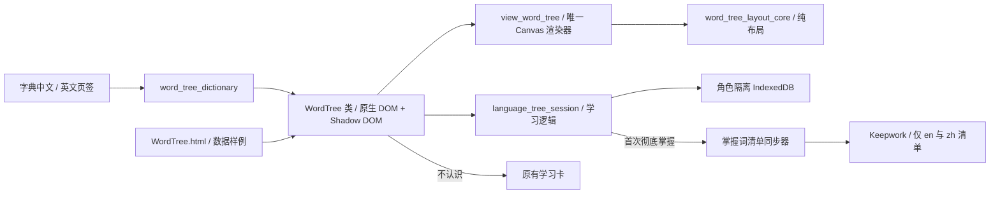

## 2026-10-18：五种状态与隐藏翻译

新增第五种“已验证掌握”（淡紫）：连续两次不同题首次无提示答对后，树上近景与远景都只显示英文。金色自评全掌握仍显示中文；其余为绿色基本理解、蓝色不认识、灰色未知。答错降回基本理解并恢复翻译。点击后的词义弹窗保持原样。

# 2026-10-18：本地学习成就与家庭平板上报

- 增加学习周报／月报，在本机字典库内累计英文新词和有效开口次数；字典首页显示，家庭平板用 `updateDesktopUI` 接收 200 字以内 Markdown 摘要。
- 统计不查询 workspace，不新增云同步，不改每日奖励判定。首次旧字典为基线；重复复习、失败录音不增加新成绩。
- 统计核心 2 项、字典 controller 与统计专项共 104 项通过；真实发送模块 → Launcher 接收端 → IndexedDB 恢复联调通过；字典 1314px／390px 展示通过。
- 战斗快速回归：1150 项中 1149 通过，1 项 `battle_earth_labels.test.mjs` 的 surface loading overlay 断言失败，断言依赖本次未修改的 `adventure_renderer.js` 中旧加载提示。未将该失败算作通过。
- 未构建、提交、推送或发布。真实麦克风与正式 CDN 端到端仍需部署版本后验收。

## 字典首页摘要精简

- 按截图移除顶部今日加成、累计／周月学习统计、说明和阶段奖励摘要，保留今日进度与开始／继续学习按钮；奖励仍从学习奖励入口查看。
- 本机统计与家庭平板上报继续保留，同步更新相关文档。
- 验证：视图语法检查通过；字典控制器与学习统计测试 104/104 通过。本次未运行浏览器或构建，未提交、推送或发布。

## 字典动画关闭入口精简

- 移除动画底部“返回字页，继续练习”按钮，保留右上角统一关闭按钮及原返回练习逻辑。
- 同步现有浏览器用例，改为检查底部按钮不存在、通过“关闭动画”返回练习。
- 验证：视图与浏览器测试文件的 Node 语法检查通过；未运行浏览器或构建。未提交、推送或发布。

## 字典详情标题栏与返回入口

- 将练习状态移至标题栏右侧，长状态省略并保留完整提示；移除详情页返回搜索／今日任务按钮及空工具栏。
- 词条与情境练习的统一叉号、Esc 返回字典首页，沿用搜索、焦点及练习草稿恢复；首页叉号仍关闭字典，动画内关闭仍先返回字页。
- 更新相关浏览器用例的返回入口，并补充标题栏状态与旧按钮移除断言。
- 验证：视图语法检查和字典控制器 102/102 通过；战斗快速回归 1149/1150，通过之外的 1 项为此前已记录的 battle_earth_labels.test.mjs 地面加载提示断言失败（预期旧加载文字，实际为空）。未运行浏览器或构建，未提交、推送或发布。

## 2026-10-18：补齐字源岛30字的独立动画

- 核对实际词表：原有7个对应故事、22个无独立动画、1个“舞”误指“武”。新增23个原生Canvas单文件故事，保留原森、光、门、雨、休、国、明及额外“武”的源文件。
- 作者源集中在 `hanzi/source/`；每字有独立场景、色彩、光影、互动和场景轮廓到规范字形的转场，沿用字典原有中线/轮廓及许可证。六阶段贯通开场、互动、变化、成字、描写、尾声，提供声音、暂停、重播、减少动态效果与手机横竖屏布局。
- 补齐每种语言192个实际缺失词条（英/日/韩），使用现有管道分隔格式；内联原Haqi H5协议，验证字幕双语和界面单语。显式URL模块接入原字典加载链路，放开同目录安全命名，保留路径穿越/外域/查询参数拒绝规则。
- “舞”保留词条ID `wu`，改为 `hanzi_wu_dance.html`；“木/目”“田/天”使用明确文件后缀。合集链接改为相对路径，可预览本地新增页面，不伪造尚未发布的CDN地址。
- 字典及新目录专项30/30通过。完整浏览器首轮23字×4尺寸92/92通过；宿主协议、四种语言、真实指针描字、键盘、暂停、迟到握手与正式字典舞字入口7/7通过；正常动态日字流程通过，截图包含连续成字中间帧。
- 战斗回归最终1155项：1154通过、1失败。失败为 `battle_earth_labels.test.mjs` 的地球加载提示断言，单独复测同样失败；该测试只读取本轮未修改的 `adventure_renderer.js`，其已有工作区改动移走了提示。未更改或跳过该测试。最初新增动画地址校验及舞/武旧断言两项失败已修复。
- `locale:check` 仍非通过：265个既有英文缺项、日/韩各247个既有对齐缺项；与保存的修改前报告逐项一致，新增故事专项无缺译，词典格式/占位符错误为0。
- 对照原“光”实拍（其原浏览器脚本两尺寸通过）及“森”桌面实拍。森的原独立验收脚本在既有 `check_hanzi_sen.mjs:111` 用户互动标记断言失败；本轮未改森，不能据此宣称其完整脚本通过。
- 未构建、未发布、未提交、未推送；修改与预览保留本地。完整制作与检查说明见 `docs/hanzi-stories.md`。

最终补充：四尺寸画面复核92/92通过（`tmp/hanzi-stories/visual-report.json`），已检查正常动态成字中间帧及新版手机主体比例。减少动态效果时缓存静止背景，描字仅重绘笔画层；音量总节点保证静音立即作用于已播放的音符。生成一致性和30项Node专项再次通过。

最终完整流程复核再次92/92通过，最终机器报告 `tmp/hanzi-stories/report.json`，逐字日志 `tmp/hanzi-stories-functional-final.log`。独立画面92组及宿主集成7组报告均完整通过；本地合集HTTP返回200，包含30个词表字及保留的额外“武”故事。

## 2026-10-18：互动序章《失落的光》（`Haqi.html?prologue`）

- 新增约 8 分钟双语开场互动电影《失落的光》，作为 `Haqi.html` 内按需加载模块（`js/prologue_app.js`、`js/prologue_stage.js`、`js/prologue_cinema.js`、`js/view_prologue_dialog.js`、`js/prologue_script_core.js`、`js/prologue_battle_core.js`、`css/prologue.css`）。
- 角色与世界观：严格使用哈奇五系名称（`烈火大师`、`寒冰大师`、`风暴大师`、`生命大师` 与守护古龙 `青龙`），反派为死亡系 `黑暗魔王`（夺走字源树顶端的「光」字），并在选系环节通过青龙台词说明死亡系魔法同样可以守护伙伴。
- 按用户反馈完成 4 项体验与美术打磨：
  1. **二头身 Q 版角色插画**：参照游戏内真实战斗形象重绘 `masters-assemble` 与 `dark-lord-steals`，四位大师（寒冰金发男孩、烈火棕发女孩、风暴黑发马尾女孩、生命黑发绿披风男孩）与青龙、黑暗魔王均改为与游戏一致的二头身 Q 版比例，重新生成哈希 WebP 并更新 `data/prologue/art.json`。
  2. **第 1 幕战斗防卡死与四师依次选攻击卡**：修复 `V.renderBattle` 重置 `battleRoot.className` 导致 `.battle-layer`（`z-index: 30`）遮挡对白框与顶栏的问题；将第 1 幕大师战改为由玩家依次为 `寒冰大师`、`烈火大师`、`风暴大师`、`生命大师` 各点选一张攻击卡（单击即锁定对 `黑暗魔王` 施法），16 种攻击卡组合均 0 失误击败魔王。
  3. **加快叙事节奏**：精简 `data/prologue/script.json` 台词（将四位大师冗长的逐一自报家门合并为青龙一句号召），缩短 `readSeconds`、标题卡停留、转场等待与对白打字机间隔。
  4. **全屏《光》字动画与退出按钮**：`.pl-hanzi` 改为 `position: fixed; inset: 0; z-index: 60` 全屏铺满 `hanzi/hanzi_guang.html`，并在右上角接入统一的 `createCloseButton` 退出按钮。
- 验证：`tests/battle_prologue.test.mjs` 5/5 通过，`tests/promo.test.mjs` 15/15 通过，`tests/packed_startup.test.mjs` 1/1 通过，`npm run test:battle` 1159/1160 通过（1 项为既有 `battle_earth_labels.test.mjs` 地面加载提示断言失败）。修改保留在本地工作区，未提交、未推送。
- 按用户第二轮 5 项反馈继续迭代：
  1. **去掉序章内选系/选男女，第四幕改为 4v2 再战（3 张代表技能 + 文字卡）**：角色创建向导已有选系与形象步骤，移除 `choose-school` 镜头；第四幕改为四位大师 4v2 迎战两只暗影小鬼，每位大师手牌包含第 1 幕的 3 张本系代表技能卡外加刚铸造的「光」之文字卡（共 4 张）。
  2. **第一幕采用新手指引 3 个代表技能 + 底部对话框提示当前选卡系别 + 卡牌居中**：每位大师使用 `adventure_creation_preview.js` 中 `TUTORIAL_SKILLS` 的 3 张代表技能卡（81 种组合四位大师均完整施放特效并获胜）；选卡时手牌区（`.battle-hand`）居中显示，底部对话框同步显示当前大师头像与提示（如「选择一张烈火系的卡牌。」）。
  3. **全部对话配备 NPC 头像**：`view_prologue_dialog.js` 增加 `.pl-avatar` 头像栏，所有剧本台词均关联具名说话人（`qinglong`、四系大师、`child`、`dark-lord`、`imp`）并渲染对应 NPC/英雄/Boss 头像。
  4. **带翅膀的黑暗魔王专属 WebP 立绘**：生成并透明去背转换 `256×256` 带双翼的死亡系黑暗魔王 WebP（`assets/prologue/dark-lord-boss-4ef00eb915a7.webp`，27,406 字节），接入战场渲染与对话头像。
  5. **收敛唯一入口**：移除标题页「观看序章」按钮与宣传片顶栏链接；无角色时进入标题页自动播放开场动画，已有角色点击「新建角色」时先弹出确认对话框（带 `createCloseButton`）询问是否播放开场动画。

## 战斗法阵大屏比例

- 修复法阵随窗口放大但角色与特效倍率被限制为1的问题；战斗Canvas以1024×640为大屏设计尺寸，法阵、人物、宠物、状态、魔力珠和法术共用等比变换，DPR仅控制清晰度。小屏沿用原紧凑布局。
- 目标点击框、状态交互区、实际头部对白锚点及宠物提示同步使用场景倍率；普通冒险和序章共用。手牌与HUD保持原DOM布局。
- 比例及点击专项19/19通过，宠物提示与对白布局12/12通过。第一轮战斗快速回归1169/1170通过；唯一失败为此前已记录的battle_earth_labels地面加载提示断言。未进行浏览器视觉验收、构建或发布，未提交或推送。
- 最终代码复跑战斗快速回归：1169/1170通过，仍仅既有地面加载提示用例失败；气泡倍率兼容与全部本次专项通过。

## 大招自动摄影机

- 新增纯摄影机采样与投影模块，复用原版施法者/目标/场地镜头语法。>2 pips 敌我技能自动采用正面施法近景、技能展示、目标冲击和回场，治疗辅助不震动。
- 地面与指针透视投影，人物按深度缩放和排序；支持正面朝向的角色使用现有素材，单视角怪物不补造视角。镜头不改变战斗随机流、结算或单技能时长。
- 手持卡、阵容和宠物提示在演出中暂隐，保留撤退；按实际顶部操作区测量安全视口，投影对白/状态/点击矩形。序章补齐200ms指针阶段。
- 增加9项摄影机行为测试、内存验收页和96采样浏览器检查脚本。桌面1100×760、手机390×844、横屏844×390均覆盖四模板、双方、命中、回场、中断与减少动态效果；真实CDN素材截图已检查。
- 完整回归的旧地面加载提示断言在 HEAD 也失败（预期片段已不存在，实际标签为空）；未修改无关行为或将失败当成通过。最终结果见 QA 记录。未提交、推送或发布。
## 汉字逐字规划文档补齐

- 用户确认本轮仅补齐规划。保留既有《休》详案，在 `hanzi/docs/` 按字典顺序新增其余29篇逐字文档，总纲新增30字索引和接续状态。
- 每字记录专属故事、色彩与构图、约114–154秒分镜、长按/拖动/点亮三次互动、专属成字转场、笔顺、三组词意与余韵；明确单HTML内联全部资源、父窗口协议、键盘触控和实现后验收要求。
- 分开古文字依据、传统训释和艺术助记，补字源查核入口及日/月/目/中/天/国/舞等解释边界。古字具体字例仍需绘制前选定，不能将规划标为已完成的文字学或浏览器验收。
- 现场源码检查发现《森》仍静态导入Keepwork CDN Three.js，已列入后续零外部JS与离线验收事项；本轮未修改HTML、运行时源码或翻译。
- 文档检查：30字逐字文档齐全，新增29篇笔画数量与现有字典一致，九段分镜和七项待验收清单齐全，153处本地链接有效。首次检查脚本将交互编号误计为笔顺，限定笔顺段后通过。纯文档改动未运行游戏回归、构建或浏览器验收；未提交、推送、发布。

### 摄影机可读性调整（用户追加）

触发费用改为≥1 pip。施法者正面近景头顶显示带描边的大字技能名，前12%技能进度延长至1400ms，后段保持原速度；播放进度同时驱动特效、音效、环境生效和命中反馈。跳过及失误使用1600ms近景，分别展示“跳过”“miss”，移除脚边重复MISS。减少动态效果模式保留文字可读时长，反射补播不重复延时。专项11项通过；浏览器加入1/2 pip、跳过及失误，扩充至192个采样。验证结论见QA记录。

## 文字世界树独立演示

- 新增WordTree.html及独立样式、控制器和纯核心模块；模拟记录驱动到期/最近学习配色、搜索定位、镜头交互。600/1500/3000节点固定种子布局，桌面16/手机8个清晰标签，远景保留逐词缓存文字。
- 支持鼠标、双指和键盘旋转/缩放/平移，日期切换、节点详情和95秒性能采样；后台暂停，采样进入后台会取消。
- 不读取或写入玩家存档，不改变正式字典、战斗和共享CSS。入口与复测方法见docs/word-tree.md。未提交、推送或发布。

### 法阵投影修复与整体节奏放慢（用户追加）

定位到旧机位屏幕坐标混合会在相反朝向时压扁或翻转地面；改用先插值视图参数、再做统一透视除法的投影，实际转角限幅并保留近裁剪保护。新增±180°/360°及七档过渡的直线共线与圆盘凸性测试。

统一名称前段1900ms，后段时长×1.65（至少1500ms）；跳过/Miss2100ms，受击650ms，致命900ms，治疗1000ms。真实伤害驱动场景震动及冲击圈，群体不累加振幅，覆盖0费、反伤和持续伤害；失误/零伤害不伪造受击，减少动态效果模式不震动。双人宣传片同步进度适配。37项相关专项通过；浏览器234采样、过渡截图及真实伤害场景验证通过，完整回归结果见QA记录。修改仅本地保留。

### 文字世界树验证

5项纯核心测试通过；1280/390视口交互覆盖旋转、缩放、平移、搜索、词条点击、日期模拟及双指操作。六组基础性能采样和两组优化版3000节点复测完成，每组5秒预热+三阶段各30秒。优化版3000节点桌面56.8～58.2FPS，手机视口54.0～56.7FPS；桌面缩放P95 33.2ms未达20ms目标，手机缩放P95 33.4ms略超33.3ms目标。实体手机未测，结果与复测入口见docs/word-tree.md；未提交或发布。

最终整树自适应取景修复后，5项核心测试及1280/390浏览器交互复验通过，3000节点整树截图已目视检查；503词典加载失败时显示错误并保持操作禁用。最后调整只影响初始/复位镜头和加载控件，性能采样固定镜头路径保持不变。

## 游戏经历驱动个人语言树
新增可选翻译观察和明确可见呈现采集，接入NPC对白、任务、物品、字典例句。新增纯核心、IndexedDB服务、会话化出题适配与六叉Canvas页面，游戏入口复用已有关闭控件。自评与跨日证据分离；模拟模式不读写角色数据。词卡渐变，点击不移动镜头。3000独立文字纹理总览发现性能退化，改为共享文字图集并复测。未提交、推送、构建或发布；实际结果见[验收报告](../language-tree-validation.md)。

## 战斗目标无响应：异常状态恢复

用户反馈播放一轮后，点击阵容卡和场上角色均无效，仍可返回。截图中场上敌人血条已空，阵容卡仍显示437血。定位到结算先修改battle、记录成功后才建立动画的异常窗口：任一步抛错会留下旧选牌界面，而已结束的battle阻止后续目标操作。该路径已用异常注入复现；未读取用户实际运行时错误，因此不认定原始异常来源已确认。

新增回合事务边界：结算/记录失败恢复检查点与revision，并重演重建battle、重绘选牌、显示重试提示及控制台原始异常。成功后先接入动画，再持久化和停止对白。新增真实PVE第二回合500伤害击杀437血敌人的回归，分别注入结算后和记录后异常，验证恢复血量、决定数量、再次Canvas目标点击及确定性重演。专项31/31通过；完整快速回归结果见qa-report。未提交、推送或发布。

## 摄影机结束后宠物提示飘到左上角

用户截图的宠物提示位于远处主角状态图标上方。复现为气泡与宠物自身状态行重叠时，speechPlacement按障碍物输入顺序选取首个合法候选，优先用了远处主角图标上方的位置。改为对实际边界钳制后的候选按离原位置的距离排序，等距离固定坐标排序，避免角色绘制顺序改变位置；宠物提示保留尾尖预留空间。镜头活动期间不测量/缓存提示，结束后重新定位；缓存覆盖全部状态矩形、视口高度及气泡尺寸，修复非首个图标移动后不更新的问题。

新增截图坐标近似复现、障碍物顺序互换、镜头开始/结束以及非首个状态图标移动回归。actor_speech、battle_pet_hint、battle_chat_layout专项16/16通过。未改战斗数值，未提交、推送或发布；完整战斗回归结果见qa-report。

## 按反馈恢复原文字树体验
用户明确要求保留上版整树体验。默认入口恢复原三维文字树，个人模式重用原投影和树干分枝样式，取消六叉分组导航。保留记录/自评/测验；词卡渐变，点击不移动镜头。新增稳定坐标与渐变单元测试，17项通过。浏览器桌面/手机复核记录见语言树验收报告；不沿用分组版本的性能达标结论。

## 语言创造家园

- 以项目独立Canvas/DOM系统替换旧外部家园链接，接入世界地图第三入口；每角色多家园，32×32分块、按需地表、纯规则/IO/视图分层。
- 160个物品ID、八类目录、中英三句式、颜色与别名、桌面槽位、旋转/收回/跨块移动；23个复用CDN图像，其余原生可编辑矢量，无新增媒体上传。
- 当前全部宠物名册、拖放、附近设施行为及12类互动；简短愿望、翻译、示范和实际操作后的反馈。通过 haqi-story 约束模板语言，不修改主线编号或战斗奖励。
- 本机原子召唤回执、写入失败重试、访客复制、手动增量云分文件和目录发布、冲突副本、会话取消；按 keepwork-web-dev 技能核对SDK Cache读写，读取失败不视为空目录。
- 新增家园Node及隔离浏览器验收入口；测试结果单列QA记录。保留其他已有修改，未提交、推送或发布。

## 10句UI正文展示新逻辑
添加独立10句输入样例，直接取自现有字典正文，通过同一核心合并为25个唯一词。可编辑、逐句重放，显示重复词次数与上下文，标记需显式点击。明确模拟时间和内存隔离，不冒充真实游戏采集；不调用模型。内容词优先清晰展示。19项核心测试通过，桌面/手机视口交互通过，未提交/推送/发布。

## 语言树恢复双语词义
按用户截图反馈，词卡第二行由学习状态改为中文词义，英文与中文同时显示；远景缓存也绘制双语。详情补充词义，学习状态仍用颜色、标记按钮和文字图例表达。复用现有词典释义与已知词形，新增tree-glosses.json补充us/my等基础词；未知词明确待补充，不挪用整句翻译。10句样例的25词均有中文释义。11项相关单元测试及桌面/手机视口样例交互通过。未提交、推送或发布。

家园最终验证：专项24/24、正式入口与1280/390px隔离浏览器通过、20张CDN资源核验通过；战斗回归1210/1213，3项地表/缺失汉字页面失败如实记入QA。真实麦克风和云端账号写入未验收。

### 家园沉浸界面修订
- 按反馈将家园目录与游玩分离；进入后全屏接管世界和底栏，退出恢复原冒险。
- 新五项底栏与按需抽屉，漫游和布置模式分离，布局覆盖桌面及390px。
- 复用冒险角色、营地树木图集，新增独立行走碰撞规则。自然树木只作为背景，不占库存；直线路径遇家具停止。
- 家园专项26项通过。战斗回归1215项中1212通过、3项失败：已有earth标签断言和两个缺失hanzi页面测试；未覆盖或恢复其他工作区修改。
- 正式入口及隔离浏览器验证记录见docs/qa-report.md；本次未验证真实麦克风及账号云服务，没有发布。

### 家园目录简化
- 移除目录页介绍、常驻命名框、刷新云端及复制访客按钮；现有家园整行点击进入，末项为新建，点击后才询问名字。
- 重命名、删除移到家园内设置；删除当前家园后回目录，重命名同步更新场景标题。
- 目录不再重复展示每个家园的管理按钮和保存提示。存储格式不变。
- 验证：家园Node回归26/26；1280px、390px浏览器检查通过，覆盖新建弹出命名、整行进入、返回列表及既有保存/布置回归。未修改共享UI或战斗逻辑。

### 家园宠物静止与出生点传送
- 取消每秒随机位移，默认保持居民摆放位置；每20秒只轮到一只可见空闲宠物尝试活动或发言，页面隐藏时暂停。
- 漫游模式支持直接拖宠物；预览保留抓取偏移，松开保存精确坐标，避免格子吸附跳动。
- 家园原点加入Canvas石台水晶传送装置及可访问按钮，打开现有哈奇世界地图，复用目的地解锁与传送逻辑。
- 实际入口传送地图验证通过；桌面/390px家园完整回归通过；22秒静止观察及拖动过程/落点不跳动检查通过。
- `npm run test:battle`：1212通过、3项既有失败（earth加载标签、缺失hanzi页面两例），日志tmp/home-pet-portal-battle.log。未提交、推送或发布。

### 家园目录本地游玩记录与缩略图
- 家园卡片显示更新时间、累计可见页面游玩分钟数，以及上次退出时的400×300 WebP预览。整项点击进入，末项新建，未增加按钮。
- 截图从场景Canvas居中裁剪为4:3，保存本机IndexedDB的`local:visit`，不进入home.parts、版本、dirty或云同步快照。账号/角色/家园沿用既有隔离键。
- 每15秒保存累计时长；退出家园和pagehide尝试保存最新截图。页面隐藏时不累积，旧存档无记录时显示暂无记录；浏览器强制终止可能丢失最后一个检查点之后的时长，截图保留最近一次成功保存。
- `scripts/check_home_preview.mjs`：1280px/390px通过，核验图片实际400×300、时间、刷新恢复及云同步快照不含截图。家园Node回归26/26通过。

### 2026-10-18：极简语言树更新

按最新反馈将语言树移到字典标签；画面只保留双语树。点击词只弹出三项理解程度选择，点击果实答题；新增连续两次正确升级、其他情况基本理解及未知词出题过滤。保留模拟与真实数据隔离。新增极简浏览器验证脚本，113 项核心／控制器测试通过；战斗回归 1211/1215 通过，4 项其他模块失败已记录。未提交、推送或发布。

### 2026-10-18：前景状态均衡与屏幕容量

个人树前景按五种状态轮流取得初始展示机会，再以不认识 1.4、未知 1.2、基本理解 1.1、自评全掌握 1、已验证掌握 0.7 的相对权重分配。仅对当前视野内能放下且无碰撞的词分配；缺少某状态时由其他状态补足，不保证拥挤视角下硬性比例。每组优先内容词，再按旋转后的深度选择；保留点击词优先，点击不会移动相机。

清晰词上限按画布面积 / 42000 取整，限制 6～32；390×900 为 8，1280×900 为 27。这是上限，实际数量受词数与标签避让影响。远景逐词表示不变；旋转会重新选择前景。核心测试 20/20 通过，覆盖五状态比例、已掌握组降权、缺组补足、点击命中及不同屏幕容量。

### 2026-10-18：文字渐显渐隐

清晰词卡与远景文字都使用透明度过渡：约 80ms 稳定缓冲、420ms 淡入、320ms 淡出；切换方向从当前透明度继续，不跳变。远景跨越前后景时亮度连续变化。后台恢复限制单帧时间步长，避免突然显现；减少动态效果设置使用短 120ms 透明度过渡。核心 20 项测试通过，含中途反向、后台恢复与减少动态效果。

### 2026-10-18：词语朗读

词语弹窗标题旁增加 NPC 对话同款喇叭图标，点击后使用现有 createLearningVoice 朗读英文；按需加载，不自动播放。播放期间仅朗读按钮忙碌，不影响三项自评；关闭弹窗或离开树时取消语音，失败仅短提示。浏览器测试以语音适配器桩验证英文文本、语言参数、弹窗保持及取消，不代表真实在线音频验收。

### 2026-10-18：家园全量 WebP 图集、随机群落河流桥梁、主角脚印与游戏化 UI

- **全量 160 项 WebP 图集化**：生成并打包 10 张 `768×768`（4×4 格）等轴测手绘风家具/建筑/游乐/花园 WebP 图集（`assets/adventure/home/home-atlas-01..10-*.webp`，单张 140KB–195KB ≤ 200KB），上传至 Keepwork CDN 并更新 `data/adventure/home/home-art.json` 与 `data/adventure/home/catalog.json`，彻底替换原有的原生 Canvas 矢量绘制占位，支持透明蒙版染色与灯光、音符、水花、炊烟、屏幕动态微光交互特效。
- **随机种子地形、六大群落、蜿蜒河流与木桥**：在 `js/home_core.js`、`js/home_walk_core.js` 与 `js/view_home_art.js` 中实现基于家园 `seed` 的二维平滑噪声地形生成，包含翡翠草甸、樱花花谷、金秋枫林、阳光沙洲、晶莹雪原、星光秘境六大群落，叠加 `environment-art.json` 与 `terrain-decoration-art.json` 无缝地表与自然花草树木 WebP 图集；生成环绕出生广场的蜿蜒动态波纹河流、浅滩鹅卵石河岸、石板道路以及跨河木板桥（未架桥河面不可趟水，木桥与自建桥可通行）。
- **主世界同款主角移动与脚印轨迹**：在 `js/adventure_app.js` 与 `js/view_home.js` 中接入 `hero_pose_core.js`（16 方向转头与呼吸姿态）、`loadHeroLibrary` 独立回退加载，以及 `adventure_motion_effects.js` 的 `createMotionTrail` / `drawMotionTrail`，使主角在家园行走时同样留下脚印（`foot`）、尘土（`dust`）、元素微粒与目标光环路径。
- **游戏化 HUD 与去按钮化交互**：重构 `js/view_home.js` 与 `css/home.css`，精简顶部为岛屿名、实时群落/地面指南针徽章与坐标胶囊；移除抽屉内重复的顶部分页按钮，由底部五项快捷坞（漫游、建造、仓库、居民、家园设置）直达对应抽屉；将家具操作（旋转、互动、收回、取消选择）改为直接浮动在选中家具正上方的场景内操作环；宠物愿望气泡内联“朗读”与“帮它实现”胶囊。
- **验证**：`node scripts/check_home_art.mjs`（160 项引用 / 10 张永久 CDN 图集）、`node --test tests/battle_home.test.mjs`（29/29）、5 项 Playwright 浏览器脚本（`check_home_immersive`、`check_home_preview`、`check_home`、`check_home_pet_idle`、`check_home_world_entry` 桌面 1280px 与手机 390px）全部通过；`npm run test:battle` 1215/1218 通过（3 项既有无关失败已如实记录于 QA 报告）。未提交、未推送。

## 2026-10-18：中英字典树与仅掌握清单云同步（当前）

中文／英文页签直接用 WordTree 替换搜索、筛选及词卡网格，顶部今日进度与学习任务保留；撤掉多余“语言树”页签。每个字典词预置为未知节点，分枝由稳定词条 ID 决定，预置不冒充遇见或掌握。选择“不认识”打开原有对应字词学习卡；未收录词可查看含原句的简要学习卡。返回恢复树，本地等级保留。

中文树使用独立本机键（角色键 + `:zh`），英文保持原采集键。学习卡正文仍须前台实际呈现满 800ms 才计数；中文仅收录字典已知汉字，未把整句译文当作字义。中英文均用经过词汇／重复校验的句子题；未实际遇见的预置词不进入出题素材。两次不同句无提示首次答对才获得彻底掌握资格。

云端只存 `HaqiAdventure/language-tree/<role>/mastered.json`，内容仅 `{en:[英文词],zh:[汉字]}`，按当前登录账号和角色隔离。使用现有 Keepwork SDK 与 `saveWorkspaceFile` 应答写入；不进入角色云存档、不置角色同步 dirty。初次打开按需读取，当前登录会话复用缓存；每个首次获得彻底掌握资格的词触发一次清单写入，重复自评、第一次答对及普通重开不写。所有上下文、次数、其他状态、答题证据及待同步标记只在 IndexedDB。失败保留待同步内容，下次打开重试；身份切换拒绝迟到写入。

清单是“曾通过彻底掌握验证”的累积资格，不上传后续答错或自评变化；本地降级仍优先于云清单，不会被重新打开覆盖。在新设备只恢复清单中的已掌握词，不伪造原句或测验证据。访客只存本机。

实现：`language_tree_dictionary_core.js`（预置／掌握清单校验）、`language_tree_mastery_sync.js`（去重与恢复）、`language_tree_mastery_cloud.js`（SDK IO）；字典通过现有 iframe 桥接学习卡与掌握事件。

## 2026-10-18：世界树唯一 JS 类库

公开入口 `js/word_tree.js` 的 `WordTree` 类；字典通过 `word_tree_dictionary.js` 直接挂载，预览通过 `word_tree_demo.js` 调用同一类。使用 Shadow DOM 隔离当前组件 CSS，不用 iframe，也不加载页面壳。纯布局与学习核心保持独立可测试。旧侧栏、六叉导航、模拟遗忘曲线与专用压力页面已删除。API 与模块表见 [世界树](word-tree.md)。

### 删除世界树独立预览入口

按用户要求删除 WordTree.html 和 Vite 中的对应入口；专用模拟脚本移入 tests/fixtures，仅用于类库回归验证。运行时 js/ 不再保留预览或模拟数据模块，字典直接挂载 WordTree 类保持不变。

## 2026-10-18：家具裁剪与座椅比例修正

检查全部10张家园图集，修正花园第二行灌木、花坛、菜地、浇水壶裁剪框中混入的上一行碎片，以及音箱左侧碎片。仅调整清单的裁剪坐标、宽高，不修改图片、CDN或哈希；home-art.json保留原打包框与修正原因，重新打包只有哈希相同时才复用修正。

椅子、浴室矮凳、扶手椅、摇椅、餐桌长凳、花园长凳通过目录renderScale=1.45放大场景外观，脚底锚点、占地与存档位置保持不变。缩略图保持独立适配，地面类缩略图改为等比绘制，避免裁剪后菜地变形。

验证：家园与美术专项33/33通过，覆盖160项裁剪框与清单一致性、格子边界、场景/缩略图裁剪、座椅比例与脚底位置。未运行浏览器或构建；未提交、推送或发布。

战斗快速回归结果：1218项中1215通过、3失败。失败分别是battle_earth_labels.test.mjs的地面加载提示断言（实际为空）和battle_hanzi_story_catalog.test.mjs的两项汉字页面检查（hanzi/hanzi_ri.html缺失）；涉及本次未修改的地球界面及汉字文件，不计为通过。本次开始时工作区已有多项汉字页面删除。

### 家园宠物浮动与居民头像

- 家园空闲宠物与外部世界社交宠物、跟随宠物共用 `petIdleLift`，保持轻微上下浮动；阴影和实际坐标固定，拖动和设施活动保留原行为，减少动态效果时关闭浮动。
- 居民列表使用已有宠物图集当前成长阶段的正面帧，按比例绘制40px头像；图片未就绪或失败显示名字首字，加载完成自动更新。名字、阶段、美术或活动变化会刷新列表。
- 验证：修改模块语法检查通过；浮动幅度、时间采样与减少动态效果检查通过。战斗快速回归结果见本节后续记录。本次未启动浏览器或构建，未提交、推送或发布。
- 战斗快速回归完成：1218项，1215通过、3失败。失败为地面加载遮罩文案断言（battle_earth_labels.test.mjs）及两项汉字独立页面检查（缺少hanzi_ri.html）；未改动这些功能或恢复工作区原有删除文件。完整输出：tmp/pet-home-battle-test.log。不能视为全量通过。

### 家园返回、对白锚点与按住行走

- 隐藏常驻本机保存成功提示，保留错误和重试保存；场景关闭入口改为左上角48px高「返回」按钮，另保留家园列表入口。
- 宠物愿望气泡取消屏幕边缘钳制，使用宠物投影位置固定偏移；宠物拖动时跟随实际拖动位置，离屏时隐藏，不贴在屏幕边缘漂移。
- 鼠标沿用外部世界6px拖动阈值和180ms按住判定，每帧按当前镜头重新计算方向，松开、取消和丢失捕获时停止。拖动不显示路径与目标圈，短点击仍保留点击行走，宠物和家具拖动保持原功能。
- 家园专项30/30通过，覆盖固定鼠标持续行走和中心死区；模块语法检查通过。未启动浏览器、未构建或发布。
- 战斗快速回归1218项：1215通过、3失败，仍为地面加载遮罩文案及两项缺少hanzi_ri.html的检查（与上一轮相同）；最终提取行走坐标函数后家园专项30/30通过。日志tmp/home-input-battle-test.log与tmp/home-input-unit.log。全套未通过，不宣称浏览器实测通过。

## 2026-10-18：原生透明家园图集重制（完成）

按用户要求使用内置 image_gen harness，十次生成均显式设置transparent_background=true，覆盖160物品；完整提示词保存于data/adventure/home/home-art-prompts.json。原始RGBA PNG保存在.cache/home-art/transparent；正式运行时仍使用带内容哈希的WebP。

替换prepare_home_art.py的白色阈值去底/固定格切割：验证原生RGBA和透明背景，按完整alpha连通区域分配逻辑格，允许踏脚石等同格分离部分；仅忽略alpha≤8的近透明噪声，保留主体及半透明边缘，不按颜色抠除白色家具，也不硬裁跨格主体。重新居中打包并留12px边距，保留座椅renderScale与原item ID。测试覆盖无alpha输入拒绝、跨格完整主体和分离部件、白色主体与半透明像素保持。

完成记录：10/10正式WebP已替换，全部768×768，178,888–194,950字节；160项alpha/填充边距/裁剪/哈希验证通过，2项打包行为测试通过，家园Node专项34/34通过。10个永久CDN地址逐一核验HTTP、CORS、WebP、SHA-256；浏览器本地/CDN各160项×3底色绘制及Canvas可读检查通过，1280px和390px家园目录与摆放通过；已人工查看花园三底色与场景截图。截图位于tmp/home-alpha/。旧10张WebP移入.cache/home-art/retired，不再位于正式assets目录。用户选择仅CDN和当前项目，不复制digitalhuman-resource镜像。未提交、推送、构建或发布游戏代码。

## 2026-10-18：美术技能优先使用harness原生透明生成

更新项目AGENTS.md所引用的apps共享art-asset-generator技能维护源，增加原生透明能力优先路由：包括批量任务，显式请求alpha，禁止原生RGBA再次经过JPEG或白底抠色；旧浏览器流程仅作能力不可用或用户明确指定时的回退。补充多底色alpha检查、完整对象提取与留边打包，保留原有CDN授权及核验规则；项目AGENTS.md加入对应路由约定。技能结构校验与diff空白检查已执行，未提交、推送或发布。

校验说明：使用Python UTF-8模式重跑技能校验后，validator报告既有argument-hint字段不在其允许列表；为保留原技能接口未移除该字段。共享技能diff --check通过；项目AGENTS.md的diff检查另报告既有文件末尾空行，本次未修改该尾部。
