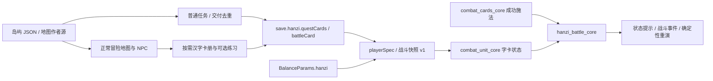

# 字源岛与汉字魔法

## 2026-10-17：文字战斗卡与字典统一（本地版）

已替换旧火／水／土随身增益、旧卡册／魔法外观和三片成卡。字源岛保留六段生活故事、探索及守护战斗，完成一次真实字典练习即可推进对应字词任务；观看动画与吟唱不记学习完成。已领奖任务继续保留，旧碎片不折算练习；旧实际读写记录可用于任务迁移。下文涉及收藏、三片和随身字卡的段落为历史记录。

文字卡配置在 `data/adventure/dictionary/word-cards.json`，覆盖中文30字与英文30词。每张卡引用 `baseCardKey`，名称、简短描述和朗读文本独立，数值、魔力、系别、目标、冷却及动画均继承原卡。

仅开启学习模式的普通单人冒险战斗启用。开战时读取当前账号／角色的IndexedDB，按最后作答或完成练习时间合并中英最近10个不同词条；浏览不算，不足不补新词。卡池独立种子洗牌并冻结，共用8格：普通牌充足时最多一张文字卡，不足时用文字卡补位。仅回合补牌时抽取，施放、失误或确认弃牌均消耗本场实例，最多10张。

选中文字卡后选择施法目标，自动打开读写练习；通过并保存后直接向该目标施放，不再显示激活按钮或状态。取消练习不会施法，已激活卡牌直接沿原目标流程施放。中文朗读完整技能句，或按笔顺书写目标字；英文朗读完整句子或隐藏答案后拼写。左侧复用NPC对话的绿色回答气泡、示范扬声器、双语词义映射、输入回答、提示收起和圆形录音进度环；录音复用点击／按住说话、松开发送与滑出取消交互；完整匹配直接通过，最多三次有效识别，第三次按既有跟读覆盖率允许容错，无关内容仍不能激活，可转写字／拼写。空录音及服务错误不消耗次数。书写每笔立即校验，正确笔画立即换成标准字形轮廓，错误笔画自动撤回，不再显示逐笔文字提示，最后一笔正确后自动保存并激活，右侧只保留“看演示”。识别不是专业发音评分。练习时暂停场景帧更新；普通冒险本身没有赛场出牌倒计时，本功能不进入赛场。成功记录复习间隔及最近练习时间，错误和示范计入原提示／错误规则，每日奖励继续去重；当前战斗属性快照不随学习奖励改变。

语音仍走既有Keepwork识别接口。主动录音最多15秒，成功音频只在内存暂存为WAV；施法字幕显示朗读文字，并在启用声音时回放一次。刷新、离场或账号切换不保存录音，刷新后卡牌激活状态仍可恢复。数据快照只保存版本、候选顺序、激活身份和已有战斗决定，重演无需字典网络请求或再次答题。旧版战斗仍读取旧规则快照，后续新战斗不再装备旧字卡。

## 2026-10-17：文字记忆与生活故事（本地开发版）

字源岛现采用六段生活故事、30个重点字，作者源为 `data/adventure/island-packs/hanzi.json` 的 `memory` 和任务873100—873105。旧873000—873005保留存档兼容，停止新接取并退出普通任务手记；旧已领奖励不会由新故事重复发放。下面2026-10-12的跑腿赠卡说明属于历史版本。

路标、引水记录、天气册、夜归灯、家书与庆典分别对应五个字。探索点在可行走道路和守护区内确定性生成；普通点停留吟唱4秒，有守护怪物则先战斗。获胜后圈内碎片移到安全道路；有进行中的本岛文字任务时自动打开一张目标卡。任务追踪会寻路到记忆点。每次观看支持完成协议的动画或正确写字获得一片，三片成卡；旧卡与旧有效读写次数折算收藏，不制造练习记录。

地图上每收齐一个字，在对应居民身边显示该字标识，卡片反馈说明它在生活中的用途。六段任务按顺序展开；全部字典30字进入本岛收藏页。由字典的“字卡收藏与魔法外观”进入，原有战斗卡装备和外观入口保留。其他岛屿本次未接入。

`save.hanzi.memories` 保存碎片及每个固定槽位的领取序号；随原有hanzi记录分片同步。`hanziMemoryRuntime` 保存现场节点、待完成交互与自动开卡意图，仅本机保存。吟唱只在内存中。成功领取先持久化再更新字典；本地失败保留同一领取序号供重试。动画只记观看，写字才调用原字典完成规则，沿用每日奖励上限。

动画翻译采用中文key的parent消息协议，详见[动画协议](hanzi-animation-protocol.md)。当前CDN动画尚未发布完成协议新版，仍可欣赏并通过写字获得碎片；明、舞本地H5已接通。没有发布游戏，也没有批量补翻译。

2026-10-12：已接入本地开发版，未发布。新角色仍从魔法营地开始。字源岛是适合 1–10 级额外探索的独立岛屿，可从世界地图自由前往，拥有六步独立任务线；不替代营地教学，也不要求先完成营地主线。旧角色保留原位置、任务和收藏。

## 冒险与任务

岛屿使用正常可行走地形、居民交谈、任务列表、目标追踪与战斗。四位居民、六个地标和一处新手遭遇构成首版内容。字源岛具有独立海岸、溪流、道路和建筑布局；世界地图岛屿图、六种建筑和四位居民使用新生成的透明 WebP，生物沿用儿童版资源。全部新美术已上传 Keepwork CDN，详见 [美术来源与验收](hanzi-island-art.md)。

| 任务 ID | 任务 | 行动与奖励 |
| --- | --- | --- |
| 873000 | 早安，字源岛 | 阿初请玩家问候溪禾；获得火字卡并自动携带 |
| 873001 | 一杯水的问候 | 向石伯带去小苗的消息；获得水字卡 |
| 873002 | 脚下的土地 | 告诉阿初道路已修好；获得土字卡 |
| 873003 | 让小鼠回树林 | 完成一次普通战斗，使用随身字卡的力量 |
| 873004 | 给远方的灯 | 向小灯带去道路安全的消息 |
| 873005 | 从这里出发 | 与阿初道别，介绍世界地图和后续岛屿 |

任务前置依次衔接，使用既有接取、交谈、击败与交付动作；奖励只领取一次。六次任务经验足以到达 10 级。通过码头或世界地图前往魔法营地、哈奇岛与后续岛屿，之后仍可返回；出岛不以收齐字卡、写字或登录语音为条件。魔法营地原教学任务保留，可以前往继续。

作者源为 `data/adventure/island-packs/hanzi.json`；地图作者源为 `config/maps/islands/hanzi.json`。正式故事目录通过现有导出器生成 [C873000](story/chapters/C873000.md)，不手改导出正文。

## 汉字卡与战斗

HUD 的“字”按钮和岛上居民都能打开随身汉字卡册，战前最多携带一张战斗字卡，也可卸下。成功施放普通卡牌后触发，单次群攻只触发一次，失误、跳过、倒下时不触发；不额外消耗字卡，不插入战中问答。切换字卡在战斗外进行，离岛后仍可使用。

| 字卡 | 每次成功施法后的效果 | 每场上限 |
| --- | --- | --- |
| 火 | 攻击加成增加 3 个百分点，从后续攻击起生效 | 3 次，合计 +9% |
| 土 | 防御加成增加 3 个百分点 | 3 次，合计 +9% |
| 水 | 恢复自身最大生命的 3%，向上取整，不超过满血 | 3 次，满血也计一次 |

火、土增益持续至该场战斗结束，与每日学习增益分别计算。参数集中在 `BalanceParams.hanzi`。卡册说明、任务奖励、战斗状态及事件记录展示字卡与触发信息。其他 21 字仍可收藏、练习及解锁外观，尚无独立战斗效果。

任务字卡收藏和读写记录分别保存：领取任务卡不伪造读写尝试，也不发每日学习奖励。原型中读写三次获得的火、水、土卡也可直接携带。战斗规则版本为 1，所用字卡及参数写入玩家战斗快照；存档重演使用当时参数，旧快照不增加新效果。原版 Lua 伤害公式保持不变，字卡是显式网页新增规则，不使用随机数。

## 可选读写与外观

居民提供“看看这个字 · 可选练习”，直接打开相关汉字的局部练习，关闭回到原地点。卡册保留 24 字、三章、现代笔顺、书写与已有语音链路、程序动画、三阶段学习、复习以及六组卡牌外观。卡册中的字形按钮直接打开练习，已移除假想地图上的角色走点流程。

`product=hanzi` 旧链接仍进入同一个游戏，不再自动弹出专用活动面板或改品牌标题。字卡册按需加载汉字正文、笔画和样式；普通任务与数值增益不依赖这些资源。已有装备外观的角色沿用原外观适配器预加载。

说字或写字练习按稳定 `hanzi:<字ID>` 每字每天最多尝试一次共享学习奖励；三阶段收藏独立推进。演示、预览、普通任务、装备及施法均不产生每日学习奖励。任务通行不要求读写练习。

## 模块与保存

- `hanzi_core.js`：读写、外观、任务赠卡、携带与验证；`hanzi_battle_core.js`：快照、参数校验、施法增益。
- `adventure_hanzi.js` / `view_hanzi.js`：按需卡册、直接打开指定汉字、携带与保存回调；练习逻辑复用原模块。
- `save.hanzi.version=1` 新增可选 `questCards`、`battleCard`，仍在角色 records 分片保存；未变更的旧档无需补字段。任务领取使用既有 quests 状态。当前位置、生命和未结束战斗继续仅存本机。
- `data/adventure/hanzi/content.json` 与 `strokes.json` 保留原 24 字素材；生成来源为 `scripts/prepare_hanzi_content.py`，不以任务赠卡替代教学进度。

## 来源与验证边界

程序动画及诗句为艺术联想，不是古文字复原。现代笔画源为 Make Me a Hanzi 固定提交 `bddc96d41bef78427ed0e034e9f7e31d71fd1b92`，许可在 `licenses/hanzi/`。9 字已附一手《说文解字》阅读来源，其余 15 字保留待审标记。教学与字源审校、真实账号语音与云同步、真实手机书写和受众试用仍待完成。

专项测试覆盖营地出生、主动前往字源岛、任务前置与重复领取、成长到10级、旧角色保留位置、往返岛屿、任务卡 records/cloud 往返、五系新手战斗、增益上限、回血上限、失误/跳过、状态提示、保存重演与参数变化后的旧快照。地图生成器检查出生点、居民、怪物、地标、出口与道路可达性。运行记录见 [QA 报告](qa-report.md) 与当日开发日志；本轮未运行发布黑盒 QA 或构建，不宣称浏览器或真人验收完成。

## 2026-10-16：语言字典与每日学习

HUD 的“字”改为字典图标；中文、英文各有独立首页。作者数据为 `data/adventure/dictionary/zh.json`、`en.json`，分别30条。中文包含原24字与休、森、光、国、明、舞，沿用 Make Me a Hanzi 的原始笔画/中线坐标与 Arphic Public License；许可全文保留于 `data/adventure/hanzi/licenses.json`。释义和例句是本项目编写的基础教学内容，不提供未经审校的历史字源断言。

每日第一次打开固定“复习5个 / 新学3个 / 情境1题”，不足按实际数量；刷新继续同一队列。中文首次写字，复习先选词义再写字；英文首次选词义，后续词义与拼写交替。书写可触控、鼠标，或聚焦画布后用方向键与空格操作。复习题隐藏释义提示，拼写题隐藏目标拼写；提示后需要重新作答。

门、休、森、光、国、雨使用已验证的永久 CDN 页面。明、舞的 CDN 返回404，使用本仓库独立HTML，Vite通过明确的URL引用将HTML随代码打包；不上传、不伪造CDN地址。点击“有动画”才创建iframe，关闭销毁；动画无奖励消息协议，不自动播放计分。动画属于艺术联想，笔顺练习独立校验。原主线、任务奖励、汉字战斗卡和魔法外观保留；任务字卡通知及任务详情可直接翻开对应字典页。原卡册通过字典的“原有字卡与魔法外观”进入。

情境题复用 `createLearningVoice.judge`，登录用户按当前语言设置的模型生成题目和判断语义；返回对象必须匹配目标词条，正确回答必须含目标词及可逐字核验的回答证据。模型不决定奖励金额。题目保存在当日计划，回答与录音不入库。访客、超时、无效回复退回同一目标词的本地选择题。模型输出按纯文本展示；关闭、换角色、换账号使迟到结果失效。

答对字词每天最多一次、情境每语言每天一次，均复用每日语言加成1%及共享40层上限。阶段货币奖励仍用原领取动作和云端领取标记；字典没有新增货币发放逻辑。数据库未确认写入时只允许练习，不发奖励。该功能不是技能树或岛屿主线改写。

### 字典内的小老师

词条练习下方提供可展开的讲解与连续追问。复用 Keepwork 模型接口，只返回当前词条的结构化讲解、例句和追问；对话仅保留在当前页面会话中。未登录、失败或无效响应时展示已收录的本地讲解。练习完成前请求讲解计为提示，不直接发奖；关闭、切换词条或角色后的迟到响应丢弃。英文拼写错误按缺字母、多字母、相邻字母颠倒等情况反馈。

英文首次学习采用两步：先阅读词义和例句，点击“准备好了，试着回忆”后隐藏释义并显示选择题。切换不产生额外查看记录，控制器在认识阶段不接受答题领奖；答对后展开完整例句供回顾。辅导迟到回答不能跨越本次阶段切换。

中文书写会显示已写笔数，并基于现有识别结果提示缺笔、多笔或需检查的笔画；“从第 N 笔重写”只撤销该笔及后续笔画，保留前面的输入。辅导请求附带本次本地题型、错误次数与最近反馈，不发送手写轨迹，不声称模型已观察笔画。

情境回答在改做本地题时保留为当前页面内的草稿，退出后丢弃，不写入IndexedDB或云端。在线判题期间显示等待状态，允许主动改做选择题；迟到结果不影响新页面。答对后显示模型的简短学习反馈，奖励仍由本地规则控制。

英文30词的本地情境题采用独立生活场景与两个人工编写的近义/反义/角色方向干扰选项，配置字段为 `context.distractors: [{text, feedback}]` 和 `context.explanation`。选错按实际选项解释，答对总结用法。核心验证唯一答案、选项去重及反馈完整性；旧配置缺省时保留原兼容选题。无需模型即可完成此流程。

中文30字也采用生活场景、两项相关干扰选项和逐项解释。“目”用目光与眼睛的场景说明，不再使用不含相关字义的通用笔画句。题目解释只陈述现代字义与日常用法，不编造字源；动画仍是可选欣赏内容。

字典搜索支持不带声调和数字声调拼音（如 shui/shuǐ/shui3）、全角输入、词义、例词与例句片段。精确字词和读音优先，多段搜索按同时包含处理；ü 与 u 保持区分，兼容 v/u: 输入。搜索宽松匹配与答题规范化独立，不用于判题。提供结果数量、空结果建议和清除后回到输入框的操作。

词条提供单字/单词和完整例句两种朗读，复用既有Keepwork语音接口及音频缓存，不新增录音存档。朗读可停止；同一请求期间防止重复播放，切换到回忆时停止介绍页音频。回忆/复习期间听例句计提示，首次认识时不计提示；答对后仍能听例句。无音频保持文字练习可用。

每日学习使用统一进度计算：当前任务组完成后继续剩余复习、新词或情境题，全部完成回首页。情境题已完成时不会再次进入。首页与任务页显示队列实际总量和剩余项，额外浏览过的字不增加当日队列总数。

同一次打开字典期间，中文和英文分别保留搜索词、筛选及列表滚动位置。由列表打开词条后返回会恢复原列表和条目焦点；进入每日学习时清除列表返回锚点。浏览条件只保存在视图内存，不进入学习数据库或云端。

复习间隔按本机日历日计算，下一次复习时间落在目标日零点，而不是保留上次练习的小时。晚间学习可在次日早晨进入复习；旧索引中的具体时刻按其本机日期判断到期，已生成的今日队列仍保持稳定。夏令时前后使用日历加天，不使用固定24小时累加。

情境判定的正确证据须逐字来自回答，且包含完整目标词或配置中的常见词形。不能截取 know 中的 no、helpless 中的 help；否定判定的非空证据也不能捏造。英文 `forms` 明确列出帮助理解的常见变形（如 helped、wrote、children），模型仍须判断是否符合目标词义和场景。变形可用于搜索，但不放宽单词拼写题答案。

词条列表显示学习状态（未练习、待初次练习、今日已练习、可以复习了、已练习），条目内展示下次日历复习日期。仅查看不会变成已练习；这些标签说明练习记录，不表示测量记忆掌握程度。“可以复习”筛选列出已到期字词，空状态仍可继续新词和自由查阅。保存失败不显示已保存学习状态。

小老师等待时提供“先看简短讲解”，取消当前模型请求并显示词条已有内容；不发放奖励，输入框恢复可用。每次请求独立取消，返回词条或进入回忆时也取消旧请求，迟到内容不能覆盖当前讲解。主动选择本地内容与服务失败使用不同提示。

答题完成反馈与继续按钮显示在练习区顶部，避免长词条或长对话把下一步挤到页面底部。完成后键盘焦点转到继续按钮；若用户正在小老师区域输入，则保留输入焦点。拼写输入与原提交按钮完成后禁用，例句朗读和小老师仍可使用。

英文拼写查看答案时暂时禁用输入和提交；点击“收起答案，再试一次”后隐藏答案、清空输入并恢复焦点。仍使用原提示记录和次日重访规则，查看答案不算答对或发奖。

当日字词练习的错误数和是否使用提示保存在词条 `dailyAttempt` 摘要中。完成复习时从数据库事务内读取并合并，关闭/刷新/另一标签页作答不会丢失此前的辅助信息；跨日不沿用前一天提示。情境题错误保留总计，但不计入字词复习阶段的辅助摘要。

同日已完成后再次练习，如果后来出现错误或使用提示，完成时可将下次复习缩短为次日；当天不再发奖，也不再次增加复习阶段。没有困难的重复答对保留原日期，不能靠同日重复练习拉长间隔。

情境题的语音输入区分麦克风准备、录音、识别收尾状态；只有录音期间才显示结束动作，准备/识别时也可改用文字。识别结果追加到录音前草稿，不覆盖已有回答，不自动提交或发奖。失败、取消或完成后恢复文字编辑；迟到启动与转写结果被忽略。不保存录音。

页面隐藏时，字典会取消语音并复位录音/朗读控件。文字草稿保留，旧请求的迟到错误和识别片段不能覆盖返回后的界面。重新打开当前页面可以主动开始新的录音或朗读，不自动恢复麦克风。

字典词条可配置 `coaching: {tip, prompt}`，分别提供简短用法提示和一步练习。英文首版30词均已配置；离线小老师直接采用，在线模型作为词条资料参考。它不参与奖励资格或复习阶段判定。

中文首版30字同样配置 `coaching`，包括现代字形观察、易混字对比和生活表达。字形联想在文案中明确标为记忆方法；未将其当作字源研究结论。

“休”的学习提示已补充可核验来源：教育部《異體字字典》休条 https://dict.variants.moe.edu.tw/dictView.jsp?ID=936 所载《说文》释形“从人依木”。传统释形与现代动画的具体创作情节分开说明；缺少资料时不应反向断言某种解释没有历史依据。

小老师未发送的提问在本次字典打开期间按语言与词条保留；返回原词条、进入回忆题时恢复草稿和展开状态。切换词条不会混用草稿，发送后清空；关闭或刷新后丢弃。不会自动发送，也不影响查看计数与奖励。

从新词介绍进入回忆题时，保留当前词条已经完成的小老师对话、例句翻译和讲解/练习模式，与模型上下文一致；默认收起小老师，避免直接展示刚讲过的答案。展开后可回看及继续追问。最多保留最近 12 轮，离开词条后结束这段对话；未完成请求仍取消，不恢复旧重试动作、不自动发起模型请求。未发送草稿继续按前述规则独立保留。

键盘输入：小老师 Enter 发送、Shift+Enter 换行；拼写框 Enter 提交。组合输入事件（isComposing 或兼容 keyCode 229）不触发发送、提交或字典 Escape 关闭，以免输入法确认/取消选字误操作。正常 Escape 仍关闭当前动画或字典。

空白提交不作为答错记录：拼写框为空（含全角空格及规范化后只剩末尾标点）或写字区尚无笔画时，只提示先尝试输入/书写，不记录错误或提示、不改复习阶段、不发奖。真正错误的拼写和笔画仍按既有规则处理。

动画在字典外层显示独立具名弹层，包含汉字标题、统一关闭按钮及“返回字页，继续练习”。打开后底下字页 inert 且 aria-hidden，关闭恢复；iframe 按需创建并销毁，关闭返回原入口且不重建书写组件，已有笔画保留。不读取动画消息发放奖励。

拼写纠错与判题共享 normalizeSpelling：统一全角、大小写、两端空白和末尾句号/问号/感叹号。除末尾缺字母、末尾多字母、相邻颠倒外，对仅一个中间漏字母或多字符给出具体位置；仅在剩余序列完全匹配时肯定其余顺序。提示不补全正确答案，用户需自行修改后重交，错误次数与次日重访规则不变。

小老师可引用当前词条最近实际提交的拼写/词义选项，并结合本地判定解释问题。答对后清除旧错误提示，提示模型不再把旧错误当作当前答案，不据一次答对宣称长期掌握。手写只提供计数摘要，不让模型假称看过轨迹；最终判题和奖励仍由本地规则完成。

模型讲解经过结构校验后，去掉开头独立的“不对哦”套话，使具体改法先出现；只处理该短语与紧随的标点，不改写解释里的否定或引用。若去掉后没有讲解内容，按无效模型回复使用词条讲解。展示与后续对话上下文使用同一整理后的文字，不影响判题及奖励。此规则不自动修复无关扩展或其他语气问题。

双语语义：字典界面使用 zh-CN，英文词条、正文例句、拼写答案与小老师英文例句使用 en；小老师例句下的中文翻译显式恢复 zh-CN。拼写回忆占位文字使用中文，答对恢复英文词形。英文拼写框设置 lang=en、autocapitalize=none、autocorrect=off、spellcheck=false、autocomplete=off 和 enterkeyhint=done，减少浏览器替学习者改写输入；实际行为仍取决于浏览器与输入法。

小老师等待期间若用户重新提交词义、拼写或非空书写，当前请求会取消并递增修订号，迟到回复丢弃，不对新答案继续输出旧纠错。界面提示之前讲解已停止，输入框为空时恢复原问题，有新草稿时保留新草稿；允许主动再问，不自动重发或发奖。空白提交不触发此取消。

快速重试时，每次有效作答更新顺序标记。异步错误记录完成后，只在它仍是当前答案且未完成题目时显示错误提示/笔画修复入口；中文选对后进入书写不会被旧错误提示覆盖。答对保存期间忽略重复提交，防止改写刚才的正确作答证据。已经真实发生的错误仍正常记录，不因为提示失效而删掉历史摘要。

字典首页奖励区显示实际已分配的非零属性加成，并直接读取 speechRewardStatus 展示既有阶段进度：未达到时显示当前/目标及差额，有待领奖励时显示入口，全部领取后显示完成状态。待领按钮仍打开现有语言奖励面板，由原逻辑领取；没有新增奖励数值、货币或重复发奖。口语/中文/英文仍共享总量。

本地小老师也结合当前词条最近一次真实作答：拼写沿用本地规范化与位置提示，词义题解释本题释义，笔顺沿用本地检查反馈；改对后确认本次结果，不宣称长期掌握。未提交、空白输入或切换词条不编造作答。网络失败和主动切换本地讲解使用同一规则；固定词条讲解与例句继续保留。它不独立评判开放回答，也不改变奖励或存储内容。

英文词条可选 `exampleChunks: [{text, meaning}]`，首批30词均提供按自然短语划分的中文说明；片段按空格拼回必须严格等于原例句，缺失中文或不完整拆解拒绝加载。字页提供默认收起的“读懂这句话”。首次认识可展开，词义回忆和拼写题隐藏；词义提示或答对后可见，避免拆解提前泄露答案。拆解是词条内容，不新增查看次数、奖励或用户存档字段。

字典笔顺示范使用 preserveOnDemo 模式：保留已完成的笔画，播放时暂不绘制用户笔迹，停止或自然结束后恢复。可点击“停止示范，继续写”回到写字区，直接落笔也会终止示范。清空/撤销会先停止示范再执行；播放本身不追加练习笔画或发奖，仍记作提示。旧收藏页未启用该模式，保留既有示范行为。

“读懂这句话”中的英文短语可点读，当前短语再次点击停止。短语与整句、小老师例句共用朗读服务、取消机制和缓存；只接受当前词条配置中的短语或已校验的老师例句。初次认识点读不计练习，回忆期点读沿用提示标记；不发奖、不增加查看次数。音频不可用仍可阅读中文拆解、完成文字题。

小老师练习模式中，常见“我还不会/我不知道/I don't know/I'm confused”等求助转为讲解模式，收起结构化追问；明确要求练习或点击练习入口仍优先保留练习意愿。练习时原例子快捷入口显示“先看一个示范”，发送一个请求简单例子及中文的提问并切回讲解。模式恢复后显示原“举个生活中的例子”，不增加常驻按钮数量。

每日情境目标在候选词中依上次计划目标轮换：优先当天新词，其次当天到期复习词，两者皆空时使用整册词条；只有一个候选时仍使用它。当天计划一经保存不换目标、不重抽题；日期回拨仍返回已保存的较新计划。轮换复用plan.target，不新增历史流水，情境完成仍不代表完成词条初学或推进复习阶段。

小老师请求的 reference 提供当前词条发音信息、例词、标准笔画数和英文短语拆解。仅发送教学摘要，不发送SVG字形路径或笔画坐标；标准总笔数与用户实际作答仍分开。中文提问包含“几笔/多少笔/笔画数”而模型不可用时，本地讲解直接引用字形数据中的笔画总数，不猜测用户是否写对，也不额外要求造句。

字典笔顺示范按每笔650ms推进，而非所有字固定约3.3秒；进度说明显示“正在示范第N/M笔”，与用户“已写N/M笔”分开。每笔时长是当前交互参数，不宣称适合所有人的最优学习速度；可随时停止。旧收藏页未传入demoStrokeMs，沿用原速度。

用户明确比较两个已收录词条（例如“木和目”“home vs family”）时，小老师会额外收到另一词条的发音、词义、例词和作者讲解，最多3项。不按单个汉字任意命中问题中的其他文字，例如“我不明白木”不因此加入“明”。这些参考内容不计作用户翻页，不产生查看或练习记录；仍不发送字形路径或书写坐标。

小老师讲解正文支持成对星号加粗和反引号短词突出显示，仅使用文本节点及原生strong/code元素。不解析HTML、链接或图片；未配对符号保持文字。学习者输入、独立例句和朗读内容保留原文，同一词页进入回忆阶段后的历史重绘沿用相同显示规则，不改变判题、查看次数或奖励。

本次打开字典期间，查完另一个词再返回，原词的小老师对话与练习/讲解模式仍可继续；每个语言、词条分别保留最近12轮完整问答，原例句仍可点读。仅恢复对话，不恢复上次作答状态或待处理请求。关闭字典或刷新后清空，不新增持久化聊天记录。

在线小老师可边生成边显示讲解正文，预览标记“正在讲解”，不提供例句朗读或写入对话历史。完整JSON经过词条及结构校验后替换为正式回答；无效返回改用本地讲解。用户切词、修改答案或选择本地讲解时移除预览，旧片段和迟到完成结果均不再显示。生成中仍可阅读旧对话，不强制滚动离开用户正在看的位置。

等待讲解时离开词页，返回后可从输入框继续修改或重发未完成的问题；若等待期间已输入另一个问题，优先保留新草稿。页面明确说明原讲解未完成，不自动重发、不把预览当作完整对话。关闭字典或刷新后仍按草稿规则清空。

情境题的答错提示和答对解释显示在题目下方、回答控件前，使用状态区供辅助阅读；窗口顶部保留等待、网络或存储信息，不重复显示同一条纠错。再次提交时清除旧解释，答错后保留回答并回到输入框，或回到刚选的选项，方便重试。

英文拼写增加“给一点字母提示”：从首字母开始逐步显示前缀，保留当前输入并将焦点还给输入框，最多显示到倒数第二个字母。它计为提示，完成后按既有规则次日重访，不直接提交或发奖。需要完整答案仍可用“查看答案”，必须收起后重新作答。单字母词不提供会直接泄露完整答案的前缀提示。

英文搜索在没有正常匹配时，可对3至32个字母的单词提供最多3个近似词建议，覆盖一次漏字母、多字母、替换或相邻字母颠倒；界面明确显示“没有精确匹配。你想找的是不是”。不改原查询，不影响拼写判分；建议仍遵守最近查看/到期筛选，点击后才计作查看。已有单词、词形、释义和例句的搜索匹配保持优先，中文和多词查询不做英文近似猜测。

字页朗读区可选“正常速度/慢速朗读”，慢速以0.8倍播放原音频并请求浏览器保持音高；适用于字词、例句、拆解短语和小老师例句。播放期间选择器禁用，停止后可切换；本次字典内跨词保留，关闭/刷新重置。只改变本地播放速度，不重新合成音频，不修改原Keepwork合成参数或其他对话入口的默认速度；音质仍需真实设备验收。

返回首页不会立即丢失尚未提交的拼写和已写笔迹：在同一次打开字典期间返回原词条，会恢复按语言/词条/题型隔离的草稿，并显示“尚未提交”。恢复仍需自己提交检查，可撤销或清空；完成练习后删除。关闭字典或刷新会清空，不把草稿写入复习索引或云端。

情境判题提示由纯核心 `contextVerdictMessages` 统一生成，游戏与真实服务验收共用。模型需同时检查目标字词与交际目的（人物、动作方向、否定、时间场景），不能只因出现目标词判对，亦不能用反馈补全的答案替原回答判分。已有逐字证据与词形校验继续生效；模型不决定奖励。8项真实样例及发现的求助方向误判、修正复测见 QA 记录；有限样例通过不等于所有回答可靠。

词义选择与拼写的错误解释显示在练习标题下、答题控件前，保留用户输入与当前焦点；顶部仅保留存储等全局消息。重新提交清除旧解释，答对或中文进入书写步骤后清除。反馈继续使用本地规则，模型无需参与固定题判分，错误和提示仍按原复习规则记录。

键盘Tab循环排除闭合小老师/例句拆解正文中的隐藏控件及禁用、inert、负tabIndex元素，保留折叠标题可聚焦，并包含朗读速度select、对话阅读区和写字canvas。独立键盘浏览器专项覆盖桌面与390px、展开/折叠和模型等待状态。

词义和拼写错误反馈旁提供“请小老师讲讲”，点击才请求针对最近一次作答的解释并打开对话。混淆已有词义时带入两个词条的对比资料；等待中禁用重复请求，离线沿用本地讲解。打开讲解属于使用提示，仍须重新答题，中文仍须完成笔顺；不自动完成任务或奖励。入口随错误反馈清除，不持久化新字段。

从错题入口查看完整讲解后，可点“回到练习”收起对话并回到原词义选项/拼写输入。原输入和已完成讲解保留，等待回复或题目已经重新提交/完成时不显示该入口；普通自由提问不额外显示。该导航不提交答案、不发奖励、不增加查看次数。

英文基础内容避免用“正在做什么”的题干教一般现在时：习惯类例句对应平时的行为，book采用介绍自己的书、teacher采用老师帮助自己的场景；词页、小老师参考、拆句及本地题目同步维护。内容更新沿用稳定词条ID，不重置复习计划。

中文书写可点“下一笔怎么写”，按已写笔数单独示范后继笔画并保留原笔迹；写满禁用，撤销/清空恢复。观看计为提示，不自动添加笔画、认可已有笔迹或完成练习；仍须自己写完并提交原笔顺检查。整字示范与停止操作保留。

小老师完整回复的JSON或字段格式不合格时，自动按原问题重新生成一次；仍需原校验器通过，不能补齐未校验文本。整理期间清除旧预览并允许先看本地讲解；重复格式错误或网络失败仍回退。自动修复不重复提问、不额外记录提示、不推进复习或奖励，离开/答题/关闭均取消。

视口尺寸变化时，字典保留当前输入框的文本与焦点，并滚动到可见范围；空间足够时同时露出紧邻的提交按钮。适用于搜索、拼写、情境回答及小老师输入，不改变普通阅读位置。390×420布局模拟已验收，实体手机软键盘仍待验证。

### 例句求助入口（2026-10-16）

英文“读懂这句话”可以直接请求小老师解释当前例句。进入解释模式，按短语解释并说明生活用法，不自动追加练习；本地回退使用同一例句的已配置短语释义。该入口复用讲解提示计数与会话历史，不完成今日任务或额外发奖。等待内容和回复出现后确保讲解进入可见区域；用户已转向输入时不夺取焦点。桌面/390px及低高度回归记录见QA。

例句讲解的自动展示尊重等待期间的阅读操作：回复到达前若已滚动离开、转向输入或收起小老师，不再拉回讲解。继续停在原处等待时仍自动显示回复。桌面及390px模拟流式请求已覆盖以上分支（2026-10-16）。

中文写错后的单笔帮助（2026-10-16）：本地判断可定位笔画时，提供“看看第N笔”与“从第N笔重写”。先看示范保留全部原稿，重写保留此前笔画；预览计为提示，不算练习完成。开始修改后清除过期纠错入口。桌面/390px真实指针绘制回归已验证。

低高度书写（2026-10-16）：字典写字区显示尺寸随可用视口高度收缩，保持正方形与原始笔迹坐标；浏览器旋转或缩高后可继续完成此前未写完的字。844×390及390×420布局模拟已验证，详见QA。

离线对比（2026-10-16）：明确询问两个已收录字词的区别时，本地讲解展示两边资料。中文同音字提供读音、释义和例词，英文提供释义及例句译文；只使用词条配置，不额外推导词源或语法规则。模型失败及主动简短讲解共用该路径，不单独发奖。

### 字源资料入口（2026-10-16）

中文词条已有`coaching.sourceUrl`时，字页显示“查看字源资料（新窗口）”，与动画故事分别提供入口。仅复用作者已收录的来源，不从模型回复提取链接、不为缺少出处的字生成字源。来源必须为无内嵌凭据的绝对HTTPS地址。点击来源按现有提示使用规则记录，不计练习完成或发奖。当前仅“休”有该来源配置；其他词条可继续按现代字义和明确的记忆联想讲解。

### 搜索词形与原词页的衔接

英文现有40个收录词形配有formNotes简短说明，包含数量差别或可直接理解的短例句。从精确词形或近似词形搜索进入对应词页时，就地显示相关说明，并可请小老师继续讲解；普通首页进入不额外展示。进入回忆/复习时隐藏，主动揭示词页或完成练习后可恢复。说明只解释已收录词形，不改变拼写答案、奖励或复习资格。在线老师获得同一作者资料，离线明确请求词形讲解时直接使用本地说明。

笔顺示范播放期间可暂停并从原位置继续，暂停时保留当前图形与笔画编号；停止示范或开始书写仍返回原草稿。暂停/继续不产生书写轨迹或学习完成，关闭与完成后失效的动画回调不再更新页面。

页面隐藏或打开字源动画时，进行中的笔顺示范自动暂停；返回页面或关闭动画后保留暂停位置，由用户主动继续。

英文formNotes现按词形保存explanation/example/translation三个字段。搜索提示将说明与例句分开展示；本地老师使用同一例句与中文意思，例句可通过既有“听这句”独立朗读。

小老师区域在有可朗读例句时提供正常/慢速选择，与词页上方朗读速度同步；播放期间不可切换，停止后恢复。该设置仅在本次字典会话中保留，不新增持久化偏好。

英文条目可用spellingAlternatives配置少量已确认的日常近义表达（text/explanation）。它们只用于解释合理的其他表达，不是拼写题可接受答案，也不加入情境判题的acceptedForms。当前涵盖hi、bye、mom/mum、dad、kid；命中时解释用法并引导回忆当前词页，避免将近义表达简单说成拼错字母。小老师参考资料包含这些说明。

查词也支持上述已配置日常表达的完整匹配：输入mom可找到mother，结果标记“相关表达：mom → mother”，词页显示作者说明。它们不是词形；不会按部分字母扩展这一关联，也不会新增拼写可接受答案。词页说明在回忆阶段收起，避免泄露练习线索。

小老师的例句可跨语言：中文词条默认使用中文例句、不附译文；用户明确询问英文时，校验允许英文例句配中文解释，并由程序标记exampleLanguage为en。显示与朗读使用例句语言，词条自身的发音语言保持中文；返回词页后从已验证对话恢复。不直接相信模型自报的语言标记。

### 2026-10-17 地面碎片与字卡归档反馈

地面文字记忆使用 `hanzi-memory-art.json` 的六格透明 WebP 图集，固定在场景坐标，不浮动、不叠加可读汉字或名称。图集由内置 imagegen 生成，经 WebP 转换为 140,610 字节；清单保留来源哈希、成品哈希及裁剪范围，默认读取已核验的 Keepwork CDN，显式 `assets=local` 使用归档副本。

主线选字在当前两字批次内优先选择碎片最少的未完成字，同进度按故事顺序轮换；交互开始后仍锁字。无主线时保留到期复习、未收藏、最近将到期的顺序。字卡窗口固定屏幕中央；成功领取后关闭窗口，卡片飞入左上角字典按钮。未完成练习关闭不播放归档动画，减少动态效果设置下直接归档。

采集过程与花草共用 `view_gathering_progress.js`：相同金色圆形进度、深色底圈和上方提示位置，文字为“文字记忆”；地面图集只负责碎片本体，不绘制进度椭圆。

### 字源岛野外怪物与守护警戒

野外遭遇从1处扩展为20处，仍使用原有低等级小鼠模板与正常战利品规则，沿各段道路外侧分布；守护范围不覆盖道路，避开居民、码头和桥面。布局源为 `config/maps/islands/hanzi.json`，运行时布局为 `data/adventure/maps/hanzi.json`，遭遇身份由岛屿包维护。

文字记忆控制器不再直接调用开战。守护怪物复用普通怪物的警戒倒计时（默认1.5秒）、追近和接触开战；碎片默认采集4秒。BalanceParams 的 `hanziMemory.guardianLeadSeconds` 默认1秒，实际采集时长至少为怪物警戒时间加该余量。若怪物仍守护目标碎片或玩家所在区域，采集不结算，等待正常战斗流程，避免怪物绕路时先弹字卡。获胜释放与失败不释放规则保持原行为。

### 两字一批的任务节奏

每段故事仍保存原有五字目标和任务身份，但只展示及采集当前一批，固定按2、2、1分批。当前批内按碎片较少者轮换，两个字均完整收藏后才进入下一批；已有旧档进度直接参与分批计算，不清空进度。任务完成判定仍检查全部目标，避免首批完成就领奖。任务追踪和任务详情共用 `catalogVisibleGoalRows`，选字共用 `memoryBatch`。玩家对白统一说“采集”，不再把进度动画称为“吟唱”。
