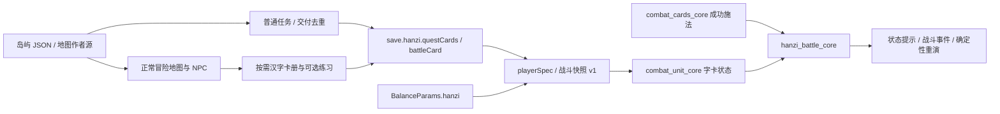

# 字源岛与汉字魔法

2026-10-12：已接入本地开发版，未发布。新角色仍从魔法营地开始。字源岛是适合 1–10 级额外探索的独立岛屿，可从世界地图自由前往，拥有六步独立任务线；不替代营地教学，也不要求先完成营地主线。旧角色保留原位置、任务和收藏。

## 冒险与任务

岛屿使用正常可行走地形、居民交谈、任务列表、目标追踪与战斗。四位居民、六个地标和一处新手遭遇构成首版内容。字源岛具有独立海岸、溪流、道路和建筑布局；世界地图岛屿图、六种建筑和四位居民使用新生成的透明 WebP，生物沿用儿童版资源。全部新美术已上传 Keepwork CDN，详见 [美术来源与验收](hanzi-island-art.md)。

| 任务 ID | 任务 | 行动与奖励 |
| --- | --- | --- |
| 873000 | 早安，字源岛 | 阿初请玩家问候溪禾；获得火字卡并自动携带 |
| 873001 | 一杯水的问候 | 向石伯带去小苗的消息；获得水字卡 |
| 873002 | 脚下的土地 | 告诉阿初道路已修好；获得土字卡 |
| 873003 | 让小鼠回树林 | 完成一次普通战斗，使用随身字卡的力量 |
| 873004 | 给远方的灯 | 向小灯带去道路安全的消息 |
| 873005 | 从这里出发 | 与阿初道别，介绍世界地图和后续岛屿 |

任务前置依次衔接，使用既有接取、交谈、击败与交付动作；奖励只领取一次。六次任务经验足以到达 10 级。通过码头或世界地图前往魔法营地、哈奇岛与后续岛屿，之后仍可返回；出岛不以收齐字卡、写字或登录语音为条件。魔法营地原教学任务保留，可以前往继续。

作者源为 `data/adventure/island-packs/hanzi.json`；地图作者源为 `config/maps/islands/hanzi.json`。正式故事目录通过现有导出器生成 [C873000](story/chapters/C873000.md)，不手改导出正文。

## 汉字卡与战斗

HUD 的“字”按钮和岛上居民都能打开随身汉字卡册，战前最多携带一张战斗字卡，也可卸下。成功施放普通卡牌后触发，单次群攻只触发一次，失误、跳过、倒下时不触发；不额外消耗字卡，不插入战中问答。切换字卡在战斗外进行，离岛后仍可使用。

| 字卡 | 每次成功施法后的效果 | 每场上限 |
| --- | --- | --- |
| 火 | 攻击加成增加 3 个百分点，从后续攻击起生效 | 3 次，合计 +9% |
| 土 | 防御加成增加 3 个百分点 | 3 次，合计 +9% |
| 水 | 恢复自身最大生命的 3%，向上取整，不超过满血 | 3 次，满血也计一次 |

火、土增益持续至该场战斗结束，与每日学习增益分别计算。参数集中在 `BalanceParams.hanzi`。卡册说明、任务奖励、战斗状态及事件记录展示字卡与触发信息。其他 21 字仍可收藏、练习及解锁外观，尚无独立战斗效果。

任务字卡收藏和读写记录分别保存：领取任务卡不伪造读写尝试，也不发每日学习奖励。原型中读写三次获得的火、水、土卡也可直接携带。战斗规则版本为 1，所用字卡及参数写入玩家战斗快照；存档重演使用当时参数，旧快照不增加新效果。原版 Lua 伤害公式保持不变，字卡是显式网页新增规则，不使用随机数。

## 可选读写与外观

居民提供“看看这个字 · 可选练习”，直接打开相关汉字的局部练习，关闭回到原地点。卡册保留 24 字、三章、现代笔顺、书写与已有语音链路、程序动画、三阶段学习、复习以及六组卡牌外观。卡册中的字形按钮直接打开练习，已移除假想地图上的角色走点流程。

`product=hanzi` 旧链接仍进入同一个游戏，不再自动弹出专用活动面板或改品牌标题。字卡册按需加载汉字正文、笔画和样式；普通任务与数值增益不依赖这些资源。已有装备外观的角色沿用原外观适配器预加载。

说字或写字练习按稳定 `hanzi:<字ID>` 每字每天最多尝试一次共享学习奖励；三阶段收藏独立推进。演示、预览、普通任务、装备及施法均不产生每日学习奖励。任务通行不要求读写练习。

## 模块与保存

- `hanzi_core.js`：读写、外观、任务赠卡、携带与验证；`hanzi_battle_core.js`：快照、参数校验、施法增益。
- `adventure_hanzi.js` / `view_hanzi.js`：按需卡册、直接打开指定汉字、携带与保存回调；练习逻辑复用原模块。
- `save.hanzi.version=1` 新增可选 `questCards`、`battleCard`，仍在角色 records 分片保存；未变更的旧档无需补字段。任务领取使用既有 quests 状态。当前位置、生命和未结束战斗继续仅存本机。
- `data/adventure/hanzi/content.json` 与 `strokes.json` 保留原 24 字素材；生成来源为 `scripts/prepare_hanzi_content.py`，不以任务赠卡替代教学进度。

## 来源与验证边界

程序动画及诗句为艺术联想，不是古文字复原。现代笔画源为 Make Me a Hanzi 固定提交 `bddc96d41bef78427ed0e034e9f7e31d71fd1b92`，许可在 `licenses/hanzi/`。9 字已附一手《说文解字》阅读来源，其余 15 字保留待审标记。教学与字源审校、真实账号语音与云同步、真实手机书写和受众试用仍待完成。

专项测试覆盖营地出生、主动前往字源岛、任务前置与重复领取、成长到10级、旧角色保留位置、往返岛屿、任务卡 records/cloud 往返、五系新手战斗、增益上限、回血上限、失误/跳过、状态提示、保存重演与参数变化后的旧快照。地图生成器检查出生点、居民、怪物、地标、出口与道路可达性。运行记录见 [QA 报告](qa-report.md) 与当日开发日志；本轮未运行发布黑盒 QA 或构建，不宣称浏览器或真人验收完成。
